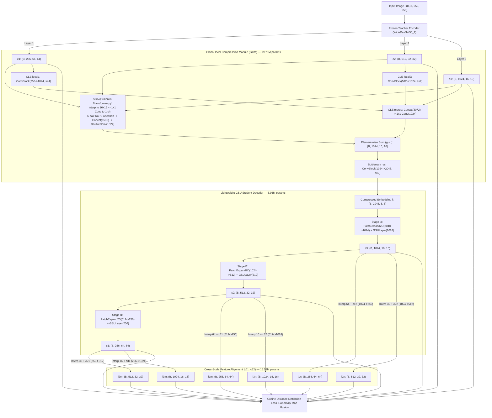

# Deep Analysis of the Primary Paper (CDA)

**Paper Title:** *Efficient Industrial Anomaly Detection via Cross-Scale Distillation with Enhanced Feature Compression*  
**Authors:** Ronglong Hu, Jizheng Yi, Xiaoyao Li, Aibin Chen, Guangjie Han  
**Venue:** *Pattern Recognition*, Vol. 173, Article 112761, 2026 (`https://doi.org/10.1016/j.patcog.2025.112761`)  
**Official Implementation:** `https://github.com/WHUer-cloud/CDA`

> [!IMPORTANT]
> **Provenance Note:** Every statement below distinguishes between facts verified from the paper metadata + official repository (`[VERIFIED-BOTH]`), implementation specifics verified from the official codebase (`[VERIFIED-CODE]`), and details requiring verification against the paywalled full-text PDF (`[UNRESOLVED-PDF-REQUIRED]`). See [paper_access_and_verification.md](file:///c:/Users/Administrator/Desktop/workspace/CS331-Anomaly-Detection/cs331-knowledge-distillation-lightweight-industrial-anomaly-detection/docs/paper_access_and_verification.md).

---

## A. Research Problem and Motivation

### 1. Limitations of Earlier Industrial Anomaly Detection (IAD) Methods `[VERIFIED-BOTH]`
Unsupervised Industrial Anomaly Detection (IAD) aims to learn the distribution of normal samples without anomalous training examples and identify both image-level defects and pixel-level defective regions at test time. Existing Teacher–Student Knowledge Distillation (KD) approaches face three coupled challenges:
1. **Identity Mapping / Over-Generalization in Forward Distillation (e.g., STFPM):** When the Teacher and Student share identical architectures and both receive the raw input image directly, the Student can inadvertently generalize to anomalous perturbations, reducing the Teacher–Student feature discrepancy on defects.
2. **Local-Only Bottleneck and Heavy Decoder in Reverse Distillation (e.g., RD4AD):** Reverse Distillation (RD4AD) mitigates over-generalization by inserting a One-Class Bottleneck Embedding (OCBE) between a frozen WideResNet-50 encoder and a symmetric WideResNet-50 decoder. However:
   - Its bottleneck compression relies exclusively on local strided convolutions, losing long-range global spatial context needed for structural or large-scale anomalies.
   - Its symmetric ResNet decoder is computationally heavy in parameters and FLOPs.
3. **Rigid Same-Scale Feature Alignment:** Both STFPM and RD4AD restrict knowledge transfer to **same-scale** pairs $(e_1 \leftrightarrow d_1, e_2 \leftrightarrow d_2, e_3 \leftrightarrow d_3)$. Same-scale matching ignores semantic consistency across adjacent and distant spatial resolutions, weakening the model's ability to simultaneously localize tiny textural defects (which require high-resolution shallow features grounded by deep semantics) and larger structural defects.

### 2. Why Cross-Scale Knowledge Transfer is Useful `[VERIFIED-BOTH]`
In a multi-scale pyramid:
- Shallow features ($e_1$, $64 \times 64$) preserve high spatial resolution, edges, and fine textures, but carry higher background noise and weak semantic abstraction.
- Deep features ($e_3$, $16 \times 16$) encode global object semantics and structural context, but suffer from coarse spatial resolution.
By requiring each decoded student feature $s_j$ to reconstruct not only its corresponding teacher scale $e_j$ (same-scale distillation) but also the other two teacher scales $e_i$ ($i \neq j$, cross-scale distillation), CDA forces the student decoder to maintain **multi-granular semantic-spatial consistency** across all three pyramid levels. At test time, cross-scale discrepancy maps amplify defects that manifest across scales while suppressing isolated single-scale noise.

### 3. Problems Solved by GCM and the Lightweight GSU Decoder `[VERIFIED-BOTH]`
- **Global-local Compression Module (GCM):** Replaces RD4AD's purely convolutional bottleneck with two parallel branches:
  1. **Channel-oriented Local Extraction (CLE):** Multi-stage strided bottleneck convolutions that progressively align spatial resolutions ($64 \times 64 \to 16 \times 16$ and $32 \times 32 \to 16 \times 16$) while expanding channel capacity to preserve fine local cues.
  2. **Spatial-guided Global Attention (SGA):** Compresses multi-scale features along the channel dimension into spatial token sequences ($L = 16 \times 16 = 256$) with Rotary Position Embeddings (RoPE) and computes intra-scale and inter-scale self/cross-attention across all scale pairs, capturing global spatial dependencies at low token dimensionality.
- **Lightweight Student Decoder with Gated-depth Sequence Unit (GSU):** Replaces heavy ResNet transposed-convolution blocks with `PatchExpand2D` (bilinear upsampling + linear channel reduction) and a single `GSULayer` per scale ($16 \times 16 \to 32 \times 32 \to 64 \times 64$). `GSU` uses linear gating, depthwise 1D causal convolution (`k=4`), and grouped linear projections (`DepthwiseMLP`) to model spatial sequences with only **6.96M parameters** across all three decoder stages (`[VERIFIED-CODE]`).

---

## B. Method Reconstruction: Complete CDA Pipeline

### 1. Teacher Architecture (`Encoder` in `model.py`) `[VERIFIED-CODE]`
- **Backbone:** `torchvision.models.wide_resnet50_2(weights=Wide_ResNet50_2_Weights.DEFAULT)` (frozen, `.eval()` mode, `24,862,528` parameters up to `layer3`).
- **Forward Extraction:** Given input image $I \in \mathbb{R}^{B \times 3 \times 256 \times 256}$:
  - Stem: $x_0 = \text{MaxPool}(\text{ReLU}(\text{BN}_1(\text{Conv}_1(I)))) \in \mathbb{R}^{B \times 64 \times 64 \times 64}$.
  - Stage 1 (`layer1`): $e_1 \in \mathbb{R}^{B \times 256 \times 64 \times 64}$ (spatial stride 4).
  - Stage 2 (`layer2`): $e_2 \in \mathbb{R}^{B \times 512 \times 32 \times 32}$ (spatial stride 8).
  - Stage 3 (`layer3`): $e_3 \in \mathbb{R}^{B \times 1024 \times 16 \times 16}$ (spatial stride 16).
  - `layer4` and classification head are discarded.

### 2. Global-local Compression Module (`GCM` in `model.py` + `Fusion` in `Transformer.py`) `[VERIFIED-CODE]`
Total parameters: `19,704,579` (`19.70M`). Takes $(e_1, e_2, e_3)$ and outputs bottleneck $f \in \mathbb{R}^{B \times 2048 \times 8 \times 8}$:

1. **Channel-oriented Local Extraction (CLE):**
   - Uses residual bottleneck `ConvBlock(c_in, k=3, filters=[f1, f2, f3], stride)`:
     - Main branch: $\text{Conv}_{1\times1}(c_{\text{in}} \to f_1, s) \to \text{BN} \to \text{GELU} \to \text{Conv}_{3\times3}(f_1 \to f_2, 1, p=1) \to \text{BN} \to \text{GELU} \to \text{Conv}_{1\times1}(f_2 \to f_3, 1) \to \text{BN} \to \text{GELU}$.
     - Shortcut branch: $\text{Conv}_{1\times1}(c_{\text{in}} \to f_3, s) \to \text{BN} \to \text{GELU}$.
   - `local1`: `ConvBlock(256, 3, [256, 512, 1024], stride=4)` maps $e_1 \to l_1 \in \mathbb{R}^{B \times 1024 \times 16 \times 16}$ (`2,040,064` params).
   - `local2`: `ConvBlock(512, 3, [512, 512, 1024], stride=2)` maps $e_2 \to l_2 \in \mathbb{R}^{B \times 1024 \times 16 \times 16}$ (`3,679,232` params).
   - `merge`: `nn.Conv2d(3072, 1024, kernel_size=1)` maps $\text{Concat}([l_1, l_2, e_3], \text{dim}=1) \in \mathbb{R}^{B \times 3072 \times 16 \times 16} \to l \in \mathbb{R}^{B \times 1024 \times 16 \times 16}$ (`3,146,752` params).

2. **Spatial-guided Global Attention (SGA / `Fusion` in `Transformer.py`):**
   - Spatial alignment: Bilinearly interpolates $e_1$ and $e_2$ to $(16, 16)$ spatial size (`p1`, `p2`).
   - Channel squeeze to spatial tokens: $1 \times 1$ convolutions (`conv1: 256->1`, `conv2: 512->1`, `conv3: 1024->1`) squeeze each feature map to 1 channel, reshaped and permuted to token sequences $t_1, t_2, t_3 \in \mathbb{R}^{B \times 256 \times 1}$, where sequence length $L = 16 \times 16 = 256$.
   - Multi-scale RoPE Attention (`SelfAttention(hidden_size=256, n_heads=8)`):
     - Projects token scalar features $\mathbb{R}^{B \times 256 \times 1} \to \mathbb{R}^{B \times 256 \times 256}$ via `w_q`, `w_k`, `w_v`.
     - Applies 1D sinusoidal Rotary Position Embedding (`RoPE`) to $Q$ and $K$ over the 256 spatial positions.
     - Computes 6 attention interactions (`i <= j` for $i, j \in \{1, 2, 3\}$):
       $(t_1, t_1), (t_1, t_2), (t_1, t_3), (t_2, t_2), (t_2, t_3), (t_3, t_3)$.
     - Each interaction returns a tensor reshaped to $(B, 256, 16, 16)$.
   - Concatenation & `DoubleConv(1536)`: Concatenates the 6 outputs along channel dimension $\to (B, 1536, 16, 16)$, then applies $\text{Conv}_{1\times1}(1536 \to 512) \to \text{BN} \to \text{GELU} \to \text{Conv}_{1\times1}(512 \to 1024) \to \text{BN} \to \text{GELU}$ to produce $g \in \mathbb{R}^{B \times 1024 \times 16 \times 16}$ (`1,384,451` params total for `Fusion`).

3. **Global-Local Fusion & Bottleneck Compression (`res`):**
   - `res = ConvBlock(1024, 3, [512, 1024, 2048], stride=2)` (`9,454,080` params) takes $g + l \in \mathbb{R}^{B \times 1024 \times 16 \times 16}$ and downsamples by 2 to produce $f \in \mathbb{R}^{B \times 2048 \times 8 \times 8}$.

### 3. Lightweight Student Decoder with GSU (`Decoder`, `PatchExpand2D`, `GSULayer`, `GSU` in `model.py`) `[VERIFIED-CODE]`
Total parameters: `6,959,616` (`6.96M`). Reconstructs multi-scale features from $f \in \mathbb{R}^{B \times 2048 \times 8 \times 8}$:
- **Stage `l3` (`5.29M` params):** `PatchExpand2D(2048, 2)` upsamples $8 \times 8 \to 16 \times 16$ via bilinear interpolation (`align_corners=True`), flattens spatial tokens to $L = 256$, projects channels $2048 \to 1024$ (`Linear` + `LayerNorm`), and passes through `GSULayer(1024)` $\to$ reshaped via `to_2d` to $s_3 \in \mathbb{R}^{B \times 1024 \times 16 \times 16}$.
- **Stage `l2` (`1.33M` params):** `PatchExpand2D(1024, 2)` upsamples $16 \times 16 \to 32 \times 32$ ($L = 1024$), projects $1024 \to 512$, applies `GSULayer(512)` $\to$ reshaped to $s_2 \in \mathbb{R}^{B \times 512 \times 32 \times 32}$.
- **Stage `l1` (`0.34M` params):** `PatchExpand2D(512, 2)` upsamples $32 \times 32 \to 64 \times 64$ ($L = 4096$), projects $512 \to 256$, applies `GSULayer(256)` $\to$ reshaped to $s_1 \in \mathbb{R}^{B \times 256 \times 64 \times 64}$.
- **Internal Structure of `GSULayer(d)` and `GSU(d)`:**
  - Residual pre-norm: $y = u + \text{GSU}(\text{RMSNorm}(u))$ for input $u \in \mathbb{R}^{B \times L \times d}$.
  - Inside `GSU(d)`:
    1. Dual projection: $(x, z) = \text{chunk}(\text{Linear}_{d \to 2d}(u), 2, \text{dim}=-1)$, where $x, z \in \mathbb{R}^{B \times L \times d}$.
    2. 1D depthwise convolution along sequence $L$: $x \leftarrow \text{Conv1d}_{d \to d, k=4, \text{groups}=d, \text{pad}=3}(x^\top)[:, :, :L]^\top$.
    3. `DepthwiseMLP(d)`: Splits channel dimension $d$ into $g = \max\{k \le \lfloor\sqrt{d}\rfloor : k \mid d\}$ groups ($g=32$ for $d=1024$, $g=16$ for $d=512, 256$), applies independent $\text{Linear}(d/g, d/g)$ per group, concatenates, and applies $\text{SiLU}$.
    4. Gated RMSNorm output: $\text{Linear}_{d \to d}(\text{RMSNorm}(x) \odot \text{SiLU}(z))$.

### 4. Cross-Scale Feature Mapping (`GCMAndDecoder` in `model.py`) `[VERIFIED-CODE]`
Total alignment parameters: `16,518,656` (`16.52M`). To distil knowledge across scales, each decoded student feature $s_j$ is bilinearly resized (`align_corners=True`) and projected via a $3 \times 3$ convolution (`padding=1`) to match the other two teacher scales:
- **Target Scale 1 ($64 \times 64, C=256$, matched against $e_1$):**
  - Same-scale: $s_1 \in \mathbb{R}^{B \times 256 \times 64 \times 64}$
  - Cross-scale from $s_2$: $l_{1m} = c_{11}(\text{Interp}_{64}(s_2))$, where $c_{11} = \text{Conv2d}(512, 256, 3, 1, 1)$
  - Cross-scale from $s_3$: $l_{1n} = c_{12}(\text{Interp}_{64}(s_3))$, where $c_{12} = \text{Conv2d}(1024, 256, 3, 1, 1)$
- **Target Scale 2 ($32 \times 32, C=512$, matched against $e_2$):**
  - Same-scale: $s_2 \in \mathbb{R}^{B \times 512 \times 32 \times 32}$
  - Cross-scale from $s_1$: $l_{2m} = c_{21}(\text{Interp}_{32}(s_1))$, where $c_{21} = \text{Conv2d}(256, 512, 3, 1, 1)$
  - Cross-scale from $s_3$: $l_{2n} = c_{22}(\text{Interp}_{32}(s_3))$, where $c_{22} = \text{Conv2d}(1024, 512, 3, 1, 1)$
- **Target Scale 3 ($16 \times 16, C=1024$, matched against $e_3$):**
  - Same-scale: $s_3 \in \mathbb{R}^{B \times 1024 \times 16 \times 16}$
  - Cross-scale from $s_1$: $l_{3m} = c_{31}(\text{Interp}_{16}(s_1))$, where $c_{31} = \text{Conv2d}(256, 1024, 3, 1, 1)$
  - Cross-scale from $s_2$: $l_{3n} = c_{32}(\text{Interp}_{16}(s_2))$, where $c_{32} = \text{Conv2d}(512, 1024, 3, 1, 1)$

### 5. Training Objective and Inference Procedure `[VERIFIED-CODE]`
- **Pointwise Cosine Distance:** For two feature maps $F_1, F_2 \in \mathbb{R}^{B \times C \times H_k \times W_k}$, channel-wise cosine distance at each spatial location $(h, w)$ is:
  $$D_{\cos}(F_1, F_2)_{b,h,w} = 1 - \frac{\sum_{c=1}^{C} F_{1,b,c,h,w} F_{2,b,c,h,w}}{\|F_{1,b,:,h,w}\|_2 \|F_{2,b,:,h,w}\|_2}$$
- **Training Loss (`train.py` lines 42–46):**
  - Same-scale loss $\mathcal{L}_1 = \sum_{k=1}^{3} \text{mean}(D_{\cos}(e_k, s_k))$.
  - Cross-scale loss $\mathcal{L}_2$: weighted sum of cross-scale cosine distances at scales $k=1,2,3$ with weights $(0.4, 0.2, 0.4)$ (see [paper_equations.md](file:///c:/Users/Administrator/Desktop/workspace/CS331-Anomaly-Detection/cs331-knowledge-distillation-lightweight-industrial-anomaly-detection/docs/paper_equations.md) for the exact parenthesis comparison between `train.py` and `metric.py`).
  - Total loss: $\mathcal{L}_{\text{total}} = 2.0 \cdot \mathcal{L}_1 + 0.1 \cdot \mathcal{L}_2$.
- **Inference & Anomaly Map Construction (`metric.py` lines 10–37):**
  - Computes same-scale distance maps $a_k = D_{\cos}(e_k, s_k)$ and cross-scale distance maps $ac_k = D_{\cos}(e_k, l_{kn}) + D_{\cos}(e_k, l_{km})$ for $k \in \{1, 2, 3\}$.
  - Bilinearly upsamples all 6 maps $(a_1, a_2, a_3, ac_1, ac_2, ac_3)$ to image resolution $256 \times 256$ (`align_corners=True`).
  - Combines them via fixed linear weights:
    $$\mathcal{M}_{\text{raw}} = 2.0 \cdot (a_1 + a_2 + a_3) + 0.1 \cdot (0.4 \cdot ac_1 + 0.2 \cdot ac_2 + 0.4 \cdot ac_3)$$
  - Applies 2D Gaussian smoothing (`scipy.ndimage.gaussian_filter` with $\sigma = 4$) per image to obtain final pixel-level anomaly map $\mathcal{M} \in \mathbb{R}^{H \times W}$.
  - Image-level anomaly score: $S_{\text{img}} = \max_{h, w} \mathcal{M}(h, w)$.

---

## C. Experimental Protocol

| Protocol Dimension | Official Code Setting (`[VERIFIED-CODE]`) | Paper Verification Status |
| :--- | :--- | :--- |
| **Primary Benchmark** | MVTec AD (15 categories: 5 textures, 10 objects listed in `config.py`) | `[VERIFIED-BOTH]` |
| **Secondary Benchmarks** | Commented out `OBJ_NAMES` in `config.py` show BTAD (`01, 02, 03`) and VisA (12 categories: `candle`..`pipe_fryum`) | `[VERIFIED-BOTH]` |
| **Training Set** | Unsupervised one-class: only defect-free (`train/good/*.png`) images per category | `[VERIFIED-BOTH]` |
| **Input Resolution & Preprocessing** | Resize to $256 \times 256$ (no center crop), `ToTensor()`, ImageNet normalize; Ground-truth mask resized to $256 \times 256$ and binarized at threshold $0.5$ | `[VERIFIED-CODE]` |
| **Teacher Initialization** | `Wide_ResNet50_2_Weights.DEFAULT` (Torchvision ImageNet-1K V2 weights), frozen in `.eval()` mode | `[VERIFIED-CODE]` |
| **Student Initialization** | PyTorch default initialization for `GCMAndDecoder` | `[VERIFIED-CODE]` |
| **Optimizer** | `torch.optim.Adam(dec.parameters(), lr=0.005, betas=(0.5, 0.999))` (no weight decay, no LR scheduler) | `[VERIFIED-CODE]` |
| **Batch Size & Epochs** | `bs = 4`, `epochs = 160`, `drop_last = True`, `shuffle = False` | `[VERIFIED-CODE]` |
| **Loss Weights** | $\lambda_1 = 2.0$, $\lambda_2 = 0.1$, cross-scale weights $(0.4, 0.2, 0.4)$ | `[VERIFIED-CODE]` |
| **Evaluation Metrics** | Image-level AUROC (`roc_auc_score` on $\max(\mathcal{M})$), Pixel-level AUROC (`roc_auc_score` on flattened pixels). PRO/AUPRO is **not** implemented in `metric.py`. | `[VERIFIED-CODE]` / Check PDF for PRO |

---

## D. Critical Scientific Assessment

### 1. Main Contributions of CDA
1. **Global-Local Feature Bottleneck (`GCM`):** Augments RD4AD's convolutional bottleneck with a parameter-light multi-scale RoPE attention branch (`SGA`, `1.38M` params) alongside local strided convolutions (`CLE`).
2. **Gated-Depth Sequence Decoder (`GSU`):** Introduces a Mamba-inspired gated 1D-conv + grouped-MLP sequence decoder that requires only `6.96M` parameters across 3 stages.
3. **Dense Cross-Scale Knowledge Distillation:** Enforces all-to-all scale consistency between student decoded features $(s_1, s_2, s_3)$ and teacher features $(e_1, e_2, e_3)$.

### 2. Hidden Architectural & Methodological Limitations (Crucial for Our Research!)
Our quantitative audit of the official codebase revealed four profound scientific findings that directly motivate our two research directions:

1. **Finding 1 — The Cross-Scale Alignment Parameter Paradox (38.3% of Trainable Parameters!):**
   - While CDA claims a lightweight student decoder (`Decoder` is only `6.96M` params), the 6 cross-scale alignment convolutions (`c11..c32`, each a dense $3 \times 3$ conv) contain **16,518,656 parameters (`16.52M`)** — **more than $2.37\times$ the size of the entire GSU decoder itself!**
   - Furthermore, `GCM.res` (`ConvBlock(1024->2048, s=2)`) contains another **9.45M parameters**. Thus, out of `43.18M` total trainable parameters in `GCMAndDecoder`, **`25.97M` (60.1%)** reside in just `c11..c32` and `GCM.res`!
2. **Finding 2 — Static Heuristic Fusion Ignores Scale Reliability and Spatial Variance:**
   - At inference (`metric.py`), CDA linearly sums $a_1 + a_2 + a_3$ with equal weight ($1:1:1$) and adds $0.05 \times (0.4 ac_1 + 0.2 ac_2 + 0.4 ac_3)$, followed by a fixed $\sigma=4$ Gaussian blur and global `max()` pooling for image scoring.
   - Because $a_1$ ($64 \times 64$), $a_2$ ($32 \times 32$), and $a_3$ ($16 \times 16$) have different unnormalized cosine distance distributions on normal background textures, adding them raw without scale calibration or cross-scale consistency gating allows high-frequency normal texture noise in $a_1$ to create false positives, while $\sigma=4$ blur can wash out tiny defects.
   - Moreover, image-level scoring via single-pixel `max()` (`s.max()`) is maximally sensitive to single-pixel outlier spikes.
3. **Finding 3 — Train/Inference Formula Asymmetry in Cross-Scale Weights:**
   - In `train.py` lines 43–45, `(0.4 * cos_dist(e1, l1n) + cos_dist(e1, l1m))` weights $l_{1n}$ by $0.4$ and $l_{1m}$ by $1.0$, whereas `metric.py` line 21 & 32 weights $(l_{1n} + l_{1m})$ equally by $0.4$.
4. **Finding 4 — Test-Set Checkpoint Selection Bias in `train.py`:**
   - `train.py` evaluates on the test set every 5 epochs and independently tracks `best_img` and `best_pix` on the test set. In our experimental protocol, we must report **fixed/last-epoch (or validation-selected) metrics** alongside the official repo's `best_test` protocol to prevent test-set leakage in our scientific comparisons.

### 3. Essential vs. Modifiable Components
- **Essential for Baseline Reproduction (`B0`/`A0`):** Frozen `Wide_ResNet50_2` teacher (`layer1..3`), exact `GCM` + `Decoder` + `c11..c32` architecture, $256 \times 256$ input size, Adam (`lr=0.005, betas=(0.5, 0.999)`), and exact loss/scoring functions.
- **Independently Modifiable for Researcher A (Thành — Localization & Calibration):** Post-hoc / inference-stage multi-scale discrepancy normalization, cross-scale agreement/reliability weighting between $\{a_k, ac_k\}$, multi-scale adaptive smoothing, and robust top-$q$ / spatial-energy image-level aggregation (can be evaluated on the exact same frozen baseline checkpoint!).
- **Independently Modifiable for Researcher B (Luân — Efficiency & Compression):** Factorizing the `16.52M`-parameter dense $3 \times 3$ cross-scale alignment layers (`c11..c32`) into depthwise-separable or $1 \times 1$ bottleneck projections, compressing `GCM.res`, or pruning cross-scale branches at inference time.
- **Confounding Changes to Avoid:** Never change the teacher backbone, input image resolution, or train/test split simultaneously when evaluating a localization or compression module.
