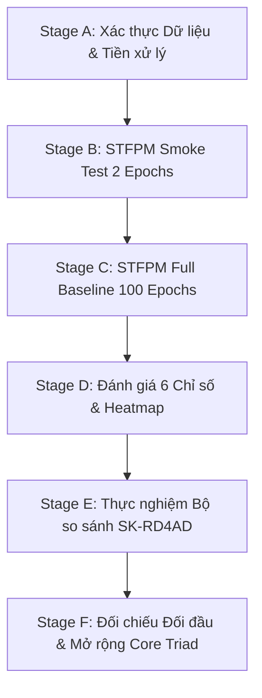

# Kế Hoạch Tái Hiện Baseline: Quy Trình Kiểm Chứng Từng Giai Đoạn

**Nhóm thực hiện:** Nguyễn Văn Thành & Trần Minh Luân (CS331)  
**Môi trường thực nghiệm:** Kaggle GPU (Tesla T4 / P100, 16 GB VRAM)  

---

## 1. Quy Trình Thực Nghiệm Tuần Tự (Stage A $\to$ Stage F)

Nhóm áp dụng nguyên tắc: **Giai đoạn trước đạt 100% nghiệm thu mới bước sang giai đoạn sau**.



---

### Giai đoạn A: Xác thực Đường dẫn, Mặt nạ và Dữ liệu MVTec AD
- **Mục tiêu:** Đảm bảo toàn bộ 15 danh mục ảnh, cấu trúc thư mục, ảnh RGB 3 kênh và mặt nạ nhãn 1 kênh nhị phân đều hoàn toàn hợp lệ.
- **Lệnh thực thi:**
  ```bash
  python scripts/validate_dataset.py --data-root /kaggle/input/datasets/ipythonx/mvtec-ad --categories carpet bottle screw
  ```
- **Kết quả thực tế trên Kaggle:** **ĐÃ ĐẠT 100%** (280 train và 117 test `carpet`, không có rò rỉ dữ liệu `zero_train_test_overlap: true`).

---

### Giai đoạn B: STFPM Smoke Test trên 1 Danh mục (`carpet`)
- **Mục tiêu:** Kiểm tra luồng tính loss, lan truyền ngược gradient, cập nhật trọng số và lưu/nạp checkpoint.
- **Cấu hình:** Epochs=2, BatchSize=16, SGD (lr=0.4, momentum=0.9, wd=1e-4).
- **Kết quả thực tế trên Kaggle:** **ĐÃ ĐẠT 100%**
  - Thiết bị: `cuda` (NVIDIA Tesla T4).
  - Loss giảm đều đặn từ `1.5026` (Epoch 1) xuống `1.1404` (Epoch 2).
  - Thời gian: 63.16s (đã gồm tải weights ResNet18 từ PyTorch Hub).
  - Peak VRAM thực tế đo đạc: **579.6 MB** (cực kỳ nhẹ).
  - Checkpoint `outputs/stfpm_smoke/last.pth` lưu và nạp lại thành công.

---

### Giai đoạn C: Huấn luyện Đầy đủ STFPM 100 Epochs trên `carpet`
- **Mục tiêu:** Thiết lập ngưỡng sàn thực nghiệm (empirical baseline) hoàn chỉnh.
- **Cấu hình:** Category=`carpet`, Epochs=100, BatchSize=32, Seed=42.
- **Lệnh thực thi:**
  ```bash
  python scripts/train_stfpm.py --data-root /kaggle/input/datasets/ipythonx/mvtec-ad --category carpet --epochs 100 --batch-size 32 --seed 42 --save-dir ./outputs/stfpm_carpet
  ```

---

### Giai đoạn D: Đánh giá Toàn diện 6 Chỉ số & Heatmap
- **Mục tiêu:** Tính toán đầy đủ hệ thống chỉ số định vị và phát hiện lỗi.
- **Lệnh thực thi:**
  ```bash
  python scripts/evaluate_stfpm.py --data-root /kaggle/input/datasets/ipythonx/mvtec-ad --category carpet --checkpoint ./outputs/stfpm_carpet/last.pth
  ```
- **6 chỉ số bắt buộc:**
  1. Image-Level AUROC (`auroc_img`)
  2. Image-Level Average Precision (`ap_img`)
  3. Pixel-Level AUROC (`auroc_pix`)
  4. Pixel-Level Average Precision (`ap_pix`)
  5. Per-Region Overlap tiêu chuẩn (`aupro_30` với $\text{FPR} \le 0.30$)
  6. Per-Region Overlap khắt khe (`aupro_05` với $\text{FPR} \le 0.05$)

---

### Giai đoạn E: Thực nghiệm Bộ So Sánh Hiện Đại SK-RD4AD
- **Mục tiêu:** Đánh giá mô hình Reverse Distillation có skip-connection (CVPRW 2025) trên cùng danh mục `carpet`.
- **Giao thức:** Đánh giá trên checkpoint epoch cố định cuối cùng (Epoch 200), tuyệt đối không chọn checkpoint theo điểm số test set.

---

### Giai đoạn F: Tổng hợp Đối chiếu & Mở rộng Bộ Ba Danh mục (Core Triad)
- **Mục tiêu:** Lập bảng so sánh đối đầu STFPM vs. SK-RD4AD về cả chất lượng phát hiện lẫn chi phí phần cứng (Params, FLOPs, Latency ms, VRAM).
- Khi kết quả ổn định, mở rộng tiếp sang `bottle` (vật thể cứng phản xạ) và `screw` (khuyết tật ren vi mô).
