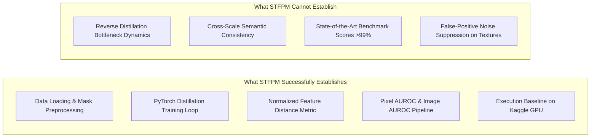

# Baseline Selection Rationale & STFPM Validation Specification

## 1. Executive Strategic Decision

Our investigation adopts a **two-layer baseline strategy**:
1. **Primary Foundational Baseline:** **STFPM** (Wang et al., *BMVC* 2021). STFPM validates the end-to-end Teacher–Student data pipeline, multi-scale feature pyramid matching, anomaly scoring, and localization metrics.
2. **Secondary Recent Comparator:** **CDA** (Hu et al., *Pattern Recognition* 2026, evaluated via our clean-room bug-fixed PyTorch implementation) and/or **SK-RD4AD** (Park et al., *CVPRW* 2025).

> [!IMPORTANT]
> **Scientific Integrity Rule:**
> - STFPM is **not** claimed as recent or novel. It is an established 2021 foundational work.
> - CDA is **not** automatically promoted to the single unassailable baseline because its Elsevier full-text PDF is currently inaccessible to the student team and its upstream code contained 6 blocking defects.

---

## 2. In-Depth Audit of STFPM as Foundational Baseline

### 2.1 Repository Provenance & License
- **Paper:** Guodong Wang, Shumin Han, Errui Ding, Di Huang, *"Student-Teacher Feature Pyramid Matching for Anomaly Detection,"* BMVC 2021 (arXiv:2103.04257).
- **Official Repository:** `https://github.com/gdwang08/STFPM` (created October 2021, last commit March 2022).
- **Author Identity:** Guodong Wang (first author) is the repository owner (`gdwang08`), affiliated with Beihang University.
- **License Status:** `[VERIFIED]` **GPL-3.0**. Copying code directly creates GPL copyleft obligations. Therefore, we use either a clean modular implementation or the **Apache-2.0** licensed reference implementation available in `open-edge-platform/anomalib` (`src/anomalib/models/image/stfpm/`).

### 2.2 Dependencies & Modern Environment Compatibility
The original 2021 code was written for PyTorch 1.x / NumPy 1.21. On modern Kaggle runtimes (Python 3.10+, PyTorch 2.x, NumPy 1.24+), three specific breakages must be patched:
1. **`np.bool` Removal:** The official code uses `.astype(np.bool)`. NumPy $\ge 1.24$ completely removed `np.bool`, raising `AttributeError`. Must be replaced with standard Python `bool` or `np.bool_`.
2. **Torchvision Model Weight API:** The official code uses `models.resnet18(pretrained=True)`, which is deprecated in torchvision $\ge 0.13$. Must be updated to `weights=ResNet18_Weights.IMAGENET1K_V1`.
3. **Hardcoded CUDA Calls:** `.cuda()` is hardcoded throughout; must be wrapped with device-agnostic helpers (`device = torch.device(...)`).

### 2.3 Dataset Preprocessing Protocol
- **Resolution:** $256 \times 256$ pixels.
- **Normalization:** ImageNet standard (`mean=[0.485, 0.456, 0.406]`, `std=[0.229, 0.224, 0.225]`).
- **Data Augmentation:** **None**. Industrial anomaly detection evaluates unsupervised normal distribution modeling without aggressive synthetic distortions.
- **Data Splitting:** 80% train, 20% validation split from `train/good` normal images (using seed 0). Test set evaluates all defect-free and defective test images with corresponding binary ground-truth masks.

### 2.4 Training Pipeline
- **Teacher Network:** Frozen `ResNet-18` pretrained on ImageNet-1k, placed in `.eval()` mode with gradient tracking disabled (`requires_grad = False`).
- **Student Network:** Identical `ResNet-18` architecture, randomly initialized, trained from scratch.
- **Feature Extraction Stages:** Three intermediate feature pyramids:
  - `conv2_x` (`layer1`): 64 channels, spatial resolution $64 \times 64$.
  - `conv3_x` (`layer2`): 128 channels, spatial resolution $32 \times 32$.
  - `conv4_x` (`layer3`): 256 channels, spatial resolution $16 \times 16$.
- **Loss Function:** Pointwise $\ell_2$-normalized Euclidean distance (equivalent to cosine distance):
  $$\ell(F_T, F_S) = \frac{1}{2} \sum_{l=1}^3 \frac{1}{H_l W_l} \sum_{h=1}^{H_l} \sum_{w=1}^{W_l} \left\| \frac{F_T^l(h,w)}{\|F_T^l(h,w)\|_2} - \frac{F_S^l(h,w)}{\|F_S^l(h,w)\|_2} \right\|_2^2$$
- **Optimization:** SGD with initial learning rate $\eta = 0.4$, momentum $0.9$, weight decay $10^{-4}$, batch size $32$, trained for 100 epochs.

### 2.5 Inference & Anomaly Map Generation
For a test image $I$:
1. Compute $\ell_2$-normalized feature difference at each layer $l \in \{1, 2, 3\}$:
   $$\mathcal{M}_l(h,w) = \frac{1}{2} \left\| \hat{F}_T^l(h,w) - \hat{F}_S^l(h,w) \right\|_2^2$$
2. Upsample each layer map to the intermediate resolution ($64 \times 64$) via bilinear interpolation.
3. Compute the multi-scale anomaly map as the **element-wise product**:
   $$\mathcal{M} = \prod_{l=1}^3 \mathcal{I}_{64 \times 64}(\mathcal{M}_l)$$
4. Upsample $\mathcal{M}$ to the input resolution ($256 \times 256$).
5. The image-level anomaly score is defined as the maximum pixel value:
   $$S_{\text{image}} = \max_{(h,w)} \mathcal{M}(h,w)$$

### 2.6 Evaluation Metrics & Official Baseline Numbers
- **Image-Level AUROC:** Area under the ROC curve on image anomaly scores.
- **Pixel-Level AUROC:** Pixel-wise AUROC comparing flattened score maps to ground-truth masks.
- **Per-Region Overlap (PRO / AUPRO):** Evaluates localization coverage across individual connected defect components up to a false positive rate of $\text{FPR} \le 0.30$.
- **Headline MVTec AD Results Reported in Wang et al. (BMVC 2021):**
  - **Mean Image AUROC:** **95.5%**
  - **Mean Pixel AUROC:** **97.0%**
  - **Mean PRO:** **92.1%**

---

## 3. What STFPM Can and Cannot Establish

- **What STFPM Can Establish:**
  1. Validates that our PyTorch dataloader, batching, and ground-truth mask alignment are 100% bug-free.
  2. Confirms that our GPU training loop, optimizer step, learning rate schedule, and loss backward pass operate without memory leaks or divergence.
  3. Provides an indisputable empirical anchor: any proposed model by our team must demonstrably outperform STFPM's 95.5% image AUROC / 97.0% pixel AUROC.
- **What STFPM Cannot Establish:**
  1. STFPM cannot establish modern **Reverse Distillation** behavior because it uses identical forward student passes where both models observe the raw input image directly.
  2. STFPM cannot establish **cross-scale semantic consistency** because distillation occurs strictly within the same layer ($l \leftrightarrow l$).
  3. STFPM cannot represent state-of-the-art 2025–2026 performance because its simple element-wise product fusion suffers from zero-suppression and lacks statistical calibration on complex textures (e.g., transistor pixel AUROC is only 82.5%).

---

## 4. Evaluation of Potential 2025–2026 Experimental Comparators

| Candidate Comparator | Key Architectural Paradigm | Code Availability & License | Kaggle Compute Burden | Protocol Match to Project | Decision & Recommendation |
| :--- | :--- | :--- | :--- | :--- | :--- |
| **CPKD** (AAAI 2025) | Co-Progression KD with Knowledge Prototype | **No Official Code Released** | High (Co-updating teacher & student doubles VRAM) | Full-Shot Unsupervised | **Rejected as Primary Comparator** (Reproduction from scratch without code is too risky for a 3-week course timeline). |
| **LKDF-AD** (Sci Rep 2026) | Ultra-lightweight student (385K params) | Nature Supplement / Code Available | Very Low (<400K params) | **Few-Shot (1–10 shots)** | **Conditional Comparator ONLY**: Valid if our project includes a few-shot ablation; cannot be compared directly against full-shot models without explicit qualification. |
| **DHKD** (ESWA 2026) | Dual-Heterogeneous KD with Mamba SSM | Unofficial / Community Repos | High (Requires compiling `mamba-ssm` CUDA kernels) | Full-Shot Unsupervised | **Rejected as Experimental Comparator** (High risk of CUDA compilation crashes on Kaggle). |
| **CDA** (Pattern Recognit. 2026) | Cross-scale distillation + GCM + GSU | Audited official repo (`WHUer-cloud/CDA`) | Moderate (Trainable params: 43.18M) | Full-Shot Unsupervised | **Retained as Modern Comparator via Clean Reimplementation**: 6 bugs fixed, full architecture reproduced in `src/anomaly_detection/`. |
| **SK-RD4AD** (CVPRW 2025) | Skip-connected Reverse Distillation | Official repo (`pej0918/SK-RD4AD`) | Moderate (WideResNet-50 backbone) | Full-Shot Unsupervised | **Recommended Additional Comparator**: Open-access paper, public PyTorch code, directly addresses RD4AD bottleneck loss. |

### Justified Fallback Plan
If running multiple heavy 2025–2026 comparators strains Kaggle GPU time quotas (30 hours/week limit):
1. **Anchor Baseline:** Run STFPM across all core categories to establish the verified lower bound.
2. **Modern Comparator:** Run our clean-room, bug-fixed CDA baseline (`B0`) on the core triad (`carpet`, `bottle`, `screw`).
3. **If CDA Training Fails:** Fall back to the widely verified **RD4AD** (CVPR 2022) or **SK-RD4AD** (CVPRW 2025), which are pure PyTorch without Mamba or complex attention dependencies.

---

## 5. Minimal STFPM Smoke-Test Plan (Single Category: `carpet`)

To guarantee empirical grounding without premature claims, we specify a minimal, executable smoke test on a single MVTec AD category (`carpet`):

1. **Category:** `carpet` (Texture class: 280 train images, 117 test images across 5 defect types: `color`, `cut`, `hole`, `metal_contamination`, `thread`).
2. **Hardware:** Kaggle Notebook GPU (Tesla T4 or P100, 16 GB VRAM).
3. **Smoke-Test Parameters:**
   - Input size: $256 \times 256$
   - Batch size: 16 (train), 1 (test)
   - Epochs: 2 epochs (to verify loss descent and checkpoint saving) followed by a full 100-epoch verification run.
   - Optimizer: SGD (lr=0.4, momentum=0.9, weight_decay=1e-4)
4. **Acceptance Criteria for Smoke Test (`STFPM-Smoke`):**
   - [ ] Training loss starts at $\sim 0.8–1.5$ and decreases monotonically over the first 5 epochs.
   - [ ] GPU VRAM usage remains strictly under 4 GB.
   - [ ] Checkpoint `stfpm_carpet_best.pth` is created and verified loadable.
   - [ ] Test inference produces valid 2D anomaly heatmaps (`256x256`, values $\in [0, \infty)$) and calculates Image-AUROC $> 0.90$ upon full convergence (target: paper reported $0.988$ pixel AUROC on carpet).
   - [ ] **Zero-Claim Principle:** We do **not** claim baseline reproduction success until this smoke test has executed to completion on the Kaggle environment.
