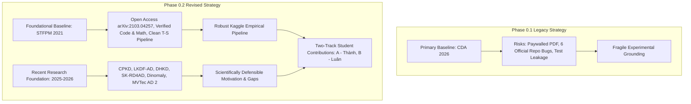

# Project Strategic Decision Log

## 1. Change Record: Phase 0.1 $\to$ Phase 0.2 Strategic Pivot

- **Date:** 2026-10-29
- **Project:** Knowledge Distillation-Based Lightweight Industrial Anomaly Detection
- **Team:** Thành (Researcher A) & Luân (Researcher B), CS331 Advanced Computer Vision
- **Advisor / Review Role:** Senior Computer Vision Research Advisor & Scientific Literature Analyst

---

### Context and Motivation for the Change

In Phase 0.1, the project initially focused heavily on **CDA** (*Pattern Recognition*, 2026, Hu et al.) as the single primary baseline and direct template for improvement. While the official author repository for CDA was successfully cloned and audited, the Elsevier publisher full-text PDF (`10.1016/j.patcog.2025.112761`) remains behind a paywall and has not been accessed by the student team. Furthermore, the official CDA codebase contains blocking execution bugs and test-set selection leakage.

Concurrently, the course instructor instituted two explicit requirements:
1. The **literature review, scientific motivation, and research gap** must primarily reference relevant peer-reviewed papers published in **2025–2026**.
2. The **experimental baseline** used for empirical pipeline validation does not have to be from 2025–2026; an established, accessible, and mathematically sound foundational baseline is acceptable and preferable to an unverified or fragile baseline.

To satisfy these academic standards, we officially adopt a **Two-Layer Research Strategy**:
- **Layer 1 (Foundational Experimental Baseline):** **STFPM** (Wang et al., *BMVC* 2021). STFPM provides an open-access, fully verified, lightweight Teacher–Student feature pyramid distillation pipeline. It serves as our anchor to validate data loading, feature extraction, cosine-distance distillation, anomaly map generation, and AUROC/PRO evaluation metrics.
- **Layer 2 (Recent Research Foundation & Comparative Horizon):** A verified corpus of **2025–2026 papers** (including CPKD, LKDF-AD, DHKD, SK-RD4AD, Dinomaly, and MVTec AD 2) to establish the state-of-the-art context, identify genuine research gaps, and guide the architectural/algorithmic contributions of Thành and Luân.

---

## 2. Audit of Previous Phase 0 Assumptions Regarding CDA

All previous Phase 0 documentation (`docs/paper_analysis.md`, `docs/official_code_audit.md`, `docs/baseline_specification.md`, etc.) remains **strictly preserved** in this repository as an audit trail. However, under Phase 0.2 scrutiny, we explicitly classify which prior assumptions about CDA are verified versus unverified:

| Prior Assumption / Artifact | Source in Phase 0.1 | Phase 0.2 Verification Status | Impact & Required Treatment |
| :--- | :--- | :--- | :--- |
| **CDA Full-Text Paper Claims** | Elsevier Metadata / Abstract | `[UNVERIFIED - PAYWALL]` | The team **cannot** verify the exact text, tables, ablation details, or metric definitions in the paper. We must not claim knowledge of the paper's internal proofs or numerical tables beyond what is publicly indexed. |
| **CDA as Primary Baseline** | Project Readme & Early Specs | `[DE-PROMOTED]` | CDA is de-promoted to an experimental comparator / secondary prior art. STFPM becomes the primary foundational baseline. |
| **Cross-Scale Distillation as Team Invention** | Initial brainstorming | `[REJECTED]` | Cross-scale distillation (`c11..c32`) and bottleneck compression (`GCM`) belong strictly to Hu et al. (2026). They are existing prior art. |
| **Equation $\mathcal{L}_2$ Parenthesization** | `train.py` vs `metric.py` discrepancy | `[CONFIRMED DISCREPANCY]` | In `train.py`, only `l1n` is scaled by 0.4; in `metric.py`, the sum is scaled. Without the PDF, we cannot determine author intent. |
| **Official CDA Reproducibility** | `WHUer-cloud/CDA` GitHub | `[VERIFIED BROKEN OUT-OF-THE-BOX]` | Contains 6 verified bugs: `dataloder.py` typo, hardcoded paths, missing `parents=True`, non-portable slash paths, sequence length hardcoding, and lack of license. |
| **AUPRO Metric Reporting** | Early evaluation plan | `[UNVERIFIED IN CDA REPO]` | Official CDA repo only implements image/pixel AUROC (`roc_auc_score`). No AUPRO or Pixel-AP code exists in the official repository. |

---

## 3. Decision-Change Matrix

### Detailed Decision Records

#### Decision 1: Formal Adoption of STFPM as Foundational Baseline
- **Status:** **APPROVED**
- **Rationale:** STFPM (BMVC 2021) is open access, has public PyTorch code, is widely benchmarked (mean 0.955 image AUROC, 0.970 pixel AUROC, 0.921 PRO on MVTec AD), and executes cleanly in <10 minutes per category on Kaggle GPUs.
- **Boundaries:** STFPM must **never** be represented as recent or novel. It is an established benchmark to validate our data loader, metric calculator, and training loop.

#### Decision 2: 2025–2026 Literature as the Scientific Motivation Anchor
- **Status:** **APPROVED**
- **Rationale:** Aligns with the instructor's requirement. Modern industrial anomaly detection has evolved beyond basic cosine matching; papers like CPKD (AAAI 2025), LKDF-AD (Sci Rep 2026), and DHKD (ESWA 2026) define the cutting edge.

#### Decision 3: Reclassification of CDA as Prior Art & Secondary Reference
- **Status:** **APPROVED**
- **Rationale:** CDA remains a valuable architectural case study for cross-scale distillation and GSU sequence units, but cannot serve as our sole foundation due to the paywalled text and upstream software defects.

#### Decision 4: Selection Criteria for Recent Experimental Comparators
- **Status:** **APPROVED**
- **Rationale:** Any recent comparator must have: (1) open-access paper text, (2) verified official or verified clean open-source code, (3) comparable dataset protocol (full-shot unsupervised MVTec AD), and (4) runnable dependencies on Kaggle without custom CUDA C++ compilation blockers.
