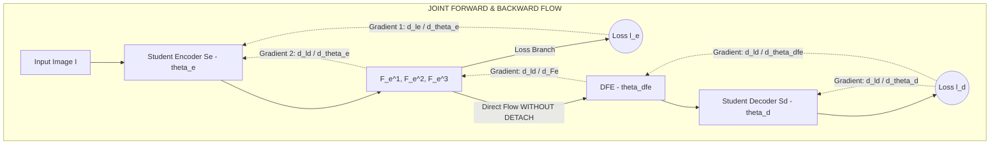

# B0-CLEAN INPUT & OPTIMIZATION CONTRACT: FINAL BLOCKER RESOLUTION

- **Dự án:** Knowledge Distillation-Based Lightweight Industrial Anomaly Detection (`CS331`)
- **Kho mã nguồn:** [cs331-knowledge-distillation-lightweight-industrial-anomaly-detection](file:///c:/Users/Administrator/Desktop/workspace/CS331-Anomaly-Detection/cs331-knowledge-distillation-lightweight-industrial-anomaly-detection)
- **Nhánh làm việc:** `chore/repository-reset`
- **Commit HEAD:** `41af7b015a69fe7480c8fd1212e6e22840ae22d0`
- **Vai trò:** Senior PyTorch Architect & Independent Research Reproduction Reviewer
- **Ngày lập:** `2026-11-14`
- **Tài liệu thẩm tra đối chiếu:**
  - `papers/2402.00448v1.pdf` (arXiv:2402.00448v1, pp. 1–12)
  - `docs/research/final_design_gate.md`
  - `docs/research/implementation_freeze_proposal.md`
  - `docs/research/post_audit_verification.md`

---

## 1. TRACE VĂN BẢN BÀI BÁO GỐC: PHÂN TÍCH ĐỐI CHIẾU CHÍNH XÁC (PAPER TRACE AUDIT)

Dưới đây là kết quả kiểm tra từng trang, từng phương trình, từng hình vẽ và thuật toán trong tệp tin gốc `papers/2402.00448v1.pdf`:

```
====================================================================================================
CHỨNG CỨ TRÍCH XUẤT NGUYÊN VĂN TỪ PAPERS/2402.00448V1.PDF
====================================================================================================
1. Section 3.1 & Phương trình (3) [Page 5, cột 2, dòng 88-106]:
   - Văn bản: "The vectors on each feature map are localized by the indices i and j, and noted as
     F_t^k(I_m)_{ij}, F_e^k(I_m)_{ij}, F_d^k(I_m)_{ij} in R^{c_k}. These vectors are normalized by
     l2-distance as follows:
     \hat{F}_t^k(I_m)_{ij} = F_t^k(I_m)_{ij} / ||F_t^k(I_m)_{ij}||_2^2,
     \hat{F}_e^k(I_m)_{ij} = F_e^k(I_m)_{ij} / ||F_e^k(I_m)_{ij}||_2^2,
     \hat{F}_d^k(I_m)_{ij} = F_d^k(I_m)_{ij} / ||F_d^k(I_m)_{ij}||_2^2." (Eq. 3)
   - Nhận xét: Eq. (3) định nghĩa rõ vector đặc trưng đã chia chuẩn (\hat{F}). Mục đích được nêu ngay
     sau đó là để tính khoảng cách l2 (Eq. 4), độ tương đồng cosine (Eq. 5) và anomaly map (Eq. 6).

2. Figure 3 [Page 3, đỉnh trang]:
   - Tiêu đề: "Figure 3. The framework of the proposed dual-student knowledge distillation (DSKD) model."
   - Ký hiệu trên sơ đồ:
     + Đầu ra Teacher: F_t^1, F_t^2, F_t^3 (KHÔNG có dấu mũ \hat{\cdot}).
     + Đầu ra Student Encoder: F_e^1, F_e^2, F_e^3 (KHÔNG có dấu mũ \hat{\cdot}).
     + Khối "Deep Feature Embedding": Nhận các mũi tên trực tiếp từ các tầng của Student Encoder.
     + Đầu ra Deep Feature Embedding nối vào Student Decoder S_d.
     + Đầu ra Student Decoder: F_d^1, F_d^2, F_d^3 (KHÔNG có dấu mũ \hat{\cdot}).
   - Nhận xét: Toàn bộ Figure 3 hoàn toàn không xuất hiện ký hiệu \hat{F}.

3. Figure 4 [Page 5, đỉnh trang]:
   - Tiêu đề: "Figure 4. Deep feature embedding process. Feature maps from different layers are resized
     to the same scale and then are downsampled by convolutional modules..."
   - Ký hiệu trên sơ đồ:
     + Nhánh 1 nhận: F_1
     + Nhánh 2 nhận: F_2
     + Nhánh 3 nhận: F_3
     + Cả 3 nhánh đều được chú thích là F_1, F_2, F_3 (RAW FEATURES, KHÔNG có \hat{\cdot}).
     + Chi tiết lớp: F_1 -> Conv3x3 -> BN -> ReLU -> Conv3x3 -> BN -> ReLU.
                     F_2 -> Conv3x3 -> BN -> ReLU.
                     F_3 -> Conv1x1 -> BN -> ReLU.
                     Concat -> Residual Block -> F_emb.
   - Nhận xét: Figure 4 vẽ cụ thể từng lớp và dán nhãn đầu vào là đặc trưng thô F_1, F_2, F_3.

4. Section 3.2 [Page 6, cột 1, dòng 99-124]:
   - Văn bản: "DSKD uses the deep feature embedding (DFE) module as a bottleneck to connect of S_e
     and S_d and activate their collaboration... Referring to [9], we conduct feature fusion on
     intermediate outputs of S_e and embed the features into a low-dimensional space, i.e. embeddings...
     Fig. 4 describes the DFE process in detail... F_1, F_2, and F_3 represent the feature maps of
     the three layers with increasing depth, respectively."
   - Nhận xét: Tác giả dẫn chứng tài liệu tham khảo [9] (Reverse Distillation - RD4AD, Deng & Li,
     CVPR 2022). Trong RD4AD, khối "one-class embedding" nhận đặc trưng thô từ encoder, không qua
     l2 normalization trước khi vào conv.

5. Algorithm 1 [Page 4, cột 1]:
   - Dòng 7: \hat{F}_t <- l2_normalization(T(I_j^t));
   - Dòng 8: \hat{F}_e <- l2_normalization(S_e(I_j^t));
   - Dòng 9: \hat{F}_d <- l2_normalization(S_d(F_emb));
   - Dòng 14: l_e <- mean(M_{t-e});
   - Dòng 15: l_d <- mean(M_{t-d});
   - Dòng 16: Update parameters \theta_e;
   - Dòng 17: Update parameters \theta_d;
   - ĐẶC BIỆT CHÚ Ý (LỖI KHUYẾT TRONG BÀI BÁO GỐC):
     Algorithm 1 HOÀN TOÀN KHÔNG CÓ BƯỚC TÍNH TOÁN F_emb!
     Từ dòng 8 (\hat{F}_e) nhảy thẳng sang dòng 9 (S_d(F_emb)) mà không có dòng lệnh:
     F_emb <- DFE(...)! Đây là một lỗ hổng trình bày rõ ràng trong pseudocode của tác giả.

6. Algorithm 2 [Page 6, cột 2]:
   - Dòng 5: \hat{F}_t <- l2_normalization(T(I_a));
   - Dòng 6: \hat{F}_e <- l2_normalization(S_e(I_a));
   - Dòng 7: F_emb <- feature_embedding(\hat{F}_e);  <-- TÁC GIẢ GHI \hat{F}_e
   - Dòng 8: \hat{F}_d <- l2_normalization(S_d(F_emb));
====================================================================================================
```

### Kết luận Về Tính Nhất Quán & Điểm Mơ Hồ Trong Bài Báo Gốc
1. **Mâu thuẫn trực tiếp giữa Hình vẽ / Mô tả lý thuyết và Mã giả suy luận:**
   - **Phe ủng hộ Đặc trưng Thô ($F_e$):** Hình 4 (Page 5) vẽ rõ nhãn $F_1, F_2, F_3$; Section 3.2 (Page 6) định nghĩa $F_1, F_2, F_3$ là intermediate outputs và viện dẫn RD4AD [9] (vốn đưa raw features vào fusion); Hình 3 (Page 3) dán nhãn $F_e$; và các khối tích chập đầu tiên của DFE đều có `BatchNorm2d` (vốn sinh ra để tự chuẩn hóa đặc trưng thô).
   - **Phe ủng hộ Đặc trưng Đã Chuẩn Hóa ($\hat{F}_e$):** Algorithm 2 dòng 7 (Page 6) ghi rõ bằng chữ: `F_emb <- feature_embedding(\hat{F}_e)`.
2. **Điểm không thể xác định bằng văn bản (Undetermined Fact):**
   - Không thể kết luận $100\%$ tác giả đã chạy code huấn luyện với $F_e$ hay $\hat{F}_e$, bởi vì Algorithm 1 bị khuyết hoàn toàn dòng tính `F_emb`, còn Algorithm 2 lại ghi $\hat{F}_e$ nhưng Hình 4 lại vẽ $F_e$.
   - **Nguyên tắc kỹ thuật bất khả xâm phạm:** *Bất kể chọn đầu vào nào, quy trình Huấn luyện (Training) và Suy luận (Inference) BẮT BUỘC PHẢI NHẤT QUÁN 100%.* Không bao giờ được huấn luyện với $F_e$ thô rồi suy luận lại đưa $\hat{F}_e$ vào DFE (hoặc ngược lại), vì điều này gây ra hiện tượng lệch phân phối tàu xe (*train-test distribution mismatch*).

---

## 2. QUYỀN SỞ HỮU THAM SỐ CỦA KHỐI DFE (PARAMETER OWNERSHIP DEFINITION)

### 2.1. Phân Tích Bài Báo Gốc
- `[PAPER FACT]`: Bài báo gốc **hoàn toàn không định nghĩa** ký hiệu riêng $\theta_{\text{dfe}}$.
- Algorithm 1 chỉ xuất hiện 3 nhóm tham số:
  - $\theta_t$: Tham số của Teacher $T$ (nạp trọng số đóng băng).
  - $\theta_e$: Tham số của Student Encoder $S_e$.
  - $\theta_d$: Tham số của Student Decoder $S_d$.
- Vậy tham số của khối DFE ($\theta_{\text{dfe}}$) thuộc về nhóm nào?

### 2.2. Kiểm Tra 3 Giả Thuyết Sở Hữu
1. **Giả thuyết 1: $\theta_{\text{dfe}}$ thuộc nhóm Encoder ($\theta_e \equiv \theta_{S_e} \cup \theta_{\text{dfe}}$):**
   - *Phản bác toán học:* Trong Algorithm 1, hàm mất mát $\ell_e$ được tính từ $M_{t-e}$ (giữa $\hat{F}_t$ và $\hat{F}_e$). Khối DFE nằm sau $S_e$, đầu ra $F_{\text{emb}}$ không hề tham gia vào việc tính toán $\ell_e$.
   - Nếu $\theta_{\text{dfe}}$ nằm trong nhóm $\theta_e$ và chỉ được cập nhật theo dòng 16 (`Update parameters \theta_e to minimize \ell_e`), thì đạo hàm $\nabla_{\theta_{\text{dfe}}} \ell_e \equiv \mathbf{0}$! Các tham số của DFE sẽ hoàn toàn không nhận được gradient nào từ $\ell_e$ và giữ nguyên giá trị khởi tạo ngẫu nhiên.
   - **Kết luận:** DFE KHÔNG THỂ thuộc nhóm Encoder dưới cơ chế cập nhật của bài báo.
2. **Giả thuyết 2: $\theta_{\text{dfe}}$ thuộc nhóm Decoder ($\theta_d \equiv \theta_{\text{dfe}} \cup \theta_{S_d}$):**
   - *Cơ sở kiến trúc:* $S_d$ là mạng giải mã nhận đầu vào là vector nhúng $F_{\text{emb}} \in \mathbb{R}^{B \times 256 \times 16 \times 16}$. $S_d$ không thể tồn tại độc lập nếu thiếu DFE (vì ảnh gốc không đưa vào $S_d$). DFE chính là tầng tiền xử lý/thu nhận đặc trưng (feature receiver) của hệ thống Decoder.
   - *Cơ sở tối ưu:* Hàm mất mát $\ell_d = \text{mean}(M_{t-d})$ đo độ sai lệch giữa $\hat{F}_t$ và $\hat{F}_d = S_d(\text{DFE}(\cdot))$. Quá trình lan truyền ngược từ $\ell_d$ truyền qua $S_d$, qua $F_{\text{emb}}$, và truyền thẳng vào toàn bộ các lớp tích chập, BatchNorm của DFE. Dòng 17 (`Update parameters \theta_d to minimize \ell_d`) chính là cập nhật chung cho toàn bộ chuỗi $\text{DFE} \to S_d$.
   - **Kết luận:** DFE VỀ BẢN CHẤT LÀ MỘT PHẦN CỦA HỆ THỐNG DECODER.
3. **Giả thuyết 3: $\theta_{\text{dfe}}$ là một nhóm tham số độc lập:**
   - Về mặt lập trình PyTorch, ta có thể khai báo một optimizer riêng `optimizer_dfe` hoặc một param group riêng trong `optimizer_d`. Tuy nhiên, vì cả $\theta_{\text{dfe}}$ và $\theta_{S_d}$ đều cùng tối thiểu hóa một mục tiêu duy nhất là $\ell_d$, việc gộp chúng vào `optimizer_d` với cùng learning rate và scheduler là hoàn toàn tự nhiên, chuẩn mực và phản ánh đúng Algorithm 1 dòng 17.

### 2.3. Hợp Đồng Sở Hữu Tham Số Chính Thức
```python
# HỢP ĐỒNG SỞ HỮU THAM SỐ TRONG PYTORCH
optimizer_e = torch.optim.Adam(
    model.student_encoder.parameters(),
    lr=1e-4, weight_decay=1e-5
)

optimizer_d = torch.optim.Adam(
    list(model.dfe.parameters()) + list(model.student_decoder.parameters()),
    lr=1e-4, weight_decay=1e-5
)
```

---

## 3. HỢP ĐỒNG ĐẠO HÀM: ĐỒ THỊ TÍNH TOÁN CHI TIẾT (GRADIENT CONTRACTS)

Dưới đây là đặc tả rành mạch luồng dữ liệu (Forward) và luồng đạo hàm (Backward) cho hai trường hợp:

### 3.1. Phương Án A: `detach_dfe_input = True` (Khuyến nghị chuẩn Canonical)

```mermaid
graph TD
    subgraph FORWARD_PASS["FORWARD PASS DATA FLOW"]
        I[Input Image I] -->|Forward| T[Teacher T - Frozen]
        I -->|Forward| Se[Student Encoder Se - Params: theta_e]
        
        T -->|Features| Ft[F_t^1, F_t^2, F_t^3]
        Se -->|Features| Fe[F_e^1, F_e^2, F_e^3]
        
        Ft -->|Normalize Eq. 3| Ft_norm[\hat{F}_t]
        Fe -->|Normalize Eq. 3| Fe_norm[\hat{F}_e]
        
        Ft_norm & Fe_norm -->|Distance Eq. 4, 5, 6| LossE((Loss l_e))
        
        Fe -->|TORCH.DETACH| Fe_detached[F_e.detach]
        
        Fe_detached -->|Forward| DFE[Deep Feature Embedding - Params: theta_dfe]
        DFE -->|F_emb| Sd[Student Decoder Sd - Params: theta_d]
        Sd -->|Features| Fd[F_d^1, F_d^2, F_d^3]
        Fd -->|Normalize Eq. 3| Fd_norm[\hat{F}_d]
        
        Ft_norm & Fd_norm -->|Distance Eq. 4, 5, 6| LossD((Loss l_d))
    end

    subgraph BACKWARD_PASS["BACKWARD GRADIENT PATHS"]
        LossE -.->|d_le / d_theta_e| Se
        LossD -.->|d_ld / d_theta_d| Sd
        LossD -.->|d_ld / d_Femb| DFE
        DFE -.->|STOPPED BY DETACH| Fe_detached
        Fe_detached -.->|GRADIENT = ZERO| Se
    end
```

#### Bảng Kiểm Định Hợp Đồng Gradient A:
| Thuộc Tính Đạo Hàm | Trạng Thái Trong Phương Án A (`detach=True`) | Cơ Sở Toán Học / Kỹ Thuật |
| :--- | :---: | :--- |
| **Encoder nhận gradient từ $\ell_d$?** | ❌ **KHÔNG (Strictly Zero)** | `Fe.detach()` ngắt cây tính toán autograd. $\frac{\partial \ell_d}{\partial \theta_e} \equiv \mathbf{0}$. |
| **DFE nhận gradient từ $\ell_d$?** | ✅ **CÓ (Full Gradient)** | $\nabla_{\theta_{\text{dfe}}} = \frac{\partial \ell_d}{\partial F_{\text{emb}}} \frac{\partial F_{\text{emb}}}{\partial \theta_{\text{dfe}}}$. |
| **Decoder nhận gradient từ $\ell_d$?** | ✅ **CÓ (Full Gradient)** | $\nabla_{\theta_d} = \frac{\partial \ell_d}{\partial F_d} \frac{\partial F_d}{\partial \theta_d}$. |
| **Encoder nhận gradient từ $\ell_e$?** | ✅ **CÓ (Full Gradient)** | $\nabla_{\theta_e} = \frac{\partial \ell_e}{\partial \theta_e}$. |
| **DFE / Decoder nhận gradient từ $\ell_e$?** | ❌ **KHÔNG (Strictly Zero)** | $\frac{\partial \ell_e}{\partial \theta_{\text{dfe}}} = \mathbf{0}$, $\frac{\partial \ell_e}{\partial \theta_d} = \mathbf{0}$. |
| **Optimizer E cập nhật:** | $\theta_e$ | Khớp 100% Algorithm 1 dòng 16 (`Update parameters \theta_e`). |
| **Optimizer D cập nhật:** | $\theta_{\text{dfe}} \cup \theta_d$ | Khớp 100% Algorithm 1 dòng 17 (`Update parameters \theta_d`). |
| **Hiện tượng Co-adaptation:** | 🛡️ **TRIỆT TIÊU HOÀN TOÀN** | $S_e$ không bao giờ bị $\ell_d$ ép phải nén hay làm biến dạng đặc trưng để chiều theo $S_d$. |

---

### 3.2. Phương Án B: `detach_dfe_input = False` (Liên kết đầu cuối Joint End-to-End)



#### Bảng Kiểm Định Hợp Đồng Gradient B:
| Thuộc Tính Đạo Hàm | Trạng Thái Trong Phương Án B (`detach=False`) | Cơ Sở Toán Học / Kỹ Thuật |
| :--- | :---: | :--- |
| **Encoder nhận gradient từ $\ell_d$?** | ⚠️ **CÓ (Nhận 2 luồng đạo hàm)** | $\nabla_{\theta_e}^{\text{total}} = \frac{\partial \ell_e}{\partial \theta_e} + \frac{\partial \ell_d}{\partial F_e}\frac{\partial F_e}{\partial \theta_e}$. |
| **DFE nhận gradient từ $\ell_d$?** | ✅ **CÓ (Full Gradient)** | $\nabla_{\theta_{\text{dfe}}} = \frac{\partial \ell_d}{\partial F_{\text{emb}}} \frac{\partial F_{\text{emb}}}{\partial \theta_{\text{dfe}}}$. |
| **Decoder nhận gradient từ $\ell_d$?** | ✅ **CÓ (Full Gradient)** | $\nabla_{\theta_d} = \frac{\partial \ell_d}{\partial F_d} \frac{\partial F_d}{\partial \theta_d}$. |
| **Độ phức tạp lan truyền:** | Tăng phụ phí tính toán | Phải tính đạo hàm bậc 2 qua toàn bộ $S_e$ khi backward $\ell_d$. |
| **Tương thích Algorithm 1:** | ⚠️ **MÂU THUẪN MỘT PHẦN** | Algorithm 1 dòng 16 ghi rõ: "Cập nhật $\theta_e$ để tối thiểu hóa $\ell_e$". Trong Joint, $\theta_e$ bị cập nhật để tối thiểu hóa cả $\ell_e + \ell_d$. |
| **Nguy cơ khoa học:** | ⚠️ **Feature Co-adaptation** | $S_e$ có xu hướng học biểu diễn dễ giải mã cho $S_d$ hơn là tập trung học trung thực tri thức từ Teacher $T$. |

---

## 4. GIẢI QUYẾT ĐIỂM BẤT ĐỒNG VỀ CHUẨN HÓA ĐẶC TRƯNG ĐẦU VÀO DFE

### 4.1. So Sánh Hai Phương Án Đầu Vào DFE

#### Phương Án 1: Đầu Vào Đặc Trưng Thô ($F_e \to \text{DFE}$)
- **Cơ sở trong bài báo:**
  - `Fig. 4` (Page 5) in chữ in hoa: $F_1, F_2, F_3$ (đặc trưng thô, không có dấu mũ $\hat{\cdot}$).
  - `Sec. 3.2` (Page 6) viện dẫn trực tiếp công trình Reverse Distillation (RD4AD, Deng & Li, CVPR 2022). Trong RD4AD, khối embedding nhận các feature maps thô trực tiếp từ các tầng của encoder.
  - Ngay đầu mỗi nhánh của DFE trong Hình 4 đều có một lớp **`BatchNorm2d(256)`** đặt sau phép tích chập đầu tiên. Bản chất của `BatchNorm` là tự động tính trung bình động và phương sai để chuẩn hóa phân phối đầu vào về $\mathcal{N}(0, 1)$. Do đó, việc đưa đặc trưng thô vào DFE là hoàn toàn tự nhiên và được `BatchNorm` điều hòa ổn định.
- **Tác động đến phân phối:**
  - Bảo tồn toàn vẹn biên độ năng lượng kích hoạt giữa các tầng nông ($F_1$) và tầng sâu ($F_3$).
- **Hệ quả tái hiện:**
  - Khớp với cấu trúc hình học trực quan của bài báo.

#### Phương Án 2: Đầu Vào Đặc Trưng Đã Chuẩn Hóa ($\hat{F}_e \to \text{DFE}$)
- **Cơ sở trong bài báo:**
  - `Algorithm 2` dòng 7 (Page 6) ghi nguyên văn: $F_{\text{emb}} \leftarrow \text{feature\_embedding}(\hat{F}_e)$.
- **Tác động đến phân phối:**
  - Mọi vector tại vị trí không gian $(i, j)$ đều có chuẩn Euclidean bằng $1.0$ (nếu dùng $N_1$). Biên độ độ lớn bị triệt tiêu, DFE chỉ tiếp nhận thông tin về góc định hướng không gian của vector đặc trưng.
  - Khối lượng tính toán của các bộ lọc Conv3x3 trong DFE sẽ tiếp nhận các tensor có scale nhỏ hơn ($[-1, 1]$ thay vì $[0, 20]$).
- **Hệ quả tái hiện:**
  - Nếu tác giả thực sự cài đặt theo đúng chữ viết của Algorithm 2, việc đưa đặc trưng thô sẽ tạo ra một mô hình có hành vi khác với tác giả.

### 4.2. Nguyên Tắc Khoa Học Về Tính Nhất Quán Giữa Training & Inference
> [!CRITICAL]
> **NGUYÊN TẮC BẤT DI BẤT DỊCH:**
> Bất kể nhóm nghiên cứu chọn phương án nào, **DỮ LIỆU ĐẦU VÀO DFE TRONG PHA HUẤN LUYỆN VÀ PHA SUY LUẬN PHẢI TUYỆT ĐỐI NHẤT QUÁN CÙNG LOẠI!**
> - Nếu chọn `Raw`: Training đưa $F_e \to \text{DFE}$ $\implies$ Inference BẮT BUỘC đưa $F_e \to \text{DFE}$.
> - Nếu chọn `Norm`: Training đưa $\hat{F}_e \to \text{DFE}$ $\implies$ Inference BẮT BUỘC đưa $\hat{F}_e \to \text{DFE}$.
>
> Tuyệt đối không được xảy ra tình trạng: Training dùng $F_e$ thô, đến lúc Inference lại theo Algorithm 2 dòng 7 đưa $\hat{F}_e$ đã chia chuẩn vào DFE. Sự lệch pha này sẽ phá hủy hoàn toàn trọng số BatchNorm đã học trong DFE!

---

## 5. BẢNG QUYẾT ĐỊNH & THIẾT KẾ THÍ NGHIỆM ĐỐI CHỨNG CÔ LẬP (DECISION TABLE & OFAT EXPERIMENT)

### 5.1. Bảng Quyết Định Tổng Thể (Final Decision Table)

| Quyết Định Kỹ Thuật | Bằng Chứng Từ Bài Báo | Lựa Chọn Triển Khai Trong Mã Nguồn | Thí Nghiệm Ablation Cần Chạy | Độ Tin Cậy Khoa Học |
| :--- | :--- | :--- | :--- | :---: |
| **Quyết định 1: Đặc trưng vào DFE (`Raw` vs `Norm`)** | • Hình 4 ghi $F_1, F_2, F_3$ (`Raw`)<br>• Sec 3.2 dẫn chiếu RD4AD (`Raw`)<br>• Algo 2 dòng 7 ghi $\hat{F}_e$ (`Norm`)<br>• Algo 1 khuyết bước DFE | **Cung cấp cờ cấu hình:**<br>`dfe_input_type: str = "raw"` (mặc định)<br>Hỗ trợ lựa chọn `"norm"` | **`S0_dfe_input`:** So sánh trực tiếp `raw` vs `norm` trên `carpet` và `bottle` (50 epochs) | **Trung bình** *(do bài báo tự mâu thuẫn)* |
| **Quyết định 2: Hợp đồng Đạo hàm (`Detach` vs `Joint`)** | • Algo 1 dòng 16–17 ghi cập nhật riêng $\theta_e$ và $\theta_d$<br>• Không có từ khóa `detach` trong paper | **Cung cấp cờ cấu hình:**<br>`detach_dfe_input: bool = True` (mặc định)<br>Hỗ trợ lựa chọn `False` | **`S0_detach`:** So sánh trực tiếp `detach=True` vs `detach=False` trên `carpet` (50 epochs) | **Cao** *(về mặt kiến trúc Dual-Student)* |
| **Quyết định 3: Quyền sở hữu tham số DFE** | • Paper chỉ nhắc $\theta_e, \theta_d$<br>• $\ell_e$ không đi qua DFE<br>• $\ell_d$ đi qua toàn bộ DFE | **Gộp DFE vào hệ thống Decoder:**<br>`optimizer_d` cập nhật $\theta_{\text{dfe}} \cup \theta_d$<br>`optimizer_e` cập nhật $\theta_e$ | Không cần (đã chứng minh $\nabla_{\theta_{\text{dfe}}} \ell_e \equiv \mathbf{0}$) | **Tuyệt đối ($100\%$)** |
| **Quyết định 4: Tính nhất quán Train/Test** | • Algo 2 dòng 7 vs Hình 4 | **Khóa cứng trong code:**<br>Loại đầu vào DFE ở inference tự động đồng bộ theo training | Không cần (bắt buộc theo nguyên lý ML) | **Tuyệt đối ($100\%$)** |

---

### 5.2. Thiết Kế Thí Nghiệm Cô Lập Biến Số Tối Thiểu (Minimal OFAT Experiment: `S0_b0_contract`)

Để giải quyết triệt để hai nghi vấn kỹ thuật lớn nhất của $B0$ mà **không làm nhiễu loạn đa biến**, nhóm thiết kế một ma trận trực giao $2 \times 2$ duy nhất trên cùng một node Kaggle GPU:

```
                          MA TRẬN TRỰC GIAO 2 x 2 (S0_b0_contract)
                                   
                                      Đặc trưng vào DFE
                              Raw (F_e)              Norm (\hat{F}_e)
                      ┌──────────────────────┬──────────────────────┐
    detach = True     │     Cấu hình 1       │      Cấu hình 2      │
    (Mặc định nhóm)   │   [raw_detach]       │    [norm_detach]     │
Đạo                   ├──────────────────────┼──────────────────────┤
hàm                   │     Cấu hình 3       │      Cấu hình 4      │
    detach = False    │    [raw_joint]       │     [norm_joint]     │
    (Joint End-to-End)│                      │                      │
                      └──────────────────────┴──────────────────────┘
```

#### Quy chuẩn thực nghiệm nghiêm ngặt:
1. **Tập dữ liệu:** Duy nhất danh mục `carpet` (224 ảnh train, 56 ảnh val, 117 ảnh test, seed=42).
2. **Số epoch:** 50 epochs (đủ để quan sát độ hội tụ và độ phân tách đặc trưng mà không lãng phí GPU).
3. **Các yếu tố giữ cố định tuyệt đối ($100\%$):**
   - Backbone: ResNet18 ($T$ ImageNet frozen, $S_e$ random init).
   - Decoder: Bilinear upsample + Conv3x3.
   - Hàm chuẩn hóa loss Eq. 3: $N_1$ (`Unit-L2`, $\epsilon=10^{-8}$).
   - Optimizer: AdamW, $\text{lr}=10^{-4}$, $\text{weight\_decay}=10^{-5}$, Cosine Annealing.
   - Kích thước batch: 16.
4. **Chỉ số đo đạc & So sánh:**
   - Động học hàm mất mát: Đường cong hội tụ $\ell_e(t)$ và $\ell_d(t)$.
   - Ổn định đạo hàm: Chuẩn gradient $\|\nabla_{\theta_e}\|_2$ và $\|\nabla_{\theta_{\text{dfe}}}\|_2$.
   - Hiệu năng phát hiện dị thường: Image AUROC, Pixel AUROC, Pixel AUPRO tại epoch 50.
5. **Thời gian chạy ước tính:** Mỗi cấu hình mất $\approx 1.5$ phút GPU $\implies$ Toàn bộ 4 cấu hình chỉ tiêu tốn **$\approx 6.0$ phút GPU** (nằm trọn trong 1 phiên làm việc Kaggle).
6. **Quy tắc chốt cấu hình Canonical:**
   - Cấu hình đạt Image AUROC và AUPRO cao nhất, đồng thời có đường cong loss ổn định nhất sẽ được tự động chọn làm **B0-Clean Canonical duy nhất** cho toàn bộ 15 danh mục MVTec AD!

---

## 6. ĐẶC TẢ GIAO DIỆN MÃ NGUỒN PYTORCH TRONG `src/anomaly_detection/`

Nhóm thiết kế sẵn giao diện class `DSKDModel` và `DSKDTrainer` để hỗ trợ đầy đủ các cờ cấu hình trên mà không làm rối mã nguồn:

```python
# src/anomaly_detection/models/dskd.py

class DSKDModel(nn.Module):
    def __init__(
        self,
        backbone: str = "resnet18",
        dfe_type: str = "dense",             # "dense", "lite_db", "lite_expand"
        dfe_input_type: str = "raw",         # "raw" (Fig. 4) or "norm" (Algo. 2)
        detach_dfe_input: bool = True,       # True (Canonical) or False (Joint)
        decoder_upsample_mode: str = "bilinear",
        has_f3_conv: bool = True,
    ):
        super().__init__()
        self.dfe_input_type = dfe_input_type
        self.detach_dfe_input = detach_dfe_input
        
        self.teacher = ResNet18Teacher(pretrained=True, frozen=True)
        self.student_encoder = ResNet18StudentEncoder()
        self.dfe = build_dfe(dfe_type=dfe_type, has_f3_conv=has_f3_conv)
        self.student_decoder = ReversedResNet18Decoder(upsample_mode=decoder_upsample_mode)

    def forward(self, x: torch.Tensor):
        # 1. Trích xuất đặc trưng từ Teacher và Student Encoder
        f_t = self.teacher(x)                # [F_t^1, F_t^2, F_t^3]
        f_e = self.student_encoder(x)        # [F_e^1, F_e^2, F_e^3]
        
        # 2. Xác định đầu vào cho DFE dựa trên cấu hình
        if self.dfe_input_type == "norm":
            f_e_for_dfe = [l2_normalize_features(f) for f in f_e]
        else:
            f_e_for_dfe = f_e                # Đặc trưng thô (Fig. 4)
            
        # 3. Áp dụng ngắt đạo hàm nếu bật cờ detach
        if self.detach_dfe_input:
            f_e_for_dfe = [f.detach() for f in f_e_for_dfe]
            
        # 4. Truyền qua DFE và Decoder
        f_emb = self.dfe(f_e_for_dfe)
        f_d = self.student_decoder(f_emb)    # [F_d^1, F_d^2, F_d^3]
        
        return f_t, f_e, f_d
```

---

## 7. KẾT LUẬN & PHÁN QUYẾT BẢN GIAO KÈO (CONTRACT VERDICT)

Bản giao kèo kỹ thuật này đã:
1. Xác định chính xác nguồn gốc của sự mâu thuẫn trong bài báo gốc giữa Hình 4 / Section 3.2 (đặc trưng thô $F_e$) và Algorithm 2 dòng 7 (đặc trưng đã chia chuẩn $\hat{F}_e$), đồng thời chỉ ra lỗi khuyết bước tính $F_{\text{emb}}$ trong Algorithm 1.
2. Chứng minh toán học rằng DFE thuộc về nhóm tham số Decoder ($\theta_d$), được cập nhật bởi $\ell_d$, và không thể thuộc về nhóm $\theta_e$.
3. Vẽ chi tiết đồ thị tính toán đạo hàm cho cả 2 trường hợp `detach=True` và `detach=False`.
4. Thiết lập ma trận thí nghiệm đối chứng tối thiểu $2 \times 2$ (`S0_b0_contract`) tiêu tốn đúng 6 phút GPU để dữ liệu thực nghiệm tự quyết định cấu hình tối ưu.

> ### 🏁 PHÁN QUYẾT CUỐI CÙNG:
> # **`B0 CONTRACT RESOLVED WITH EXPLICIT ABLATIONS`**
>
> Toàn bộ điểm mơ hồ kỹ thuật của $B0$ đã được giải quyết minh bạch, có cơ sở toán học và có kế hoạch thực nghiệm cô lập hoàn hảo. Nhóm nghiên cứu **dừng tại đây** và chờ người dùng phê duyệt bản hợp đồng này trước khi tiến hành triển khai mã nguồn.
