# Phân tích Chuyên sâu Bài báo Gốc DSKD: Dual-Student Knowledge Distillation Networks for Unsupervised Anomaly Detection

> **Tài liệu nghiên cứu nội bộ — CS331 Research Team**  
> **Thực hiện bởi:** Agent 1 (DSKD Paper Analyst)  
> **Ngày truy cập & phân tích:** `2026-11-14`  
> **Quy ước gán nhãn nhận định:**
> - `[FACT - Paper]`: Thông tin, công thức, kiến trúc hoặc số liệu được trích xuất trực tiếp từ bài báo gốc (kèm trích dẫn chính xác Section, Page, Figure, Table hoặc Equation). **Lưu ý tuyệt đối:** Mọi con số thực nghiệm mang nhãn này là kết quả do tác giả bài báo công bố, không phải kết quả thực nghiệm tự chạy của nhóm nghiên cứu.
> - `[INTERPRETATION - Agent 1]`: Phân tích, suy luận toán học, giải thích cơ chế hoặc đối chiếu tính nhất quán nội tại dựa trên nội dung bài báo.
> - `[HYPOTHESIS]`: Giả thuyết khoa học hoặc hướng cải tiến tiềm năng được đề xuất từ các khoảng trống nghiên cứu (research gaps) của bài báo.

---

## 1. Thông tin bài báo & Nguồn tham khảo

| Trường thông tin | Chi tiết (`[FACT - Paper, p. 1]`) |
| :--- | :--- |
| **Tên bài báo (Title)** | *Dual-Student Knowledge Distillation Networks for Unsupervised Anomaly Detection* |
| **Tác giả (Authors)** | **Liyi Yao** (University of Southern California, Los Angeles, California, USA — `liyiyao@usc.edu`)<br>**Shaobing Gao** (Sichuan University, Chengdu, Sichuan, China — `gaoshaobing@scu.edu.cn`) |
| **Mã định danh (arXiv ID)** | `arXiv:2402.00448v1 [cs.CV]` |
| **Ngày công bố (Publication Date)** | `1 Feb 2024` (01/02/2024) |
| **Số trang** | 12 trang (bao gồm 30 tài liệu tham khảo) |
| **URL gốc** | https://arxiv.org/abs/2402.00448 / https://arxiv.org/pdf/2402.00448v1.pdf |
| **Đường dẫn tệp cục bộ (Local Path)** | `c:\Users\Administrator\Desktop\workspace\CS331-Anomaly-Detection\cs331-knowledge-distillation-lightweight-industrial-anomaly-detection\papers\2402.00448v1.pdf` |
| **Ngày truy cập (Access Date)** | `2026-11-14` |
| **Mã nguồn công khai (Official Code Repo)** | **Không có** (`[FACT - Paper, pp. 1–12]`: Toàn bộ 12 trang của bài báo hoàn toàn không đề cập đến bất kỳ liên kết GitHub hay kho mã nguồn công khai nào). |

---

## 2. Bài toán và Động lực nghiên cứu

### 2.1. Định nghĩa bài toán: Anomaly Detection (AD) và Anomaly Localization (AL)
Trong sản xuất công nghiệp tự động, kiểm soát chất lượng dựa trên thị giác máy tính (vision-based quality control) giải quyết hai nhiệm vụ gắn kết chặt chẽ `[FACT - Paper, Sec. 1, p. 1, Fig. 1 p. 2]`:
1. **Anomaly Detection (AD — Phát hiện bất thường cấp ảnh):** Xác định xem một bức ảnh đầu vào có chứa khuyết tật/lỗi (defect/fault) hay không ở cấp độ toàn ảnh (image-level classification) `[FACT - Paper, Sec. 1, p. 1]`.
2. **Anomaly Localization (AL — Định vị/Phân vùng bất thường cấp điểm ảnh):** Đánh giá từng điểm ảnh (pixel) xem điểm ảnh đó có thuộc vùng chứa lỗi hay không, tạo ra bản đồ phân vùng bất thường (pixel-wise anomaly segmentation map) `[FACT - Paper, Sec. 1, p. 1, Fig. 1 p. 2]`.

### 2.2. Hai thách thức cốt lõi trong môi trường công nghiệp
Bài báo chỉ ra hai rào cản chính khiến các phương pháp học có giám sát (supervised learning) truyền thống thất bại trong bài toán này `[FACT - Paper, Sec. 1, p. 1]`:
1. **Sự mất cân bằng dữ liệu nghiêm trọng (Data Imbalance):** Trong dây chuyền sản xuất thực tế, các sản phẩm lỗi rất hiếm khi xảy ra so với sản phẩm đạt chuẩn (anomaly-free samples). Việc thu thập đủ số lượng mẫu lỗi để cân bằng với mẫu bình thường là bất khả thi, làm suy giảm nghiêm trọng hiệu năng của các thuật toán thị giác hướng dữ liệu (data-driven algorithms) `[FACT - Paper, Sec. 1, p. 1]`.
2. **Sự đa dạng và không thể lường trước của các mẫu lỗi (Diversity of Anomalous Patterns):** Khuyết tật có thể xuất hiện ở kết cấu bề mặt (surface texture) hoặc cấu trúc bên trong (inner structure) dưới vô số hình thái: vết bẩn (stains), hao mòn (wear), vết xước (scratches), khuyết thiếu bộ phận (absence of parts), hoặc các dạng lỗi hoàn toàn mới chưa từng xuất hiện (unknown defects). Do tập huấn luyện không thể bao quát mọi loại lỗi, học không giám sát (unsupervised learning — chỉ huấn luyện trên dữ liệu bình thường *anomaly-free*) trở thành lựa chọn tất yếu `[FACT - Paper, Sec. 1, p. 1]`.

### 2.3. Từ Reconstruction-based đến Knowledge Distillation (S-T Networks)
Các phương pháp học sâu không giám sát cho AD được chia làm hai nhánh chính `[FACT - Paper, Sec. 1, pp. 1–2; Sec. 2.2–2.3, pp. 4–5]`:
- **Reconstruction-based models** (Vanilla AE [1], AE-SSIM [5], AnoGAN [22], f-AnoGAN [21], DifferNet [18], CS-Flow [19]): Học cách tái tạo ảnh theo phân phối bình thường và phát hiện lỗi dựa trên sai số tái tạo ở không gian ảnh. Tuy nhiên, sai số trong quá trình tái tạo (reconstruction errors) rất dễ dẫn đến nhầm lẫn trong phát hiện `[FACT - Paper, Sec. 2.3, p. 4]`.
- **Deep feature embedding-based models** (SPADE [6], PaDiM [7], PatchCore [17], và nhánh **Knowledge Distillation / Student-Teacher (S-T)** [3, 8, 9, 20, 28]): Đo lường sự khác biệt biểu diễn trong không gian đặc trưng tiềm ẩn (latent/embedding space) trích xuất từ các mạng tiền huấn luyện trên ImageNet `[FACT - Paper, Sec. 1–2.3, pp. 1–5]`.

Trong mô hình **Student-Teacher (S-T)** cho AD `[FACT - Paper, Sec. 1, p. 2, Fig. 2 p. 2]`:
- Mạng **Teacher ($T$)** được tiền huấn luyện trên tập dữ liệu quy mô lớn (như ImageNet-1K) và **đóng băng toàn bộ tham số** (frozen parameters) trong suốt quá trình huấn luyện.
- Mạng **Student ($S$)** được khởi tạo ngẫu nhiên và chỉ được cung cấp dữ liệu bình thường (anomaly-free data) cùng tri thức chưng cất (feature maps) từ Teacher.
- **Nguyên lý phát hiện (Fig. 2, p. 2):** Vì Student chỉ học cách biểu diễn dữ liệu bình thường từ Teacher (giống như học sinh chỉ được học toán từ giáo viên nhưng lại gặp câu hỏi địa lý khi kiểm tra), nên trên vùng ảnh bình thường, Teacher và Student tạo ra biểu diễn đặc trưng tương đồng nhau; ngược lại, trên vùng ảnh chứa lỗi (anomalous patterns), biểu diễn của Student và Teacher sẽ phân kỳ mạnh mẽ `[FACT - Paper, Sec. 1, p. 2]`.

### 2.4. Sự đánh đổi (Trade-off) giữa Asymmetric S-T và Symmetric S-T — Động lực của DSKD
Điểm xuất phát quan trọng nhất của bài báo nằm ở việc phân tích sự mất ổn định của mạng S-T đơn lẻ (vanilla S-T network) khi lựa chọn kiến trúc giữa Teacher và Student `[FACT - Paper, Abstract p. 1, Sec. 1 p. 2]`:

1. **Asymmetric S-T Networks (Kiến trúc bất đối xứng — tiêu biểu là MKD của Salehi et al. [20]):**
   - **Cơ chế:** Sử dụng mạng Teacher có backbone lớn, phức tạp hơn mạng Student nhỏ gọn (giống bài toán nén mô hình trong KD cổ điển) `[FACT - Paper, Sec. 1, p. 2]`.
   - **Hạn chế:** Do sự chênh lệch về cấu trúc và năng lực biểu diễn, Teacher và Student đôi khi tạo ra sự khác biệt biểu diễn ngay cả trên dữ liệu bình thường (*expose representation discrepancy in anomaly-free data sometimes*), dẫn đến hiện tượng báo động giả (false positives) và làm giảm độ chính xác phát hiện `[FACT - Paper, Abstract p. 1, Sec. 1 p. 2]`.

2. **Symmetric S-T Networks (Kiến trúc đối xứng — tiêu biểu là STPM của Wang et al. [28]):**
   - **Cơ chế:** Cả Teacher và Student đều sử dụng chung một kiến trúc backbone giống hệt nhau `[FACT - Paper, Sec. 1, p. 2]`.
   - **Hạn chế:** Do có cấu trúc đồng nhất và luồng xử lý giống hệt nhau, mạng Student có khả năng khái quát hóa tương tự Teacher ngay cả trên dữ liệu ngoại lai, dẫn đến việc Teacher và Student biểu diễn tương tự nhau trên cả dữ liệu bất thường (*probably perform similarly on anomalous data*), làm suy yếu khoảng cách phân biệt lỗi `[FACT - Paper, Abstract p. 1, Sec. 1 p. 2]`.

3. **Giải pháp đề xuất — Dual-Student Knowledge Distillation (DSKD):**
   - Để giải quyết đồng thời hai cực của sự đánh đổi trên, Yao & Gao đề xuất kiến trúc **DSKD** gồm **3 thực thể (three players)**: một mạng Teacher $T$ và hai mạng Student $S_e$ (Student Encoder) và $S_d$ (Student Decoder) có **cùng quy mô (same scale — cùng dựa trên ResNet18)** nhưng **cấu trúc đảo ngược nhau hoàn toàn (completely reversed/inverted structures)** `[FACT - Paper, Abstract p. 1, Sec. 1 pp. 2–3, Fig. 3 p. 3]`.
   - **Cơ sở lý luận:** Sự kết hợp đối xứng giữa $T$ và $S_e$ giúp mô hình duy trì tính nhất quán cao khi biểu diễn các mẫu bình thường, trong khi cấu trúc giải mã đảo ngược của $S_d$ (nhận thông tin nén qua khối bottleneck Deep Feature Embedding từ $S_e$) làm tăng tính đa dạng và khuếch đại mạnh mẽ sự khác biệt biểu diễn đối với các mẫu bất thường `[FACT - Paper, Sec. 1, pp. 2–3]`.

---

## 3. Kiến trúc tổng thể & Sơ đồ luồng dữ liệu

Theo Section 3, Figure 3 (trang 3), Algorithm 1 (trang 4), Figure 4 (trang 5) và Algorithm 2 (trang 6), hệ thống DSKD vận hành với luồng dữ liệu khác biệt rõ rệt giữa **Pha Huấn luyện (Training Phase)** và **Pha Suy luận (Inference Phase)** `[FACT - Paper, pp. 3–7]`.

### 3.1. Sơ đồ luồng dữ liệu tổng thể (Mermaid Diagram)

```mermaid
flowchart TB
    subgraph TRAIN["PHA HUẤN LUYỆN (Training Phase — Chỉ dùng ảnh bình thường I^t)"]
        direction LR
        IT["Ảnh huấn luyện bình thường<br/>I^t_m ∈ R^{w×h×c}"] --> T_tr["Teacher T (Frozen)<br/>Pre-trained ResNet18"]
        IT --> Se_tr["Student Encoder S_e (Trainable)<br/>ResNet18 Encoder"]
        
        T_tr --> Ft_tr["Đặc trưng đa tầng T<br/>F_t^1, F_t^2, F_t^3"]
        Se_tr --> Fe_tr["Đặc trưng đa tầng S_e<br/>F_e^1, F_e^2, F_e^3"]
        
        Ft_tr --> Norm_te["ℓ2-Normalization (Eq. 3)<br/>& Đối sánh pixel-wise (Eq. 4, 5, 6)"]
        Fe_tr --> Norm_te
        Norm_te --> M_te["Bản đồ sai lệch M_{t-e}^1, M_{t-e}^2, M_{t-e}^3"]
        M_te --> Loss_e["Hàm mất mát ℓ_e = mean(M_{t-e}) (Eq. 7)<br/>--> Cập nhật tham số θ_e của S_e"]
        
        Fe_tr --> DFE_tr["Deep Feature Embedding (DFE)<br/>Downsample 3×3 s=2 + Concat + ResBlock"]
        DFE_tr --> Femb_tr["Biểu diễn nén<br/>F_{emb}"]
        Femb_tr --> Sd_tr["Student Decoder S_d (Trainable)<br/>Reversed/Transposed ResNet18"]
        Sd_tr --> Fd_tr["Đặc trưng giải mã đa tầng S_d<br/>F_d^3, F_d^2, F_d^1"]
        
        Ft_tr --> Norm_td["ℓ2-Normalization (Eq. 3)<br/>& Đối sánh pixel-wise (Eq. 4, 5, 6)"]
        Fd_tr --> Norm_td
        Norm_td --> M_td["Bản đồ sai lệch M_{t-d}^1, M_{t-d}^2, M_{t-d}^3"]
        M_td --> Loss_d["Hàm mất mát ℓ_d = mean(M_{t-d}) (Eq. 7)<br/>--> Cập nhật tham số θ_d của S_d"]
    end

    subgraph INFER["PHA SUY LUẬN (Inference Phase — Ảnh kiểm thử I^a)"]
        direction LR
        IA["Ảnh kiểm thử<br/>I^a ∈ R^{w×h×c}"] --> T_inf["Teacher T (Frozen)"]
        IA --> Se_inf["Student Encoder S_e (Frozen)"]
        
        T_inf --> Ft_inf["F̂_t^1, F̂_t^2, F̂_t^3<br/>(đã chuẩn hóa ℓ2)"]
        Se_inf --> Fe_inf["F̂_e^1, F̂_e^2, F̂_e^3<br/>(KHÔNG đối sánh trực tiếp với T)"]
        Fe_inf --> DFE_inf["Khối DFE"]
        DFE_inf --> Femb_inf["F_{emb}"]
        Femb_inf --> Sd_inf["Student Decoder S_d (Frozen)"]
        Sd_inf --> Fd_inf["F̂_d^3, F̂_d^2, F̂_d^1<br/>(đã chuẩn hóa ℓ2)"]
        
        Ft_inf --> Match_inf["Chỉ tính M_{t-d}^k giữa T và S_d<br/>theo Eq. (6) cho k = 1, 2, 3"]
        Fd_inf --> Match_inf
        Match_inf --> Up_inf["Upsample về (h × w)<br/>& Cộng tổng M = Σ Upsample(M_{t-d}^k) (Eq. 8)"]
        Up_inf --> Gauss["Bộ lọc Gaussian G_σ (σ = 4.0)<br/>M̃ = G_σ(M) (Eq. 9) --> Pixel Anomaly Map"]
        Gauss --> MaxScore["score = max(M̃) (Eq. 10)<br/>So sánh threshold = 0.5 (Eq. 1)"]
    end
```



### 3.2. Sơ đồ ASCII đối chiếu luồng tín hiệu chi tiết (`[FACT - Paper, Fig. 3 p. 3, Fig. 4 p. 5]`)

```text
====================================================================================================
                          KIẾN TRÚC DSKD (Fig. 3, p. 3 & Fig. 4, p. 5)
====================================================================================================

                  [Teacher T: Frozen Pre-trained ResNet18 (ImageNet-1K)]
                  Input I_m ---> [conv2_x] --------> [conv3_x] --------> [conv4_x]
                                    |                   |                   |
                                  F_t^1               F_t^2               F_t^3
                                    |                   |                   |
            +-----------------------+-------------------+-------------------+
            |                       |                   |                   |
            |    (Training Only)    v                   v                   v
            |                    [M_{t-e}^1]         [M_{t-e}^2]         [M_{t-e}^3]  ===> Loss l_e
            |                       ^                   ^                   ^
            |                       |                   |                   |
            |                     F_e^1               F_e^2               F_e^3
            |                       |                   |                   |
            |     Input I_m ---> [conv2_x] --------> [conv3_x] --------> [conv4_x]
            |     [Student Encoder S_e: Trainable ResNet18 (cùng cấu trúc với T)]
            |                       |                   |                   |
            |                       +---------+         +---------+         |
            |                                 |                   |         |
            |                                 v                   v         v
            |                       [Deep Feature Embedding (DFE) Module (Fig. 4)]
            |                       F_1: 2x (conv3x3, s=2, BN, ReLU) --+
            |                       F_2: 1x (conv3x3, s=2, BN, ReLU) --+--> [Concat]
            |                       F_3: 1x (conv1x1, BN, ReLU) -------+       |
            |                                                                  v
            |                                            [Residual Block w/ 1x1 shortcut]
            |                                                                  |
            |                                                                F_emb
            |                                                                  |
            |                                                                  v
            |     [Student Decoder S_d: Reversed/Transposed ResNet18]          |
            |                    [De-Block 3] -----> [De-Block 2] -----> [De-Block 1] <---+
            |                       |                   |                   |
            |                     F_d^3               F_d^2               F_d^1
            |                       |                   |                   |
            |                       v                   v                   v
            |  (Train & Infer)   [M_{t-d}^3]         [M_{t-d}^2]         [M_{t-d}^1]  ===> Loss l_d
            +-----------------------^-------------------^-------------------^              (Train)
                                    |                   |                   |
                             (Inference Phase: Upsample từng bản đồ về kích thước ảnh gốc)
                                    |                   |                   |
                                    +-------------------+-------------------+
                                                        |
                                                        v
                                        M(I_m) = Sum_{k=1}^3 Upsample(M_{t-d}^k)
                                                        |
                                                        v
                                        Gaussian Filter (sigma = 4.0) ---> Anomaly Map M_tilde
                                                        |
                                                        v
                                        score = max(M_tilde) >= 0.5 ? True : False
====================================================================================================
```

---

## 4. Vai trò của Teacher ($T$), Hai Student ($S_e, S_d$) và Khối DFE

### 4.1. Teacher Network ($T$)
- **Kiến trúc & Nguồn tri thức:** $T$ sử dụng backbone **ResNet18** [11] đã được tiền huấn luyện trên tập dữ liệu quy mô lớn **ImageNet-1K**, đóng vai trò là tri thức tiên nghiệm (prior knowledge) về thế giới thị giác tự nhiên `[FACT - Paper, Sec. 1 p. 2, Sec. 3.1 p. 5]`.
- **Trạng thái tham số:** Toàn bộ trọng số $\theta_t$ của $T$ được **đóng băng hoàn toàn (frozen)** trong suốt pha huấn luyện lẫn pha suy luận `[FACT - Paper, Sec. 1 p. 2, Sec. 3.1 p. 5]`.
- **Vai trò:** Cung cấp các bản đồ đặc trưng chuẩn mực $F_t^k(I_m)$ ở nhiều độ phân giải làm mốc tham chiếu (reference) cho cả hai mạng Student $S_e$ và $S_d$ học cách biểu diễn dữ liệu bình thường `[FACT - Paper, Sec. 3.1, p. 5]`.

### 4.2. Student Encoder ($S_e$)
- **Kiến trúc:** $S_e$ có kiến trúc mạng **giống hệt $T$** (symmetric ResNet18 backbone), nhưng bộ tham số $\theta_e$ được khởi tạo ngẫu nhiên (randomly initialized) `[FACT - Paper, Sec. 1 p. 2, Algo. 1 p. 4, Sec. 3.1 p. 5]`.
- **Vai trò kép:**
  1. **Học chưng cất đối xứng từ $T$:** Trong pha huấn luyện, $S_e$ nhận trực tiếp ảnh đầu vào và học cách khớp các bản đồ đặc trưng trung gian $F_e^k(I_m)$ với $F_t^k(I_m)$ của $T$. Nhờ cấu trúc đối xứng với $T$, $S_e$ nắm bắt nhất quán phân phối đặc trưng của dữ liệu không lỗi (anomaly-free data) `[FACT - Paper, Sec. 1 p. 2, Sec. 3.1 p. 5]`.
  2. **Mã hóa và truyền luồng dữ liệu một chiều sang $S_d$:** $S_e$ đóng vai trò bộ mã hóa (encoder) trích xuất đặc trưng ngữ nghĩa bậc cao từ ảnh đầu vào và chuyển tiếp luồng dữ liệu một chiều (one-way data flow) qua khối DFE sang $S_d$ `[FACT - Paper, Sec. 1 p. 3, Sec. 3.2 p. 6]`.

### 4.3. Student Decoder ($S_d$)
- **Kiến trúc:** $S_d$ có cấu trúc backbone **đảo ngược hoàn toàn so với $S_e$** (*reversed from $S_e$ with a completely transposed backbone*), trong đó toàn bộ các phép giảm mẫu (downsampling operations) trong ResNet18 được thay thế bằng các phép tăng mẫu (upsampling operations) `[FACT - Paper, Sec. 1 p. 2, Sec. 3.1 p. 5]`. Bộ tham số $\theta_d$ cũng được khởi tạo ngẫu nhiên `[FACT - Paper, Algo. 1 p. 4]`.
- **Vai trò:**
  - Do sự lệch độ phân giải (resolution mismatch), ảnh gốc không được đưa trực tiếp vào $S_d$ `[FACT - Paper, Sec. 3.2, p. 6]`. Thay vào đó, $S_d$ nhận đầu vào là biểu diễn nén $F_{emb}$ từ khối DFE, thực hiện giải mã (decode) và tăng mẫu (upsample) tuần tự qua các khối đảo ngược để tái tạo lại các bản đồ đặc trưng $F_d^3, F_d^2, F_d^1$ có cùng kích thước không gian và số kênh với $F_t^3, F_t^2, F_t^1$ của $T$ `[FACT - Paper, Fig. 3 p. 3, Sec. 3.1–3.2 pp. 5–6]`.
  - Cấu trúc đảo ngược hoàn toàn giữa $T$ (encoder tiến) và $S_d$ (decoder lùi) giúp ngăn chặn hiện tượng $S_d$ "bắt chước máy móc" phép biến đổi của $T$ trên các vùng bất thường, từ đó khuếch đại độ lệch biểu diễn giữa $F_t^k$ và $F_d^k$ khi gặp khuyết tật `[FACT - Paper, Sec. 1 pp. 2–3, Sec. 3.1 p. 5]`.

### 4.4. Deep Feature Embedding (DFE) Bottleneck Module
- **Nguồn cảm hứng:** Thiết kế DFE được lấy cảm hứng từ kịch bản giáo dục thực tế (thảo luận nhóm giữa các học sinh giúp hiểu sâu hơn kiến thức của giáo viên) và kiến trúc nút cổ chai (bottleneck) của Reverse Distillation [9] `[FACT - Paper, Abstract p. 1, Sec. 1 p. 3, Sec. 3.2 p. 6]`.
- **Hai lợi ích cốt lõi được bài báo chỉ rõ (`[FACT - Paper, Sec. 3.2, p. 6]`):**
  1. **Trong pha huấn luyện:** Hợp nhất các đặc trưng đa tỷ lệ (multi-scale intermediate outputs) từ $S_e$ vào một không gian chiều thấp (low-dimensional space) nhưng giàu thông tin ngữ nghĩa, giúp $S_d$ lĩnh hội đầy đủ phân phối dữ liệu không lỗi dù không nhìn thấy ảnh gốc.
  2. **Trong pha suy luận:** Việc truyền các vector nhúng (embeddings $F_{emb}$) thay vì truyền trực tiếp các bản đồ đặc trưng gốc giúp hạn chế thông tin nhiễu/bất thường lọt qua nguyên vẹn, qua đó làm tăng tính đa dạng biểu diễn (representative diversity) trên dữ liệu lỗi giữa $S_d$ và $T$.

---

## 5. Feature Extraction và Các tầng đặc trưng

### 5.1. Các khối đặc trưng trung gian trên ResNet18 (`[FACT - Paper, Sec. 3.1, p. 5]`)
Thay vì chỉ sử dụng đầu ra của tầng cuối cùng, DSKD tích hợp các bản đồ đặc trưng trung gian theo cấu trúc tháp đặc trưng (feature pyramid) vì các tầng khác nhau trong mạng phân cấp tập trung vào các mức độ thông tin ngữ nghĩa và chi tiết không gian khác nhau `[FACT - Paper, Sec. 1 p. 3, Sec. 3.1 p. 5]`.

Cụ thể, bài báo chọn **$K = 3$ khối đầu tiên** của ResNet18 `[FACT - Paper, Sec. 3.1, p. 5]`:
- Tầng $k = 1$: `conv2_x` (tương ứng `layer1` trong PyTorch `torchvision.models.resnet18`).
- Tầng $k = 2$: `conv3_x` (tương ứng `layer2`).
- Tầng $k = 3$: `conv4_x` (tương ứng `layer3`).
*(Khối thứ 4 là `conv5_x` / `layer4` và tầng `avgpool`/`fc` không được sử dụng).*

### 5.2. Ký hiệu toán học và Kích thước Tensor
- Tập huấn luyện gồm các ảnh không lỗi: $\mathcal{I}^t = \{I_1^t, I_2^t, \dots, I_m^t\}$ `[FACT - Paper, Sec. 3, p. 5]`.
- Tập kiểm thử gồm cả ảnh không lỗi và ảnh lỗi: $\mathcal{I}^a = \{I_1^a, I_2^a, \dots, I_m^a\}$ `[FACT - Paper, Sec. 3, p. 5]`.
- Ảnh thứ $m$ ký hiệu là $I_m \in \mathbb{R}^{w \times h \times c}$, với $w, h, c$ lần lượt là chiều rộng, chiều cao và số kênh của ảnh `[FACT - Paper, Sec. 3, p. 5]`.
- Tại tầng trung gian thứ $k \in \{1, \dots, K\}$ (với $K=3$), bản đồ đặc trưng của $T, S_e, S_d$ được ký hiệu là `[FACT - Paper, Sec. 3.1, p. 5]`:
  $$F_t^k(I_m), F_e^k(I_m), F_d^k(I_m) \in \mathbb{R}^{w_k \times h_k \times c_k}$$
- Tại mỗi tọa độ không gian $(i, j)$ trên bản đồ đặc trưng tầng $k$ (với $1 \le i \le h_k, 1 \le j \le w_k$), vector đặc trưng dọc theo chiều kênh có số chiều $c_k$ `[FACT - Paper, Sec. 3.1, p. 5]`:
  $$F_t^k(I_m)_{ij}, F_e^k(I_m)_{ij}, F_d^k(I_m)_{ij} \in \mathbb{R}^{c_k}$$

**Bảng đối chiếu kích thước cụ thể theo kiến trúc ResNet18 chuẩn `[INTERPRETATION - Agent 1]`:**

| Chỉ số tầng $k$ | Tên khối trong ResNet18 (`[FACT - Paper, p. 5]`) | Tỷ lệ giảm mẫu so với ảnh đầu vào | Kích thước $(w_k \times h_k \times c_k)$ khi ảnh đầu vào $256 \times 256 \times 3$ (MVTec AD / 3D-AD) | Kích thước $(w_k \times h_k \times c_k)$ khi ảnh đầu vào $128 \times 128 \times 3$ (MT Defects) |
| :---: | :---: | :---: | :---: | :---: |
| $k = 1$ | `conv2_x` (`layer1`) | $1/4$ | $64 \times 64 \times 64$ | $32 \times 32 \times 64$ |
| $k = 2$ | `conv3_x` (`layer2`) | $1/8$ | $32 \times 32 \times 128$ | $16 \times 16 \times 128$ |
| $k = 3$ | `conv4_x` (`layer3`) | $1/16$ | $16 \times 16 \times 256$ | $8 \times 8 \times 256$ |

### 5.3. Cấu trúc chi tiết của Khối DFE (`[FACT - Paper, Fig. 4 p. 5, Sec. 3.2 pp. 6–7]`)
Quan sát kết hợp văn bản mục 3.2 (trang 6–7) và sơ đồ nguyên lý tại Figure 4 (trang 5), quá trình biến đổi các bản đồ đặc trưng $F_1, F_2, F_3$ (tương ứng với 3 tầng của $S_e$) thành $F_{emb}$ diễn ra qua 3 bước:
1. **Đồng bộ kích thước không gian bằng tích chập giảm mẫu (Multi-scale Downsampling):**
   - Nhánh $F_1$ (độ phân giải lớn nhất): Đi qua **2 khối tích chập liên tiếp** (`downsampled twice`), mỗi khối gồm `conv3×3` với `stride = 2` $\to$ `BatchNorm (bn)` $\to$ `ReLU` `[FACT - Paper, Fig. 4 p. 5, Sec. 3.2 p. 6]`.
   - Nhánh $F_2$ (độ phân giải trung bình): Đi qua **1 khối tích chập** (`downsampled once`) gồm `conv3×3` với `stride = 2` $\to$ `bn` $\to$ `ReLU` `[FACT - Paper, Fig. 4 p. 5, Sec. 3.2 p. 6]`.
   - Nhánh $F_3$ (đã ở độ phân giải nhỏ nhất): Theo sơ đồ Figure 4 (trang 5), $F_3$ đi qua 1 khối `conv1×1` $\to$ `bn` $\to$ `ReLU` `[FACT - Paper, Fig. 4 p. 5]`.
2. **Nối kênh (Channel-wise Concatenation):**
   - Sau khi cả 3 nhánh đã có cùng kích thước không gian $(w_3 \times h_3)$, chúng được nối lại theo chiều kênh (`concat`) `[FACT - Paper, Fig. 4 p. 5, Sec. 3.2 p. 6]`.
3. **Khối phần dư (Residual Block với $1\times 1$ Shortcut):**
   - Tensor sau khi nối đi vào một **Residual Block** [11] để tạo ra $F_{emb}$ `[FACT - Paper, Sec. 3.2, pp. 6–7]`:
     - Nhánh chính (main path): `conv3×3` $\to$ `bn` $\to$ `ReLU` $\to$ `conv3×3` $\to$ `bn` `[FACT - Paper, Fig. 4 p. 5]`.
     - Nhánh tắt (shortcut connection): Sử dụng một khối tích chập với kernel `1×1` (`conv1×1` $\to$ `bn`) để khớp chiều kênh và tránh hiện tượng suy thoái đạo hàm (degradation problem) `[FACT - Paper, Fig. 4 p. 5, Sec. 3.2 p. 7]`.
     - Tổng hợp: Hai nhánh được cộng phần dư (`+`) rồi đi qua hàm kích hoạt `ReLU` cuối cùng để xuất ra $F_{emb}$ `[FACT - Paper, Fig. 4 p. 5]`.

---

## 6. Loss Functions và Hệ thống Phương trình

Dưới đây là trích dẫn nguyên văn (verbatim) toàn bộ hệ thống 10 phương trình từ Equation (1) đến Equation (10) trong bài báo kèm số trang chính xác và phân tích toán học chi tiết.

### 6.1. Phương trình (1) — Phân loại nhị phân cấp ảnh (`[FACT - Paper, Sec. 1, p. 2]`)
$$A(score) = \begin{cases} True, & score \geqslant threshold, \\ False, & score < threshold. \end{cases} \quad (1)$$
- **Ý nghĩa:** Hàm quyết định nhị phân $A(score)$ xác định ảnh kiểm thử có chứa bất thường (`True`) hay không (`False`) dựa trên việc so sánh điểm bất thường `score` với ngưỡng `threshold` (được đặt bằng $0.5$ sau khi chuẩn hóa điểm số) `[FACT - Paper, Sec. 1 p. 2, Algo. 2 p. 6]`.

### 6.2. Phương trình (2) — Mục tiêu Knowledge Distillation cổ điển (`[FACT - Paper, Sec. 3.1, p. 5]`)
$$\arg\min_{\theta} \ell_{KD} = \mathbf{D}(T_{\theta^*}(x), S_\theta(x)) + \lambda \mathbf{D}(y, S_\theta(x)), \quad (2)$$
- **Ý nghĩa:** Trong KD truyền thống (Hinton et al. [12]), Student $S_\theta$ tối thiểu hóa khoảng cách $\mathbf{D}$ với cả đầu ra của Teacher $T_{\theta^*}(x)$ và nhãn thực $y$. Trong bài toán AD không giám sát của DSKD, không có nhãn phân lớp $y$ tại mức đặc trưng nên quá trình chưng cất chỉ tập trung vào việc khớp đặc trưng giữa Teacher và hai Student trên dữ liệu không lỗi `[FACT - Paper, Sec. 3.1, p. 5]`.

### 6.3. Phương trình (3) — Chuẩn hóa $\ell_2$ cho các vector đặc trưng (`[FACT - Paper, Sec. 3.1, p. 5]`)
$$\hat{F}_t^k(I_m)_{ij} = \frac{F_t^k(I_m)_{ij}}{\left\|F_t^k(I_m)_{ij}\right\|_{\ell_2}^2}, \quad \hat{F}_e^k(I_m)_{ij} = \frac{F_e^k(I_m)_{ij}}{\left\|F_e^k(I_m)_{ij}\right\|_{\ell_2}^2},$$
$$\hat{F}_d^k(I_m)_{ij} = \frac{F_d^k(I_m)_{ij}}{\left\|F_d^k(I_m)_{ij}\right\|_{\ell_2}^2}. \quad (3)$$

> [!WARNING]
> **Phân tích toán học về ký hiệu bình phương chuẩn trong mẫu số Eq. (3) (`[INTERPRETATION - Agent 1]`):**
> - Trong công thức (3) in ở trang 5 của bài báo, mẫu số của cả ba biểu thức đều được viết là $\left\|F^k(I_m)_{ij}\right\|_{\ell_2}^2$ (bình phương chuẩn $\ell_2$, tức tổng bình phương các phần tử mà không lấy căn bậc hai).
> - Tuy nhiên, phép chuẩn hóa vector đơn vị $\ell_2$ tiêu chuẩn (standard unit $\ell_2$-normalization, vốn được sử dụng trong STPM [28] và MKD [20] mà bài báo kế thừa) phải chia cho chuẩn bậc một $\left\|F^k(I_m)_{ij}\right\|_{\ell_2}$.
> - **Hệ quả nếu hiểu theo nghĩa đen của Eq. (3):** Nếu thực sự chia cho $\|v\|_{\ell_2}^2$, thì chuẩn của vector sau chuẩn hóa sẽ là $\|\hat{v}\|_{\ell_2} = \frac{\|v\|_{\ell_2}}{\|v\|_{\ell_2}^2} = \frac{1}{\|v\|_{\ell_2}} \neq 1$. Điều này gây ra sự bùng nổ giá trị (numerical instability) khi $\|v\|_{\ell_2} \ll 1$ và làm méo mó hoàn toàn khoảng cách Euclidean ở Eq. (4).
> - **Hệ quả nếu Eq. (3) chỉ là lỗi chế bản (typo) của chuẩn hóa đơn vị $\|\hat{F}\|_{\ell_2} = 1$:** Khi $\|\hat{F}_t\|_{\ell_2} = \|\hat{F}_e\|_{\ell_2} = \|\hat{F}_d\|_{\ell_2} = 1$, mẫu số $\|\hat{F}_t\|\|\hat{F}_e\|$ trong Eq. (5) bằng $1$, và khoảng cách Euclidean bình phương trong Eq. (4) trở thành:
>   $$\ell_2^{t-d}(I_m)_{ij} = \frac{1}{2}\left\|\hat{F}_t^k(I_m)_{ij} - \hat{F}_d^k(I_m)_{ij}\right\|_{\ell_2}^2 = \frac{1}{2}\left(1 + 1 - 2\left(\hat{F}_t^k(I_m)_{ij}\right)^T \hat{F}_d^k(I_m)_{ij}\right) = 1 - \cos\left(\hat{F}_t^k, \hat{F}_d^k\right) = \ell_{cos}^{t-d}(I_m)_{ij}$$
>   Tức là nếu chuẩn hóa đơn vị chuẩn xác, **$\ell_2$ trong Eq. (4) và $\ell_{cos}$ trong Eq. (5) hoàn toàn đồng nhất về mặt toán học** ($\ell_2 \equiv \ell_{cos}$), khiến việc kết hợp tuyến tính $M^k = \lambda \ell_2 + \ell_{cos} = (1 + \lambda)\ell_{cos}$ trong Eq. (6) chỉ còn là phép nhân hằng số $(1 + \lambda) = 1.1$!

### 6.4. Phương trình (4) — Khoảng cách Euclidean ($\ell_2$-distance) (`[FACT - Paper, Sec. 3.1, p. 6]`)
$$\ell_2^{t-e}(I_m)_{ij} = \frac{1}{2}\left\|\hat{F}_t^k(I_m)_{ij} - \hat{F}_e^k(I_m)_{ij}\right\|_{\ell_2}^2,$$
$$\ell_2^{t-d}(I_m)_{ij} = \frac{1}{2}\left\|\hat{F}_t^k(I_m)_{ij} - \hat{F}_d^k(I_m)_{ij}\right\|_{\ell_2}^2, \quad (4)$$
- **Ý nghĩa:** Đo khoảng cách Euclidean bình phương (nhân hệ số $1/2$) tại từng vị trí điểm ảnh $(i, j)$ của tầng $k$ giữa Teacher $T$ với Student Encoder $S_e$ (ký hiệu $t-e$) và giữa Teacher $T$ với Student Decoder $S_d$ (ký hiệu $t-d$) `[FACT - Paper, Sec. 3.1, p. 6]`.

### 6.5. Phương trình (5) — Khoảng cách Cosine ($\ell_{cos}$) (`[FACT - Paper, Sec. 3.1, p. 6]`)
$$\ell_{cos}^{t-e}(I_m)_{ij} = 1 - \frac{\left(\hat{F}_t^k(I_m)_{ij}\right)^T \cdot \hat{F}_e^k(I_m)_{ij}}{\left\|\hat{F}_t^k(I_m)_{ij}\right\| \left\|\hat{F}_e^k(I_m)_{ij}\right\|},$$
$$\ell_{cos}^{t-d}(I_m)_{ij} = 1 - \frac{\left(\hat{F}_t^k(I_m)_{ij}\right)^T \cdot \hat{F}_d^k(I_m)_{ij}}{\left\|\hat{F}_t^k(I_m)_{ij}\right\| \left\|\hat{F}_d^k(I_m)_{ij}\right\|}. \quad (5)$$
- **Ý nghĩa:** Đo khoảng cách hướng (directional distance) giữa hai vector đặc trưng tại vị trí $(i, j)$ để giảm thiểu độ lệch góc trong quá trình tối ưu hóa `[FACT - Paper, Sec. 3.1, p. 6]`.

### 6.6. Phương trình (6) — Bản đồ bất thường tại tầng thứ $k$ (`[FACT - Paper, Sec. 3.1, p. 6]`)
$$M_{t-e}^k(I_m)_{ij} = \lambda \ell_2^{t-e}(I_m)_{ij} + \ell_{cos}^{t-e}(I_m)_{ij},$$
$$M_{t-d}^k(I_m)_{ij} = \lambda \ell_2^{t-d}(I_m)_{ij} + \ell_{cos}^{t-d}(I_m)_{ij}, \quad (6)$$
- **Ý nghĩa:** Tổng hợp khoảng cách $\ell_2$ và khoảng cách cosine $\ell_{cos}$ tại điểm $(i, j)$ của tầng $k$ với hệ số trọng số $\lambda = 0.1$ `[FACT - Paper, Sec. 3.1 p. 6, Sec. 4.1.2 p. 7]`.

### 6.7. Phương trình (7) — Hàm mất mát huấn luyện của $S_e$ và $S_d$ (`[FACT - Paper, Sec. 3.1, p. 6]`)
$$\ell_e(I_m) = \frac{1}{K}\sum_{k=1}^{K}\left[\frac{1}{h_k w_k}\sum_{i=1}^{h_k}\sum_{j=1}^{w_k} M_{t-e}^k(I_m)_{ij}\right],$$
$$\ell_d(I_m) = \frac{1}{K}\sum_{k=1}^{K}\left[\frac{1}{h_k w_k}\sum_{i=1}^{h_k}\sum_{j=1}^{w_k} M_{t-d}^k(I_m)_{ij}\right]. \quad (7)$$
- **Ý nghĩa:** Lấy trung bình cộng trên toàn bộ tọa độ không gian $(h_k \times w_k)$ của từng bản đồ bất thường tầng $k$, sau đó lấy trung bình cộng trên cả $K=3$ tầng để thu được hàm mất mát vô hướng $\ell_e(I_m)$ cho $S_e$ và $\ell_d(I_m)$ cho $S_d$ `[FACT - Paper, Sec. 3.1, p. 6]`.

### 6.8. Phương trình (8), (9), (10) — Tổng hợp Bản đồ và Điểm số Bất thường khi Suy luận (`[FACT - Paper, Sec. 3.3, p. 7]`)
$$M(I_m) = \sum_{k=1}^{K} Upsample\left(M_{t-d}^k(I_m)\right), \quad (8)$$
$$\widetilde{M}(I_m) = G_\sigma(M(I_m)), \quad \sigma = 4. \quad (9)$$
$$score = \max\left(\widetilde{M}(I_m)\right). \quad (10)$$
- **Ý nghĩa:** Phóng đại (`Upsample`) các bản đồ $M_{t-d}^k(I_m)$ từ $K=3$ tầng về cùng kích thước ảnh gốc rồi cộng tổng theo Eq. (8); lọc nhiễu bằng bộ lọc Gaussian $G_\sigma$ với $\sigma = 4$ theo Eq. (9) để thu được bản đồ định vị lỗi cấp pixel $\widetilde{M}(I_m)$; cuối cùng lấy giá trị lớn nhất trên $\widetilde{M}(I_m)$ làm điểm số bất thường cấp ảnh theo Eq. (10) `[FACT - Paper, Sec. 3.3, p. 7]`.

---

## 7. Quy trình Training và Inference

### 7.1. Thuật toán Huấn luyện — Algorithm 1 (`[FACT - Paper, p. 4]`)
Trích dẫn nguyên văn cấu trúc **Algorithm 1: DSKD Training Procedure** (trang 4):
- **Input:** Tập huấn luyện $\mathcal{I}^t = \{I_1^t, I_2^t, \dots, I_m^t\}$, tham số $\theta_t$ của $T$, số epoch $n$.
- **Output:** Tham số $\theta_e$ của $S_e$, tham số $\theta_d$ của $S_d$.
1. Khởi tạo ngẫu nhiên tham số $\theta_e$ và $\theta_d$.
2. Nạp trọng số tiền huấn luyện cho Teacher: $T \leftarrow T.\text{load\_weights}(\theta_t)$.
3. Vòng lặp qua $i = 1 \dots n$ epochs và $j = 1 \dots m$ mẫu huấn luyện:
   - Nạp trọng số hiện tại của $S_e(\theta_e)$ và $S_d(\theta_d)$.
   - Trích xuất và chuẩn hóa $\ell_2$ đặc trưng của $T$: $\hat{F}_t \leftarrow \ell_2\text{\_normalization}(T(I_j^t))$.
   - Trích xuất và chuẩn hóa $\ell_2$ đặc trưng của $S_e$: $\hat{F}_e \leftarrow \ell_2\text{\_normalization}(S_e(I_j^t))$.
   - Đưa đặc trưng qua khối DFE (tạo $F_{emb}$) rồi qua $S_d$ và chuẩn hóa $\ell_2$: $\hat{F}_d \leftarrow \ell_2\text{\_normalization}(S_d(F_{emb}))$.
   - Với mỗi tầng $k = 1 \dots \text{length}(T)$ (tức $K=3$):
     - Tính bản đồ $M_{t-e}^k$ giữa $T$ và $S_e$ theo Eq. (6).
     - Tính bản đồ $M_{t-d}^k$ giữa $T$ và $S_d$ theo Eq. (6).
   - Tính $\ell_e \leftarrow \text{mean}(M_{t-e})$ và $\ell_d \leftarrow \text{mean}(M_{t-d})$ theo Eq. (7).
   - Cập nhật tham số $\theta_e$ và $\theta_d$.

### 7.2. Thuật toán Suy luận — Algorithm 2 (`[FACT - Paper, p. 6; Sec. 3.3, p. 7]`)
Trích dẫn nguyên văn cấu trúc **Algorithm 2: DSKD Anomaly Inference** (trang 6):
- **Input:** Ảnh kiểm thử $I^a$, tham số $\theta_t$ của $T$, $\theta_e$ của $S_e$, $\theta_d$ của $S_d$.
- **Output:** Bản đồ bất thường $\widetilde{M}$, kết quả phát hiện $A$.
1. Khởi tạo bản đồ tích lũy $M \leftarrow \text{zeros}(I^a.\text{height}, I^a.\text{width})$.
2. Nạp trọng số $\theta_t, \theta_e, \theta_d$ cho $T, S_e, S_d$.
3. Lan truyền tiến và chuẩn hóa:
   - $\hat{F}_t \leftarrow \ell_2\text{\_normalization}(T(I_a))$
   - $\hat{F}_e \leftarrow \ell_2\text{\_normalization}(S_e(I_a))$
   - $F_{emb} \leftarrow \text{feature\_embedding}(\hat{F}_e)$
   - $\hat{F}_d \leftarrow \ell_2\text{\_Normalization}(Sd(F_{emb}))$
4. Với mỗi tầng $k = 1 \dots \text{length}(T)$:
   - **Chỉ tính bản đồ bất thường $M_{t-d}^k$ giữa $T$ và $S_d$ theo Eq. (6).**
   - Cộng dồn: $M \leftarrow M + \text{upsample}(M_{t-d}^k)$.
5. Khử nhiễu theo Eq. (9): $\widetilde{M} = G_\sigma(M, \sigma = 4.0)$.
6. Tính điểm số bất thường cấp ảnh: $score = \max(\widetilde{M})$.
7. Đặt $threshold \leftarrow 0.5$; nếu $score \geqslant threshold$ thì trả về $A \leftarrow True$, ngược lại $A \leftarrow False$.

### 7.3. Phân tích sự khác biệt cốt lõi giữa Training và Inference
> [!IMPORTANT]
> **Tại sao $M_{t-e}^k$ được tối ưu trong Training nhưng bị loại bỏ hoàn toàn trong Inference? (`[FACT - Paper, Algo. 1 p. 4, Algo. 2 p. 6, Sec. 3.3 p. 7]` & `[INTERPRETATION - Agent 1]`):**
> 1. **Sự thật trong bài báo (`[FACT - Paper]`):**
>    - Trong **Algorithm 1 (dòng 11–17, trang 4)** và **Figure 3 (trang 3, mũi tên đen Training Phase)**, cả hai nhánh sai lệch $M_{t-e}^k$ (giữa $T$ và $S_e$) lẫn $M_{t-d}^k$ (giữa $T$ và $S_d$) đều được tính toán để tối ưu $\ell_e$ và $\ell_d$.
>    - Tuy nhiên, trong **Algorithm 2 (dòng 9–12, trang 6)**, **Figure 3 (mũi tên tím Inference Phase)** và **Equation (8) (trang 7)**, nhánh $M_{t-e}^k$ hoàn toàn biến mất; việc định vị và phát hiện lỗi chỉ dựa duy nhất vào $M_{t-d}^k$ giữa $T$ và $S_d$.
> 2. **Giải thích cơ chế (`[INTERPRETATION - Agent 1]`):**
>    - $S_e$ có kiến trúc đối xứng hệt như $T$ (ResNet18 encoder). Như tác giả đã lập luận ở Section 1 (trang 2) và chứng minh ở thí nghiệm Ablation Table 7 (trang 10, mô hình `T-E` chỉ đạt 95.3% Image AUROC và 89.4% PRO), cấu trúc đối xứng $T - S_e$ có xu hướng khái quát hóa quá mức (over-generalize) trên cả vùng lỗi, khiến $M_{t-e}^k$ có độ phân biệt lỗi thấp hơn.
>    - Tuy vậy, việc huấn luyện $S_e$ bằng $\ell_e$ (từ $M_{t-e}^k$) trong pha Training đóng vai trò **neo biểu diễn (representation anchor)**: nó buộc $S_e$ phải học cách trích xuất đặc trưng chuẩn xác của dữ liệu bình thường trước khi đưa vào khối DFE. Khi $S_e$ đã mã hóa đúng phân phối bình thường vào $F_{emb}$, luồng dữ liệu đi qua cấu trúc đảo ngược của $S_d$ sẽ tạo ra độ tương phản cực đại với $T$ trên các mẫu lỗi thông qua $M_{t-d}^k$.

---

## 8. Cách tạo Anomaly Map và Anomaly Score

Quy trình hậu xử lý (post-processing) chuyển từ các bản đồ đặc trưng đa tầng sang kết quả định vị cấp pixel (AL) và phân lớp cấp ảnh (AD) gồm 4 bước tuần tự `[FACT - Paper, Algo. 2 p. 6, Sec. 3.3 p. 7]`:

1. **Tính bản đồ sai lệch từng tầng ($M_{t-d}^k$):**
   Tại mỗi tầng $k \in \{1, 2, 3\}$, tính khoảng cách kết hợp $M_{t-d}^k(I_m)_{ij} = \lambda \ell_2^{t-d}(I_m)_{ij} + \ell_{cos}^{t-d}(I_m)_{ij}$ với $\lambda = 0.1$ theo Eq. (6). Kết quả thu được 3 bản đồ 2D có độ phân giải tăng dần (ví dụ $16\times 16$, $32\times 32$, $64\times 64$ với ảnh $256\times 256$).
2. **Phóng đại và Cộng tổng đa tỷ lệ (Multi-scale Upsampling & Unweighted Sum — Eq. 8):**
   Mỗi bản đồ $M_{t-d}^k(I_m)$ được phóng đại (`Upsample`) trực tiếp lên kích thước của ảnh đầu vào $(h \times w)$, sau đó cộng tổng không trọng số:
   $$M(I_m) = \sum_{k=1}^{3} Upsample\left(M_{t-d}^k(I_m)\right)$$
3. **Làm trơn khử nhiễu bằng Bộ lọc Gaussian (Gaussian Denoising — Eq. 9):**
   Để loại bỏ nhiễu tần số cao và làm mượt các biên vùng lỗi sau khi phóng đại, bản đồ tổng $M(I_m)$ được tích chập với nhân Gaussian 2D có độ lệch chuẩn $\sigma = 4.0$:
   $$\widetilde{M}(I_m) = G_\sigma(M(I_m)), \quad \sigma = 4.0$$
   Giá trị tại mỗi điểm $(i, j)$ trên $\widetilde{M}(I_m)$ chính là điểm số bất thường cấp pixel (pixel-level anomaly score) dùng để tính Pixel-level AUROC và PRO `[FACT - Paper, Sec. 3.3, p. 7]`.
4. **Quyết định cấp ảnh bằng Toán tử Cực đại (Max-Pooling Image Score — Eq. 10 & Eq. 1):**
   Do sự xuất hiện của bất kỳ vùng điểm ảnh lỗi nào cũng đồng nghĩa với việc bức ảnh đó là ảnh lỗi, bài báo lấy giá trị điểm ảnh lớn nhất trên toàn bộ bản đồ $\widetilde{M}(I_m)$ làm điểm số bất thường của cả bức ảnh:
   $$score = \max\left(\widetilde{M}(I_m)\right)$$
   Sau khi chuẩn hóa điểm số (score normalization), nếu $score \geqslant 0.5$ thì ảnh được phân loại là `True` (Anomalous), ngược lại là `False` (Anomaly-free) `[FACT - Paper, Sec. 1 p. 2, Algo. 2 p. 6, Sec. 3.3 p. 7]`.

---

## 9. Dataset, Preprocessing, Hyperparameters & Kết quả trong Paper

> [!NOTE]
> **Tuyên bố minh bạch học thuật:** Toàn bộ số liệu trong Mục 9 này mang nhãn `[FACT - Paper]`, được trích xuất nguyên bản từ các Bảng 1–9 (trang 8–11) của bài báo Yao & Gao (2024) để phục vụ phân tích đối chiếu. Đây **không phải** là kết quả thực nghiệm do nhóm nghiên cứu CS331 tự huấn luyện.

### 9.1. Bộ dữ liệu (Datasets) (`[FACT - Paper, Sec. 4.1.1, p. 7]`)
1. **MVTec AD [2]:** Gồm hơn 5.000 ảnh công nghiệp độ phân giải cao chia thành **15 danh mục (categories)** (5 danh mục kết cấu bề mặt *textures*: Carpet, Grid, Leather, Tile, Wood; và 10 danh mục vật thể *objects*: Bottle, Cable, Capsule, Hazelnut, Metal nut, Pill, Screw, Toothbrush, Transistor, Zipper). Mỗi danh mục có khoảng 240 ảnh không lỗi cho huấn luyện và khoảng 100 ảnh cho kiểm thử kèm nhãn phân vùng ground-truth cấp pixel.
2. **MVTec 3D-AD [4]:** Gồm hơn 4.000 ảnh công nghiệp trên **10 danh mục** (Bagel, Cable Gland, Carrot, Cookie, Dowel, Foam, Peach, Potato, Rope, Tire). Mỗi mẫu gồm dữ liệu 3D (XYZ) và dữ liệu ảnh 2D (RGB). **Trong bài báo này, tác giả chỉ sử dụng ảnh 2D RGB để đánh giá DSKD** `[FACT - Paper, Sec. 4.1.1, p. 7]`.
3. **Magnetic Tile (MT) Defects [14]:** Bộ dữ liệu kiểm tra lỗi bề mặt gạch từ tính gồm **5 danh mục lỗi** (`fray`, `break`, `crack`, `uneven`, `blowhole`) `[FACT - Paper, Sec. 4.1.1 p. 7, Sec. 4.2.3 p. 9, Fig. 7 p. 10]`.

### 9.2. Tiền xử lý, Siêu tham số và Môi trường (`[FACT - Paper, Sec. 4.1.2 p. 7, Sec. 4.2.4 p. 10]`)

| Thành phần cấu hình | Giá trị công bố trong bài báo (`[FACT - Paper]`) | Vị trí trích dẫn |
| :--- | :--- | :--- |
| **Kiến trúc Backbone ($T, S_e, S_d$)** | Dựa trên **ResNet18** ($K=3$ khối đầu: `conv2_x`, `conv3_x`, `conv4_x`) | Sec. 3.1 (p. 5), Sec. 4.1.2 (p. 7) |
| **Kích thước ảnh đầu vào (Input Resize)** | - **MVTec AD & MVTec 3D-AD:** $256 \times 256$<br>- **MT Defects:** $128 \times 128$ | Sec. 4.1.2 (p. 7) |
| **Chuẩn hóa ảnh đầu vào** | *"The resized images are then normalized by $\ell_2$ function"* | Sec. 4.1.2 (p. 7) |
| **Thuật toán tối ưu (Optimizer)** | **Adam** với $\beta = (0.5, 0.999)$ | Sec. 4.1.2 (p. 7) |
| **Tốc độ học (Learning Rate)** | $0.001$ ($10^{-3}$) | Sec. 4.1.2 (p. 7) |
| **Số kỷ nguyên (Epochs)** | $200$ epochs | Sec. 4.1.2 (p. 7) |
| **Trọng số hàm mất mát ($\lambda$)** | $\lambda = 0.1$ (trong Eq. 6) | Sec. 4.1.2 (p. 7) |
| **Độ lệch chuẩn bộ lọc Gaussian ($\sigma$)** | $\sigma = 4.0$ (trong Eq. 9 & Algo. 2) | Algo. 2 (p. 6), Sec. 3.3 (p. 7) |
| **Ngưỡng phân loại ($threshold$)** | $0.5$ (sau khi chuẩn hóa anomaly score) | Sec. 1 (p. 2), Algo. 2 (p. 6) |
| **Phần cứng đo tốc độ suy luận** | CPU **Intel i7 @ 2.3GHz** | Sec. 4.2.4 (p. 10) |
| **Các thông số KHÔNG được nêu trong bài** | **Batch size**, **Weight decay**, **LR scheduler**, cấu trúc chi tiết từng lớp của $S_d$, số kênh của $F_{emb}$, chế độ nội suy của `Upsample` | *Không xuất hiện trong bài báo* |

### 9.3. Các thước đo đánh giá (Evaluation Criteria) (`[FACT - Paper, Sec. 4.1.3, p. 7]`)
- **Image-level AUROC (%):** Đánh giá hiệu năng phát hiện bất thường cấp ảnh (AD).
- **Pixel-level AUROC (%):** Đánh giá hiệu năng phân vùng bất thường cấp điểm ảnh (AL).
- **PRO (Per-Region Overlap, %):** Diện tích chuẩn hóa dưới đường cong PRO với ngưỡng tỷ lệ dương tính giả (FPR threshold) dưới $0.3$, đánh giá công bằng các vùng lỗi có kích thước khác nhau (không bị thiên lệch bởi diện tích vùng lỗi như Pixel-level AUROC) `[FACT - Paper, Sec. 4.1.3, p. 7]`.
- **Model Complexity Metrics:** Thời gian suy luận trên CPU (`Inf. time (s)`), số phép tính dấu phẩy động (`FLOPs (G)`), số lượng tham số (`Parameters (M)`), và dung lượng bộ nhớ (`Memory (MB)`) `[FACT - Paper, Sec. 4.1.3 p. 7, Sec. 4.2.4 p. 10]`.

### 9.4. Tổng hợp Kết quả Thực nghiệm trong Bài báo (`[FACT - Paper, Tables 1–9, pp. 8–11]`)

#### A. Kết quả trên MVTec AD (Table 1 & Table 2, trang 8) (`[FACT - Paper, p. 8]`)

| Danh mục (Category) | MKD [20]<br>Img AUROC | MKD [20]<br>Pix AUROC / PRO | STPM [28]<br>Img AUROC | STPM [28]<br>Pix AUROC / PRO | PaDiM [7]<br>Img AUROC | PaDiM [7]<br>Pix AUROC / PRO | MB-PFM [27]<br>Img AUROC | MB-PFM [27]<br>Pix AUROC / PRO | **DSKD (Ours in Paper)**<br>**Img AUROC** | **DSKD (Ours in Paper)**<br>**Pix AUROC / PRO** |
| :--- | :---: | :---: | :---: | :---: | :---: | :---: | :---: | :---: | :---: | :---: |
| **Carpet** | 79.3 | 95.6 / – | 98.9 | 98.8 / 95.8 | 99.8 | 99.1 / 96.2 | **100** | **99.2** / 96.9 | **100** | **99.2 / 97.7** |
| **Grid** | 78.0 | 91.8 / – | **100** | 99.0 / 96.6 | 96.7 | 97.3 / 94.6 | 98.0 | 98.8 / 96.0 | **100** | **99.4 / 97.7** |
| **Leather** | 95.1 | 98.1 / – | **100** | 99.3 / 98.0 | **100** | 99.2 / 97.8 | **100** | 99.4 / 98.8 | **100** | **99.4 / 99.1** |
| **Tile** | 91.6 | 82.8 / – | 95.5 | **97.4 / 92.1** | 98.1 | 94.1 / 86.0 | **99.6** | 96.2 / 88.7 | 98.4 | 94.5 / 88.2 |
| **Wood** | 94.3 | 84.8 / – | 99.2 | **97.2 / 93.6** | 99.2 | 94.9 / 91.1 | 99.5 | 95.6 / 92.6 | **99.6** | 94.3 / 91.6 |
| **Bottle** | 99.4 | 96.3 / – | **100** | **98.8** / 95.1 | 99.9 | 98.3 / 94.8 | **100** | 98.4 / 95.4 | **100** | 98.7 / **96.4** |
| **Cable** | 89.2 | 82.4 / – | 92.3 | 95.5 / 87.7 | 92.7 | 96.7 / 88.8 | 98.8 | 96.7 / **94.2** | **99.2** | **97.5** / 92.5 |
| **Capsule** | 80.5 | 95.9 / – | 88.0 | 98.3 / 92.2 | 91.3 | 98.5 / 93.5 | 94.5 | 98.3 / 91.7 | 93.1 | 98.7 / **94.4** |
| **Hazelnut** | 98.4 | 94.6 / – | **100** | 98.5 / 94.3 | 92.0 | 98.2 / 92.6 | **100** | **99.1 / 96.7** | **100** | 98.8 / 94.6 |
| **Metal nut** | 73.6 | 86.4 / – | **100** | 97.6 / 94.5 | 98.7 | 97.2 / 85.6 | **100** | 97.2 / **94.6** | 99.7 | 96.7 / 89.5 |
| **Pill** | 82.7 | 89.6 / – | 93.8 | **97.8 / 96.5** | 93.3 | 95.7 / 92.7 | **96.5** | 97.2 / 96.1 | 96.2 | 97.1 / 94.7 |
| **Screw** | 83.3 | 96.0 / – | 88.2 | 98.3 / 93.0 | 85.8 | 98.5 / 94.4 | 91.8 | 98.7 / 93.4 | 97.1 | **99.4** / 94.2 |
| **Toothbrush** | 92.2 | 96.1 / – | 87.8 | 98.9 / 92.2 | 96.1 | 98.8 / 93.1 | 88.6 | 98.6 / 90.7 | 98.9 | **99.1 / 94.5** |
| **Transistor** | 85.6 | 76.5 / – | 93.7 | 82.5 / 69.5 | 97.4 | 97.5 / 84.5 | **97.8** | 87.8 / 74.9 | 97.5 | 91.5 / 80.2 |
| **Zipper** | 93.2 | 93.9 / – | 93.6 | 98.5 / 95.2 | 90.3 | 98.5 / **95.9** | 97.4 | 98.2 / 94.8 | 97.4 | 97.5 / 93.5 |
| **Mean (Trung bình)** | 87.8 | 90.7 / – | 95.4 | 97.0 / 92.1 | 95.5 | 97.5 / 92.1 | 97.5 | 97.3 / 93.0 | **98.5** | **97.6 / 93.5** |

*(Ghi chú `[INTERPRETATION - Agent 1]`: Trong đoạn văn đầu trang 8, tác giả viết DSKD đạt 98.5% vượt STPM [28] và MKD [20] lần lượt là 2.9% và 10.5%; tuy nhiên nếu tính hiệu số trực tiếp từ dòng Mean của Table 1 thì $98.5 - 95.4 = 3.1\%$ và $98.5 - 87.8 = 10.7\%$).*

#### B. Kết quả trên MVTec 3D-AD (RGB) (Table 3, trang 8 & Table 4, trang 9) (`[FACT - Paper, pp. 8–9]`)
- **So sánh cấp ảnh (Image-level AUROC — Table 3, p. 8):** DSKD đạt trung bình **86.4%**, vượt qua CS-Flow [19] (83.0%), STPM [28] (79.3%), PatchCore [17] (77.0%) và PaDiM [7] (76.4%).
- **Chi tiết từng danh mục của DSKD (Table 3 & Table 4):**
  - `Bagel`: 96.1% Img AUROC | 99.0% Pix AUROC | 95.0% PRO
  - `Cable Gland`: **93.0%** Img AUROC | 99.1% Pix AUROC | 98.8% PRO
  - `Carrot`: **90.0%** Img AUROC | 99.2% Pix AUROC | 98.5% PRO
  - `Cookie`: 65.4% Img AUROC | 97.9% Pix AUROC | 89.0% PRO
  - `Dowel`: 97.6% Img AUROC | 99.3% Pix AUROC | 97.6% PRO
  - `Foam`: 84.8% Img AUROC | 95.5% Pix AUROC | 85.8% PRO
  - `Peach`: **88.0%** Img AUROC | 99.1% Pix AUROC | 97.9% PRO
  - `Potato`: **65.5%** Img AUROC | 99.0% Pix AUROC | 97.6% PRO
  - `Rope`: 98.0% Img AUROC | 99.1% Pix AUROC | 94.7% PRO
  - `Tire`: **86.2%** Img AUROC | 99.1% Pix AUROC | 97.4% PRO
  - **Trung bình (Mean):** **86.4%** Img AUROC | **98.6%** Pix AUROC | **95.2%** PRO.

#### C. Kết quả trên MT Defects (Table 5, trang 10) (`[FACT - Paper, p. 10]`)

| Phương pháp (Method) | Image-level AUROC (%) | Pixel-level AUROC (%) | PRO (%) |
| :--- | :---: | :---: | :---: |
| AE-SSIM [5] | 60.1 | 78.3 | – |
| RIAD [30] | 75.2 | 82.7 | – |
| FAVAE [8] | 83.4 | 86.2 | – |
| DSN [25] | 89.1 | **98.0** | – |
| **DSKD (Ours in Paper)** | **96.2** | 83.3 | **70.3** |

#### D. Độ phức tạp Mô hình (Table 6, trang 10) (`[FACT - Paper, Sec. 4.2.4, p. 10]`)
Đo lường trên CPU **Intel i7 @ 2.3GHz**:

| Phương pháp (Method) | Thời gian suy luận — Inf. time (s) | Số phép tính — FLOPs (G) | Số lượng tham số — Parameters (M) | Bộ nhớ — Memory (MB) |
| :--- | :---: | :---: | :---: | :---: |
| **PaDiM [7]** | 0.890 | 22.85 | 68.9 | 3800 |
| **MKD [20]** | **0.034** | 20.96 | **15.0** | **4** |
| **DSKD (Ours in Paper)** | 0.217 | **6.17** | 39.3 | 105 |

#### E. Các Thí nghiệm Ablation trên MVTec AD (Tables 7, 8, 9, trang 10–11) (`[FACT - Paper, Sec. 4.3, pp. 10–11]`)

1. **Table 7 (p. 10) — Ảnh hưởng của Kiến trúc Dual-Student (Fig. 8, p. 10):**
   - `DS` (Dual-Student đầy đủ): **98.5%** Img AUROC | **97.6%** Pix AUROC | **93.5%** PRO
   - `T-D` (Teacher-Decoder): 97.8% Img AUROC | 97.1% Pix AUROC | 93.1% PRO *(đứng thứ hai)*
   - `T-E` (Teacher-Encoder): 95.3% Img AUROC | 96.1% Pix AUROC | 89.4% PRO
   - `E-D` (Encoder-Decoder, không có Teacher): 93.2% Img AUROC | 94.6% Pix AUROC | 87.7% PRO
2. **Table 8 (p. 11) — Ảnh hưởng của Khối Deep Feature Embedding (DFE):**
   - Không có DFE (`✗` — lấy đầu ra của $S_e$ downsample trực tiếp rồi đưa vào $S_d$): 75.6% Img AUROC | 89.6% Pix AUROC | 76.5% PRO
   - Có DFE (`✓`): **98.5%** Img AUROC | **97.6%** Pix AUROC | **93.5%** PRO *(cải thiện vọt +22.9% Img AUROC, +8.0% Pix AUROC, +17.0% PRO; trong văn bản mục 4.3.2 trang 10 tác giả ghi mức chênh lệch là 22.6%, 7.9% và 17.0%)*.
3. **Table 9 (p. 11) — Ảnh hưởng của Hợp nhất Đa tầng Đặc trưng (Multi-scale Feature Fusion):**
   - Chỉ dùng tầng $M_3$ ($M_{t-d}^3$): 92.7% Img AUROC | 94.2% Pix AUROC | 88.7% PRO
   - Chỉ dùng tầng $M_2$ ($M_{t-d}^2$): 96.5% Img AUROC | 96.4% Pix AUROC | 91.0% PRO *(tốt nhất trong các tầng đơn lẻ)*
   - Chỉ dùng tầng $M_1$ ($M_{t-d}^1$): 96.0% Img AUROC | 95.9% Pix AUROC | 88.0% PRO
   - Kết hợp cả 3 tầng $M_{1-3}$: **98.5%** Img AUROC | **97.5%** Pix AUROC | **93.5%** PRO *(Lưu ý: ở Table 2 và Table 7/8, Pixel-level AUROC của DSKD được ghi là 97.6%, còn ở Table 9 ghi là 97.5% `[FACT - Paper, p. 11]`)*.

---

## 10. Ưu điểm, Hạn chế, Giả định & Ít nhất 6 Research Gaps có cơ sở

### 10.1. Ưu điểm nổi bật (`[FACT - Paper]`)
1. **Giải quyết hiệu quả bài toán đánh đổi S-T:** Kiến trúc 3 thành phần ($T, S_e, S_d$) giúp cải thiện vượt trội so với STPM (Symmetric S-T, +3.1% Image AUROC trên MVTec AD) và MKD (Asymmetric S-T, +10.7% Image AUROC trên MVTec AD) `[FACT - Paper, Sec. 4.2.1, p. 8]`.
2. **Chi phí tính toán FLOPs thấp:** Chỉ tốn `6.17G` FLOPs và `105MB` bộ nhớ, thấp hơn nhiều so với PaDiM (`22.85G` FLOPs, `3800MB`) và MKD (`20.96G` FLOPs) `[FACT - Paper, Table 6, p. 10]`.
3. **Vai trò quyết định của khối DFE:** Thí nghiệm Ablation chứng minh khối DFE giúp tăng hơn 22% Image-level AUROC và 17% PRO nhờ khả năng cô đọng ngữ nghĩa đa tầng `[FACT - Paper, Sec. 4.3.2 p. 10, Table 8 p. 11]`.

### 10.2. Hạn chế được tác giả thừa nhận trực tiếp trong bài báo (`[FACT - Paper]`)
1. **Hiện tượng "rỗng ruột" trên vùng lỗi diện tích lớn (Insensitivity to inner area of large anomalies):** Trên bộ dữ liệu MT Defects, dù Image-level AUROC đạt 96.2%, nhưng Pixel-level AUROC sụt giảm mạnh xuống chỉ còn **83.3%** và PRO chỉ đạt **70.3%** (thua xa DSN đạt 98.0% Pixel AUROC) `[FACT - Paper, Sec. 4.2.3 p. 9, Table 5 p. 10]`. Tác giả giải thích rõ tại trang 9 và trang 11: mô hình DSKD chỉ nhạy với **biên/cạnh (edge)** của vùng lỗi, còn **bên trong vùng lỗi lớn (inner area)** có phân phối dữ liệu đồng nhất (uniform data distribution) giống vùng không lỗi nên không tạo ra điểm bất thường đủ cao `[FACT - Paper, Sec. 4.2.3 p. 9, Sec. 5 p. 11]`.
2. **Hiện tượng "tràn viền" báo động giả quanh vùng lỗi nhỏ (Over-segmentation of surrounding normal pixels):** Trên MVTec AD (đặc biệt là `toothbrush`, `tile`, `wood` — Sec. 4.2.1 p. 8) và MVTec 3D-AD (`carrot`, `bagel` — Sec. 4.2.2 p. 8), khi vùng lỗi nhỏ, các điểm ảnh bình thường lân cận (neighbor defect-free pixels) bị nhận diện nhầm thành lỗi `[FACT - Paper, Sec. 4.2.1–4.2.2 p. 8, Sec. 5 p. 11]`.
3. **Thất bại cục bộ trên một số danh mục khó và bỏ sót lỗi trung tâm:** Trên MVTec 3D-AD (RGB), Image-level AUROC chỉ đạt 86.4% (đặc biệt `Cookie` chỉ đạt 65.4% và `Potato` đạt 65.5%), và ở mẫu `Cookie` trong Figure 6 (trang 8–9), vùng lỗi ở trung tâm bị bỏ qua hoàn toàn (*the central anomaly is ignored*) `[FACT - Paper, Sec. 4.2.2, p. 8]`. Ngoài ra, điểm Pixel AUROC cao (98.6%) trên MVTec 3D-AD một phần là do nền đen đồng nhất chiếm diện tích lớn làm tăng giả tạo điểm số định vị `[FACT - Paper, Sec. 4.2.2, p. 8]`.

### 10.3. Các Giả định ngầm định của DSKD (`[INTERPRETATION - Agent 1]`)
1. **Giả định tương thích miền (Domain Transferability Assumption):** Giả định rằng đặc trưng từ ResNet18 tiền huấn luyện trên ảnh tự nhiên (ImageNet-1K) đủ nhạy để phân tách mọi dạng lỗi kết cấu công nghiệp mà không cần thích nghi miền (domain adaptation).
2. **Giả định đẳng quyền giữa các tầng đặc trưng (Equal-Scale Importance Assumption):** Phương trình (7) và (8) cộng trung bình/cộng tổng trực tiếp $M_{t-d}^1, M_{t-d}^2, M_{t-d}^3$ với trọng số bằng nhau ($1:1:1$), giả định rằng tầng nông (chi tiết cạnh) và tầng sâu (ngữ nghĩa) đóng góp như nhau cho mọi loại vật thể và kích thước lỗi.
3. **Giả định cực đại điểm ảnh đơn lẻ (Single-Pixel Maximum Assumption):** Phương trình (10) lấy $score = \max(\widetilde{M}(I_m))$, giả định rằng một điểm cực đại duy nhất trên bản đồ đã làm trơn đại diện chính xác cho xác suất lỗi của toàn bức ảnh.

### 10.4. Tám Khoảng trống Nghiên cứu (Research Gaps) có cơ sở vững chắc

| Mã Gap | Tên Khoảng trống Nghiên cứu | Cơ sở từ Bài báo (`[FACT - Paper]`) | Phân tích Nguyên nhân (`[INTERPRETATION - Agent 1]`) | Giả thuyết Cải tiến (`[HYPOTHESIS]`) |
| :--- | :--- | :--- | :--- | :--- |
| **Gap 1** | **Sự suy giảm định vị bên trong vùng lỗi lớn ("Hollow-Center Effect")** | Sec. 4.2.3 (p. 9), Fig. 7 (p. 10), Table 5 (p. 10), Sec. 5 (p. 11): Trên MT Defects, Pixel AUROC chỉ đạt 83.3% và PRO đạt 70.3% vì các điểm ảnh bên trong vùng lỗi lớn có phân phối đồng nhất nên điểm bất thường thấp. | Các lớp tích chập $3\times 3$ trong ResNet18 có vùng tiếp nhận hiệu dụng (effective receptive field) cục bộ và khử thông tin DC/bậc thấp qua BatchNorm, khiến bên trong một mảng lỗi đồng nhất, phản ứng của $T$ và $S_d$ trở nên giống nhau, chỉ phát sáng ở ranh giới chuyển tiếp. | Bổ sung cơ chế **Global/Multi-scale Context Aggregation** (như Dilated/ASPP convolution hoặc Lightweight Spatial/Channel Attention trong khối DFE và $S_d$) để mở rộng vùng tiếp nhận, giúp phát hiện sự lệch phân phối trên toàn bộ miền lỗi lớn. |
| **Gap 2** | **Sự tràn viền sang điểm ảnh bình thường lân cận ("Boundary Bleeding Effect")** | Sec. 4.2.1 (p. 8), Sec. 4.2.2 (p. 8), Sec. 5 (p. 11): Các điểm ảnh bình thường xung quanh vùng lỗi nhỏ bị phân loại nhầm thành lỗi (`toothbrush`, `tile`, `wood`, `carrot`, `bagel`). | Phép phóng đại nội suy từ tầng sâu độ phân giải thấp ($16\times 16$ lên $256\times 256$ — gấp 16 lần) cộng không trọng số ở Eq. (8) rồi làm mờ tiếp bằng bộ lọc Gaussian lớn ($\sigma = 4.0$) ở Eq. (9) làm khuếch tán năng lượng bất thường ra vùng lân cận. | Thay thế phép cộng đều Eq. (8) bằng **Adaptive Scale Weighting / Gated Pyramid Fusion** ưu tiên độ sắc nét không gian của tầng $k=1$ ở biên và điều chỉnh $\sigma$ thích nghi theo tỷ lệ. |
| **Gap 3** | **Lãng phí thông tin từ nhánh $M_{t-e}^k$ trong pha Suy luận** | Algo. 1 (p. 4) vs. Algo. 2 (p. 6) & Eq. (8) (p. 7): $S_e$ được huấn luyện tích cực qua $\ell_e(M_{t-e})$ nhưng khi suy luận, toàn bộ bản đồ $M_{t-e}^k$ bị vứt bỏ hoàn toàn, chỉ dùng $M_{t-d}^k$. | Dù trung bình trên toàn tập dữ liệu $M_{t-d}^k$ tốt hơn $M_{t-e}^k$ (Table 7: 97.8% vs 95.3%), nhưng $M_{t-e}^k$ đo sai lệch trực tiếp ở nhánh mã hóa trước khi qua nút cổ chai DFE (nơi thông tin chi tiết tần số cao bị giảm mẫu). Việc bỏ hẳn $M_{t-e}^k$ làm mất các dấu hiệu lỗi vi mô mà DFE đã nén mất. | Thiết kế cơ chế **Dual-Branch Inference Fusion**: Kết hợp có trọng số $\alpha M_{t-d}^k + (1-\alpha) M_{t-e}^k$ (hoặc nhân tương hỗ để lọc nhiễu biên) trong pha suy luận mà **không làm tăng thêm bất kỳ tham số hay chi phí trích xuất đặc trưng nào** (vì $\hat{F}_t^k$ và $\hat{F}_e^k$ đằng nào cũng phải tính ở dòng 5–6 của Algo. 2!). |
| **Gap 4** | **Chi phí tham số (39.3M) và thời gian CPU (0.217s) còn lớn so với yêu cầu Lightweight Edge AD** | Table 6 (p. 10): DSKD có `39.3M` tham số, `105MB` bộ nhớ và mất `0.217s`/ảnh trên CPU Intel i7, nặng hơn gấp ~2.6 lần về số tham số và chậm hơn ~6.4 lần so với MKD (`15.0M` params, `4MB`, `0.034s`). | Việc duy trì đồng thời 3 mạng dựa trên ResNet18 ($T + S_e + S_d$) cộng thêm khối DFE nhiều kênh tích chập $3\times 3$ khiến tổng số tham số lên tới 39.3M, chưa thực sự tối ưu cho các thiết bị nhúng công nghiệp tài nguyên hạn chế. | Thay thế các tích chập tiêu chuẩn trong $S_e$, DFE và $S_d$ bằng **Depthwise Separable Convolutions / Inverted Residual Blocks** hoặc dùng backbone nhẹ hơn (như MobileNetV3 / ShuffleNetV2 / GhostNet) hoặc chia sẻ/nén kênh tại khối DFE để giảm mạnh số tham số và độ trễ CPU. |
| **Gap 5** | **Sự dư thừa/bất nhất toán học trong Chuẩn hóa $\ell_2$ (Eq. 3) và Hàm mất mát kết hợp (Eq. 4–6)** | Sec. 3.1, Eq. (3) (p. 5) & Eq. (4)–(6) (p. 6): Mẫu số Eq. (3) ghi bình phương chuẩn $\|\cdot\|_{\ell_2}^2$; đồng thời Eq. (6) kết hợp $\lambda \ell_2 + \ell_{cos}$ với $\lambda = 0.1$. | Như đã chứng minh ở Mục 6.3, nếu chuẩn hóa đơn vị $\ell_2$ chuẩn xác ($\|\hat{F}\|_{\ell_2} = 1$) thì $\frac{1}{2}\|\hat{F}_t - \hat{F}_s\|_{\ell_2}^2 \equiv 1 - \cos(\hat{F}_t, \hat{F}_s)$, tức hai số hạng trong Eq. (6) hoàn toàn trùng nhau! Ngược lại nếu chia cho $\|\cdot\|_{\ell_2}^2$ thì gây mất ổn định số học. Bài báo cũng không hề có bảng Ablation nào cho hệ số $\lambda$. | Làm rõ và chuẩn hóa lại hàm mất mát: Nếu muốn kết hợp thông tin biên độ (magnitude) và hướng (direction), khoảng cách biên độ phải được tính **trước khi chuẩn hóa đơn vị $\ell_2$** (hoặc dùng hàm mất mát tương phản khuếch đại vùng khó như Focal/Cosine-Magnitude Loss). |
| **Gap 6** | **Tính nhạy cảm với nhiễu của toán tử $\max(\widetilde{M})$ và ngưỡng cố định $0.5$** | Eq. (1) (p. 2), Algo. 2 (p. 6), Eq. (10) (p. 7), Table 3 (p. 8): Điểm cấp ảnh chỉ lấy $\max(\widetilde{M})$ và so với ngưỡng $0.5$; trên MVTec 3D-AD RGB, Image AUROC tụt xuống 86.4% dù Pixel AUROC đạt 98.6%. | Toán tử $\max$ cực kỳ nhạy cảm với một điểm ảnh nhiễu cực đại duy nhất (outlier pixel) hoặc ngược lại không tích lũy được năng lượng của vùng lỗi mờ trải rộng (như mẫu `Cookie` và `Potato`). Ngoài ra, bản đồ $M(I_m)$ là tổng của 3 tầng thuộc khoảng $[0, 3(1+\lambda)]$, nên ngưỡng $0.5$ phụ thuộc chặt chẽ vào cách chuẩn hóa điểm số trên tập kiểm thử (vốn không khả dụng trong thực tế). | Thay thế $\max(\widetilde{M})$ bằng **Top-$q\%$ Mean Pooling (hoặc Multi-scale Energy Aggregation)** và chuẩn hóa điểm số dựa trên thống kê (mean/std hoặc quantile) của tập dữ liệu huấn luyện bình thường (validation anomaly-free set) thay vì phụ thuộc vào tập test. |
| **Gap 7** | **Sự phụ thuộc giữa hai Student trong quá trình huấn luyện ($\ell_e$ và $\ell_d$)** | Sec. 1 (p. 3), Algo. 1 (p. 4), Sec. 3.2 (p. 6): Bài báo tuyên bố quá trình chưng cất của hai Student được thực hiện độc lập (*separately and independently*), nhưng đầu vào $F_{emb}$ của $S_d$ lại phụ thuộc trực tiếp vào đầu ra của $S_e$. | Trong các epoch đầu tiên khi $S_e$ chưa hội tụ, các đặc trưng $F_e^k$ còn nhiễu, dẫn đến $F_{emb}$ thay đổi liên tục (non-stationary input distribution) khiến $S_d$ khó học ổn định. Hơn nữa, chưa rõ việc chặn đạo hàm (`stop_gradient` / `.detach()`) hay cho phép đạo hàm từ $\ell_d$ truyền ngược qua DFE về $S_e$ sẽ tốt hơn. | Nghiên cứu cơ chế **Curriculum / Two-Stage hoặc Joint Gradient Control** giữa $\ell_e$ và $\ell_d$, hoặc bổ sung ràng buộc đồng thuận trực tiếp giữa $S_e$ và $S_d$ ($M_{e-d}^k$) như kết luận của Table 7 gợi mở. |
| **Gap 8** | **Bỏ qua thông tin hình học 3D (Depth/XYZ) trên các bề mặt phức tạp** | Sec. 4.1.1 (p. 7), Sec. 4.2.2 (p. 8), Sec. 5 (p. 11): Trên MVTec 3D-AD, tác giả chỉ dùng ảnh 2D RGB và đạt kết quả thấp trên `Cookie` (65.4%), `Potato` (65.5%), `Foam` (84.8%). | Nhiều khuyết tật công nghiệp (vết lõm, cong vênh, nứt hình học trên vật thể có màu sắc đồng nhất hoặc lốm đốm tự nhiên như khoai tây, bánh quy) không thể phân biệt chỉ bằng cường độ màu 2D RGB. | Mở rộng DSKD sang **Multi-modal / RGB-D Dual-Student Distillation** hoặc tích hợp nhánh trích xuất đặc trưng hình học nhẹ. |

---

## 11. Các thành phần có thể thay đổi mà không phá vỡ bản chất DSKD

Để đảm bảo các cải tiến trong đồ án CS331 vẫn giữ nguyên tinh thần cốt lõi của **Dual-Student Knowledge Distillation (DSKD)** mà vẫn tạo ra đóng góp khoa học rõ rệt (đặc biệt hướng tới mục tiêu *lightweight industrial anomaly detection*), bảng dưới đây phân định rõ các thành phần bất biến và các thành phần có thể tùy biến `[INTERPRETATION - Agent 1]`:

| Phân loại | Thành phần hệ thống | Mô tả trong bài báo gốc (`[FACT - Paper]`) | Mức độ cho phép thay đổi & Lý do (`[INTERPRETATION - Agent 1]`) |
| :--- | :--- | :--- | :--- |
| **BẤT BIẾN CỐT LÕI**<br>*(Core Invariants — Không được phá vỡ)* | **1. Cấu trúc 3 thực thể ($T, S_e, S_d$)** | 1 Teacher cố định + 2 Student có cấu trúc đối nghịch nhau (1 Encoder cùng chiều $T$, 1 Decoder ngược chiều $T$). | **Bắt buộc giữ nguyên.** Đây là định nghĩa cốt lõi phân biệt DSKD với STPM (1 Student đối xứng), MKD (1 Student bất đối xứng) và RD4AD (chỉ có 1 Teacher Encoder + 1 Student Decoder mà không có Student Encoder $S_e$). |
| **BẤT BIẾN CỐT LÕI** | **2. Luồng kết nối nối tiếp qua Bottleneck ($S_e \to \text{DFE} \to S_d$)** | $S_d$ không nhận ảnh gốc mà nhận đặc trưng đa tầng đã hợp nhất từ $S_e$ thông qua khối nút cổ chai DFE. | **Bắt buộc giữ nguyên nguyên lý truyền nối tiếp.** Nếu $S_d$ nhận trực tiếp đặc trưng từ $T$ thì mô hình sẽ suy biến về Reverse Distillation [9] chứ không còn là sự cộng tác giữa hai Student. |
| **BẤT BIẾN CỐT LÕI** | **3. Huấn luyện không giám sát thuần túy (One-Class / Anomaly-Free Training)** | Chỉ sử dụng ảnh không lỗi $\mathcal{I}^t$ trong pha huấn luyện; Teacher đóng băng trọng số. | **Bắt buộc giữ nguyên** theo định nghĩa bài toán Unsupervised Industrial AD. |
| **CÓ THỂ THAY ĐỔI / NÂNG CẤP**<br>*(Modifiable Components)* | **4. Kiến trúc Backbone nhẹ hơn hoặc Tối ưu hóa lớp tích chập trong $S_e, S_d$** | Cả $T, S_e, S_d$ đều dùng ResNet18 tiêu chuẩn (tổng 39.3M params). | **Có thể thay đổi.** Có thể giữ ResNet18 hoặc thay bằng backbone nhẹ hơn (MobileNet, ShuffleNet, GhostNet), hoặc thay thế các lớp conv3×3 chuẩn trong $S_d$ / DFE bằng Depthwise Separable Conv để giảm mạnh số tham số và FLOPs mà vẫn giữ nguyên cấu trúc đảo ngược $S_e \leftrightarrow S_d$. |
| **CÓ THỂ THAY ĐỔI / NÂNG CẤP** | **5. Thiết kế bên trong khối DFE (Deep Feature Embedding)** | Downsample bằng conv3×3 stride 2 + Concat + Residual Block 2 lớp conv3×3. | **Có thể nâng cấp.** Có thể tích hợp các cơ chế **Channel/Spatial Attention nhẹ (SE, ECA, CBAM)** hoặc **Multi-scale Dilated Convolution** vào khối DFE để giải quyết Gap 1 (vùng lỗi lớn) và giảm số kênh trung gian để nhẹ hóa mô hình (Gap 4). |
| **CÓ THỂ THAY ĐỔI / NÂNG CẤP** | **6. Hàm mất mát và Chuẩn hóa đặc trưng (Eq. 3–7)** | Chuẩn hóa $\ell_2$ (Eq. 3) + kết hợp tuyến tính $\lambda \ell_2 + \ell_{cos}$ với $\lambda = 0.1$ (Eq. 6). | **Có thể sửa đổi và cải tiến.** Sửa lỗi ký hiệu mẫu số Eq. (3) về chuẩn đơn vị bậc 1, tách biệt rõ thành phần khoảng cách hướng (Cosine) và khoảng cách biên độ (Magnitude trước chuẩn hóa) hoặc bổ sung trọng số tự thích nghi giữa các tầng. |
| **CÓ THỂ THAY ĐỔI / NÂNG CẤP** | **7. Cơ chế kết hợp Bản đồ Bất thường khi Suy luận (Eq. 8–10)** | Chỉ dùng $M_{t-d}^k$, cộng tổng không trọng số, lọc Gaussian $\sigma=4$, lấy $\max(\widetilde{M})$. | **Có thể cải tiến trực tiếp.** Kết hợp cả $M_{t-d}^k$ và $M_{t-e}^k$ (Gap 3), học trọng số hợp nhất đa tầng thay vì cộng đều (Gap 2), và cải tiến hàm gộp điểm cấp ảnh thay cho $\max$ đơn thuần (Gap 6). |

---

## 12. Các vấn đề chưa giải quyết (Unresolved Implementation Ambiguities) & Mức độ tin cậy (Confidence Level)

### 12.1. Danh sách các điểm mơ hồ khi cài đặt lại (Implementation Ambiguities) do thiếu mã nguồn gốc
Vì bài báo không công bố mã nguồn (`[FACT - Paper]`), bất kỳ cài đặt tái hiện (reproduction) nào cũng phải đối mặt và đưa ra quyết định kỹ thuật tường minh cho 8 điểm chưa được tác giả mô tả hết dưới đây `[INTERPRETATION - Agent 1]`:

1. **Cấu trúc chi tiết của Student Decoder ($S_d$) và số kênh của $F_{emb}$:**
   - *Mơ hồ trong bài báo:* Tác giả chỉ viết *"Sd is reversed from Se with a completely transposed backbone, where downsampling operations are replaced by upsampling operations"* (Sec. 3.1, p. 5) và trong Fig. 4 (p. 5) không ghi rõ số kênh đầu ra của khối DFE ($F_{emb}$).
   - *Phân tích kỹ thuật:* Khi nối $F_1 (64\text{ch}) + F_2 (128\text{ch}) + F_3 (256\text{ch})$ (hoặc sau khi tăng kênh qua các lớp downsample $3\times 3$ stride 2), tổng số kênh trước Residual Block của DFE là $256+256+256 = 768$ kênh (nếu mỗi bước downsample nhân đôi số kênh như RD4AD [9]) hoặc $64+128+256 = 448$ kênh (nếu giữ nguyên số kênh). Sau Residual Block (có $1\times 1$ shortcut), $F_{emb}$ có kích thước $16\times 16 \times C_{emb}$ (thường là $256$ hoặc $512$ kênh). Tiếp theo, trong $S_d$, việc đảo ngược `conv2_x, conv3_x, conv4_x` để xuất ra $F_d^3 (16\times 16 \times 256)$, $F_d^2 (32\times 32 \times 128)$, $F_d^1 (64\times 64 \times 64)$ cần xác định rõ sử dụng `ConvTranspose2d(kernel_size=2/4, stride=2)` hay `Upsample(scale_factor=2) + Conv2d(3×3)` trong các BasicBlock đảo ngược.
2. **Luồng truyền ngược đạo hàm (Gradient Flow) giữa $\ell_d$ và $S_e$:**
   - *Mơ hồ trong bài báo:* Tại Algorithm 1 (trang 4), dòng 8–9 viết $\hat{F}_e \leftarrow \ell_2\text{\_normalization}(S_e(I_j^t))$ và $\hat{F}_d \leftarrow \ell_2\text{\_normalization}(S_d(F_{emb}))$, dòng 16–17 viết `Update parameters \theta_e; Update parameters \theta_d;`. Trong khi đó, tại trang 3 tác giả viết *"The distillation processes between two students and the teacher is performed separately and independently"*, và ở Algorithm 2 (dòng 6–7, trang 6) lại viết $F_{emb} \leftarrow \text{feature\_embedding}(\hat{F}_e)$.
   - *Hai điểm cần làm rõ:*
     - Thứ nhất: Đầu vào của khối DFE là các đặc trưng gốc $F_e^k$ hay đặc trưng đã chuẩn hóa $\hat{F}_e^k$?
     - Thứ hai: Tham số của khối DFE ($\theta_{DFE}$) thuộc về $\theta_d$ hay được cập nhật cùng $\theta_e$, và đạo hàm từ $\ell_d$ có truyền ngược qua DFE vào $S_e$ hay bị ngắt (`detach`) tại đầu ra của $S_e$? (Nếu quá trình chưng cất của hai Student thực sự độc lập như câu chữ trang 3, đầu ra của $S_e$ đưa vào DFE có thể được `detach()`, và DFE + $S_d$ được tối ưu hoàn toàn bởi $\ell_d$).
3. **Ký hiệu bình phương chuẩn trong mẫu số Phương trình (3):**
   - *Mơ hồ trong bài báo:* Mẫu số Eq. (3) ghi $\|F\|_{\ell_2}^2$ thay vì $\|F\|_{\ell_2}$.
   - *Hướng xử lý khi cài đặt:* Cần kiểm chứng thực nghiệm chuẩn hóa đơn vị tiêu chuẩn $\hat{F} = F / (\|F\|_{\ell_2} + \epsilon)$ so với công thức nguyên văn để đảm bảo tính ổn định số học.
4. **Chuẩn hóa ảnh đầu vào (Input Image Normalization):**
   - *Mơ hồ trong bài báo:* Mục 4.1.2 (trang 7) viết *"The resized images are then normalized by $\ell_2$ function"*, trong khi Teacher $T$ là ResNet18 tiền huấn luyện trên ImageNet-1K (vốn yêu cầu chuẩn hóa kênh theo `mean=[0.485, 0.456, 0.406], std=[0.229, 0.224, 0.225]`). Cần kiểm tra xem tác giả dùng chuẩn hóa ImageNet tiêu chuẩn hay chuẩn hóa $\ell_2$ trên tensor ảnh.
5. **Kích thước Batch (Batch Size):**
   - *Mơ hồ trong bài báo:* Hoàn toàn không được nêu trong Mục 4.1.2 (trang 7). Trong Algorithm 1 (trang 4), vòng lặp viết theo từng ảnh $j = 1 \dots m$, nhưng thực tế các mạng có chứa Batch Normalization (`bn` trong ResNet18 và DFE Fig. 4) bắt buộc phải huấn luyện theo mini-batch (thường là `batch_size = 8`, `16` hoặc `32` trên MVTec AD).
6. **Phương pháp nội suy trong hàm `Upsample` (Eq. 8):**
   - *Mơ hồ trong bài báo:* Eq. (8) không nêu rõ chế độ nội suy (`bilinear` hay `nearest`). Trong các bài báo cùng họ như STPM [28] và RD4AD [9], `bilinear` interpolation là thiết lập tiêu chuẩn.
7. **Cách chuẩn hóa Anomaly Score trước khi áp ngưỡng $0.5$ (Eq. 1 & Algo. 2):**
   - *Mơ hồ trong bài báo:* Trang 2 viết *"we perform normalization on the anomaly score and set the threshold to 0.5"*, nhưng Algorithm 2 (dòng 14–16, trang 6) lại gán thẳng `score = max(\widetilde{M}); threshold <- 0.5; if score >= threshold`. Lưu ý rằng các thước đo chính trong toàn bộ bài báo (Image AUROC, Pixel AUROC, PRO) đều là thước đo **không phụ thuộc ngưỡng (threshold-independent)** (trừ PRO tích hợp đến FPR = 0.3), nên phép chuẩn hóa min-max trên tập điểm số chỉ ảnh hưởng khi xuất nhãn nhị phân cuối cùng.
8. **Sự chênh lệch nhỏ về số học trong văn bản so với bảng số liệu:**
   - Trang 8 viết 98.5% vượt 95.4% là 2.9% (thực tế là 3.1%) và vượt 87.8% là 10.5% (thực tế là 10.7%).
   - Trang 10 viết 98.5% vượt 75.6% là 22.6% (thực tế là 22.9%) và 97.6% vượt 89.6% là 7.9% (thực tế là 8.0%).
   - Table 2, 7, 8 ghi Pixel-level AUROC của DSKD trên MVTec AD là `97.6%`, trong khi Table 9 ghi `97.5%`.

### 12.2. Đánh giá Mức độ Tin cậy (Confidence Level Assessment)

| Khía cạnh phân tích | Mức độ tin cậy | Căn cứ đánh giá |
| :--- | :---: | :--- |
| **1. Trích xuất thông tin bài báo, phương trình (Eq. 1–10), thuật toán (Algo. 1–2) và bảng kết quả (Tables 1–9)** | **Cao (High — 100%)** | Đối chiếu trực tiếp từng trang, từng biểu thức và từng con số từ tệp PDF gốc `2402.00448v1.pdf` (12 trang). |
| **2. Phân tích luồng dữ liệu Training vs. Inference (sự lược bỏ $M_{t-e}^k$ khi suy luận)** | **Cao (High — 100%)** | Xác nhận nhất quán trên cả 3 nguồn độc lập trong bài báo: Sơ đồ Figure 3 (trang 3), Mã giả Algorithm 2 (trang 6) và Phương trình (8) (trang 7). |
| **3. Phân tích hạn chế thực nghiệm và 8 Research Gaps** | **Cao (High — 95%)** | Bám sát các thất bại được chính tác giả chỉ ra ở Section 4.2.1–4.2.4, Section 5, các bảng kết quả thực nghiệm (Table 3, 5, 6, 7, 8, 9) và chứng minh đại số tuyến tính trên Eq. (3)–(6). |
| **4. Chi tiết vi kiến trúc của $S_d$ và khối DFE để tái lập chính xác 100% số tham số (39.3M params, 6.17G FLOPs)** | **Trung bình (Medium — 75%)** | Do bài báo không công bố mã nguồn và không ghi rõ số kênh đầu ra của DFE cũng như cấu trúc khối upsampling trong $S_d$; cần bước kiểm tra kích thước tham số (parameter & FLOPs profiling) khi cài đặt thực tế để khớp con số `39.3M` params và `6.17G` FLOPs trong Table 6. |
