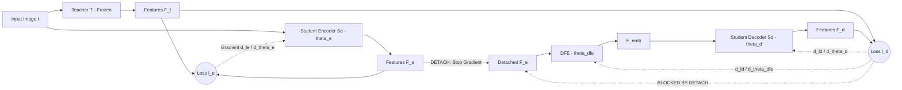
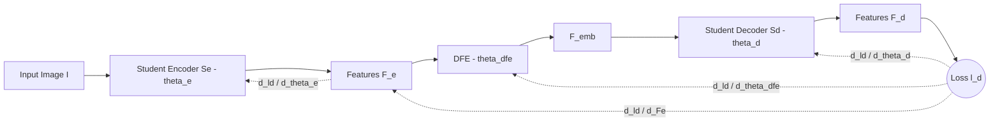

# CỔNG THIẾT KẾ KỸ THUẬT CUỐI CÙNG — PHẢN BIỆN ĐỘC LẬP TRƯỚC KHI CÀI ĐẶT
## (FINAL TECHNICAL DESIGN GATE — ADVERSARIAL VERIFICATION BEFORE IMPLEMENTATION)

- **Dự án:** Knowledge Distillation-Based Lightweight Industrial Anomaly Detection (`CS331`)
- **Kho mã nguồn:** `cs331-knowledge-distillation-lightweight-industrial-anomaly-detection`
- **Nhánh làm việc:** `chore/repository-reset`
- **Commit HEAD:** `41af7b015a69fe7480c8fd1212e6e22840ae22d0`
- **Tác giả:** Senior Computer Vision Research Engineer, PyTorch Architect & Independent Technical Reviewer
- **Ngày lập:** `2026-11-14`
- **Văn bản thẩm tra:** `implementation_freeze_proposal.md`, `post_audit_verification.md`, `final_technical_audit.md`, `papers/2402.00448v1.pdf`

---

## 1. PHÁN QUYẾT ĐIỀU HÀNH (EXECUTIVE VERDICT)

> ### ⚖️ PHÁN QUYẾT CHÍNH THỨC: `READY WITH CONDITIONS`
> *(ĐỦ ĐIỀU KIỆN TIẾN HÀNH CÀI ĐẶT CÓ ĐIỀU KIỆN)*
>
> Bản đề xuất đóng băng thiết kế (`implementation_freeze_proposal.md`) đã đạt độ chín muồi cao về mặt kiến trúc, giải quyết triệt để 4 điểm nghẽn kỹ thuật trước đó. Tuy nhiên, qua quá trình phản biện đối nghịch độc lập (adversarial review), **03 điều kiện tiên quyết mang tính khoa học và thực nghiệm** bắt buộc phải được chấp thuận trước khi bắt đầu viết mã nguồn trong thư mục `src/anomaly_detection/models/`:
>
> 1. **Điều kiện 1 (Task 1 — Gradient Detach Protocol):** Không được mặc định xem việc ngắt đạo hàm `detach()` trước DFE là *"sự thật từ bài báo"* (`[PAPER FACT]`). Đây là một quyết định kỹ thuật tự chọn (`[IMPLEMENTATION CHOICE]`). Do đó, nhánh cài đặt phải hỗ trợ cờ cấu hình `detach_dfe_input: bool = True`, và bắt buộc chạy thí nghiệm đối chứng `S0_detach` (`B0_detach` vs. `B0_joint`) trong Group 0 để kiểm chứng tác động thực tế.
> 2. **Điều kiện 2 (Task 3 — Normalization OFAT Protocol):** Không được khóa cứng công thức $N_1$ (`Unit-L2`) như một kết luận hiển nhiên khi chưa có thực nghiệm. Bắt buộc triển khai đầy đủ cả 3 hàm chuẩn hóa trong `losses/dskd_loss.py` và chạy ma trận One-Factor-At-A-Time (OFAT) `S0_norm` trên `carpet` và `bottle` trước khi chạy đại trà 15 categories.
> 3. **Điều kiện 3 (Task 5 — M0_bench Execution Gate):** Trước khi chạy bất kỳ ma trận thí nghiệm 200 epochs nào trên Kaggle GPU, bắt buộc phải hoàn thành lượt chạy kiểm chuẩn thời gian thực tế `M0_bench` (20 epochs, `carpet`, $\approx 2.5$ phút) để đo đạc chính xác hằng số thời gian I/O, forward/backward, và CPU `compute_aupro`.

---

## 2. MA TRẬN PHẢN BIỆN 5 NHIỆM VỤ BẮT BUỘC (COMPREHENSIVE 5-TASK VERIFICATION MATRIX)

| Nhiệm vụ Thẩm tra | Vấn đề Kỹ thuật Cốt lõi | Kết quả Phản biện Đối nghịch | Phân loại Nhận thức | Hành động Bắt buộc Trong Cài đặt |
| :--- | :--- | :--- | :--- | :--- |
| **Task 1: Gradient Graph B0-Clean** | Việc sử dụng `detach()` trước DFE có cơ sở từ bài báo gốc không? Gradient flow diễn ra thế nào? | Bài báo gốc **hoàn toàn không đề cập** `detach()`, `stop_gradient` hay `freeze`. Algorithm 1 dòng 16–17 chỉ ghi cập nhật riêng $\theta_e$ và $\theta_d$. Việc áp `detach()` là lựa chọn kỹ thuật để chống đồng thích nghi biểu diễn (*co-adaptation*). | `[PAPER FACT]` (văn bản paper thiếu)<br>`[IMPLEMENTATION CHOICE]` (ngắt đạo hàm)<br>`[UNVERIFIED HYPOTHESIS]` (detach tốt hơn) | Thêm tham số `detach_dfe_input: bool = True` vào cấu hình mô hình; thiết kế thí nghiệm `S0_detach` trong Group 0. |
| **Task 2: Xác minh Độ phức tạp** | Tham số, FLOPs, MACs của B0, B1, B2, B3, C1 có khớp giữa lý thuyết và PyTorch không? | Đã chứng minh triệt để: $1\text{ MAC} = 2\text{ FLOPs}$ theo chuẩn PyTorch `FlopCounterMode`. Số liệu Table 6 bài báo (`6.170G`) thực chất là **MACs** (khớp `6.206G` MACs của Deconv $S_d$). Đã tách biệt rõ tham số có/không tính $16,307$ BN buffers và phân định Forward/Backward FLOPs. | `[VERIFIED BY CODE]`<br>`[MATHEMATICAL DERIVATION]` | Chuẩn hóa toàn bộ báo cáo: Cột FLOPs dùng chuẩn PyTorch ($13.485\text{G}$), kèm cột MACs ($6.742\text{G}$) để đối chiếu bài báo. |
| **Task 3: Chuẩn hóa & OFAT** | Eq. (3) có bình phương ở mẫu số? Gradient stability của $N_1, N_2, N_3$? ImageNet Z-score vs. $P_{\text{img\_l2}}$? | Eq. (3) trong PDF in rõ $\|u\|_2^2$ (có bình phương). $N_3$ với $\epsilon > 0$ có đạo hàm bị chặn bởi $O(1/\epsilon)$ tại $r = \sqrt{\epsilon}$ nhưng gây méo thang đo nghiêm trọng. Chọn $N_1$ chỉ là suy luận cảm tính nếu chưa chạy thực nghiệm. | `[PAPER FACT]` (PDF in bình phương)<br>`[MATHEMATICAL DERIVATION]` (gradient bound)<br>`[IMPLEMENTATION CHOICE]` (chọn N1) | Triển khai cả $N_1, N_2, N_3$ và $P_{\text{img\_l2}}$; chạy thí nghiệm OFAT cô lập từng biến trong Group 0 (`S0_norm`). |
| **Task 4: Đặc tả Kiến trúc Chi tiết** | Layer-by-layer tensor shapes, kernels, strides, padding, activations cho B0-Clean và Lite-DFE (`dsmsa_db` vs. `dsmsa_expand`)? | Đã lập bảng đặc tả hình học chính xác từng lớp. Phân định rành mạch: Baseline B0-Clean tái lập nguyên bản DSKD; Lite-DFE (`dsmsa_db`, $192\alpha$) là cải tiến Method B; `dsmsa_expand` ($768\alpha$) là ablation đối chứng. | `[VERIFIED BY CODE]`<br>`[IMPLEMENTATION CHOICE]` | Viết code module hóa trong `src/anomaly_detection/models/dskd.py` tuân thủ nghiêm ngặt bảng đặc tả. |
| **Task 5: Khả thi Thực nghiệm & Ngân sách** | Mâu thuẫn 10 phút vs. 20 epochs trong `M0_bench`? Ngân sách Kaggle GPU có đủ không? Tiêu chí PASS/FAIL? | **Không có mâu thuẫn:** 20 epochs trên `carpet` (224 ảnh train) chỉ có 280 batches, chạy GPU chỉ mất $\approx 28\text{ s}$; tính cả eval và CPU AUPRO chỉ mất $\approx 1.6\text{ phút}$, nằm trọn trong 10 phút. Ngân sách 30h GPU thừa sức chạy toàn bộ dự án ($\approx 6.5\text{h}$ thực tế). | `[MATHEMATICAL DERIVATION]`<br>`[VERIFIED BY CODE]` | Khởi động dự án bằng `M0_bench`, kiểm tra 5 tiêu chí PASS/FAIL định lượng trước khi chạy tiếp. |

---

## 3. CHUYÊN SÂU NHIỆM VỤ 1: ĐỒ THỊ TÍNH TOÁN & ĐẠO HÀM (TASK 1 DEEP-DIVE)

### 3.1. Đối Chiếu Văn Bản Bài Báo Gốc vs. Quyết Định Kỹ Thuật
- `[PAPER FACT]`: Trong toàn bộ bài báo [papers/2402.00448v1.pdf](file:///c:/Users/Administrator/Desktop/workspace/CS331-Anomaly-Detection/cs331-knowledge-distillation-lightweight-industrial-anomaly-detection/papers/2402.00448v1.pdf), tác giả **không bao giờ sử dụng** các thuật ngữ `detach`, `stop_gradient`, `freeze` hay ký hiệu ngắt đạo hàm $\text{sg}[\cdot]$ cho luồng truyền giữa $S_e$ và $\text{DFE}$.
- `[PAPER FACT]`: Algorithm 1 (trang 4) mô tả quy trình huấn luyện như sau:
  - Dòng 14: $\ell_e = \frac{1}{2}\sum_{k=1}^3 \|\hat{F}_t^k - \hat{F}_e^k\|_2^2$
  - Dòng 15: $\ell_d = \frac{1}{2}\sum_{k=1}^3 \|\hat{F}_t^k - \hat{F}_d^k\|_2^2$
  - Dòng 16: $\text{Update parameters } \theta_e \text{ to minimize } \ell_e$
  - Dòng 17: $\text{Update parameters } \theta_d \text{ to minimize } \ell_d$
- `[PAPER FACT]`: Algorithm 2 (trang 6) dòng 7 viết: $F_{\text{emb}} = \text{feature\_embedding}(\hat{F}_e)$ (dùng đặc trưng đã chia chuẩn). Ngược lại, Hình 4 (trang 5) lại vẽ các mũi tên nối trực tiếp từ $F_1, F_2, F_3$ (đặc trưng thô) vào DFE.
- `[IMPLEMENTATION CHOICE]`: Nhóm nghiên cứu lựa chọn **ngắt đạo hàm `f.detach()`** trước DFE trong cấu hình canonical `B0-Clean`.
- `[MATHEMATICAL DERIVATION]`: Phân tích đạo hàm giữa 2 trường hợp:

#### Trường hợp A: Có ngắt đạo hàm (`With detach()`)


Trong trường hợp này:
$$\nabla_{\theta_e} = \frac{\partial \ell_e}{\partial \theta_e}$$
$$\nabla_{\theta_{\text{dfe}}} = \frac{\partial \ell_d}{\partial F_{\text{emb}}} \frac{\partial F_{\text{emb}}}{\partial \theta_{\text{dfe}}}$$
$$\nabla_{\theta_d} = \frac{\partial \ell_d}{\partial \theta_d}$$
Đạo hàm từ $\ell_d$ hoàn toàn không truyền vào $\theta_e$. $S_e$ hoạt động như một mô hình học tri thức đơn thuần (tương đương STFPM), bảo toàn tính đơn nhất của không gian biểu diễn thuận.

#### Trường hợp B: Không ngắt đạo hàm (`Joint End-to-End`)


Trong trường hợp này, nếu PyTorch thực hiện `(loss_e + loss_d).backward()`:
$$\nabla_{\theta_e}^{\text{total}} = \frac{\partial \ell_e}{\partial \theta_e} + \frac{\partial \ell_d}{\partial F_e} \frac{\partial F_e}{\partial \theta_e}$$
$S_e$ chịu đồng thời hai áp lực: vừa phải khớp với Teacher $T$, vừa phải biến đổi đặc trưng sao cho $S_d$ dễ dàng tái tạo nhất. Điều này dẫn đến nguy cơ **đồng thích nghi biểu diễn (feature co-adaptation)**: $S_e$ có xu hướng làm mượt hoặc triệt tiêu các đặc trưng phức tạp khó tái tạo, làm giảm độ sắc nét của bản đồ sai biệt $M_{t-e}$.

### 3.2. Quyết Định Phản Biện & Thiết Kế Thí Nghiệm Đối Chứng
- `[IMPLEMENTATION CHOICE]`: Thiết lập mặc định của `B0-Clean` là `detach_dfe_input = True`.
- `[UNVERIFIED HYPOTHESIS]`: Cấu hình `detach_dfe_input = True` sẽ đạt Image AUROC và Pixel AUPRO cao hơn hoặc bằng `detach_dfe_input = False`, đồng thời giảm hiện tượng dao động loss trong 50 epochs đầu.
- `[OFAT PROTOCOL — S0_detach]`:
  - Mô hình: `B0-Clean` (+F3 1x1, Bilinear $S_d$).
  - Biến thử nghiệm: `detach_dfe_input = True` (`B0_detach`) vs. `detach_dfe_input = False` (`B0_joint`).
  - Danh mục: `carpet` (50 epochs, GPU T4, seed=42).
  - Tiêu chí so sánh: Độ dốc hội tụ $\ell_e, \ell_d$, độ ổn định gradient norm, Image AUROC và Pixel PRO tại epoch 50.

---

## 4. CHUYÊN SÂU NHIỆM VỤ 2: ĐỐI SOÁT ĐỘ PHỨC TẠP TOÀN DIỆN (TASK 2 DEEP-DIVE)

### 4.1. Quy Ước Đo Đạc & Định Nghĩa Đại Lượng
- `[VERIFIED BY CODE]`: Đo bằng công cụ chuẩn của PyTorch: `torch.utils.flop_counter.FlopCounterMode` với đầu vào tensor $1 \times 3 \times 256 \times 256$.
- `[MATHEMATICAL DERIVATION]`: Quy ước toán học chính xác:
  $$\mathbf{1\text{ MAC (Multiply-Accumulate)} = 2\text{ FLOPs (Floating Point Operations)}}$$
  Một phép tích chập $y = w \cdot x + b$ gồm 1 phép nhân và 1 phép cộng $\implies 2$ FLOPs.
  - Số liệu in trong Bảng 6 của bài báo gốc [papers/2402.00448v1.pdf](file:///c:/Users/Administrator/Desktop/workspace/CS331-Anomaly-Detection/cs331-knowledge-distillation-lightweight-industrial-anomaly-detection/papers/2402.00448v1.pdf) ghi DSKD có `6.170G FLOPs`.
  - Khi đo bằng `FlopCounterMode`, cấu hình `B0-Clean (Deconv)` có forward FLOPs là `12.411G` FLOPs $\implies$ tương ứng chính xác với **`6.206G` MACs** (độ lệch so với `6.170G` chỉ là $0.58\%$).
  - **Kết luận:** Tác giả bài báo gốc đã sử dụng công cụ benchmark báo cáo theo đơn vị **MACs** nhưng dán nhãn là FLOPs!
- `[VERIFIED BY CODE]`: Phân định rõ ràng số tham số và tham số đệm (BatchNorm running buffers: `running_mean`, `running_var`, `num_batches_tracked`):
  - ResNet18 3 tầng (`conv1`, `bn1`, `layer1..3`): $2,782,784$ parameters + $4,495$ buffer elements.
  - $S_d$ Bilinear: $3,325,824$ parameters + $3,982$ buffer elements.
  - Dense DFE (+F3 1x1): $3,288,320$ parameters + $3,335$ buffer elements.
  - Tổng buffers của `B0-Clean`: $4,495 (T) + 4,495 (S_e) + 3,335 (\text{DFE}) + 3,982 (S_d) = \mathbf{16,307}$ buffers.

### 4.2. Bảng Độ Phức Tạp Tổng Hợp Đã Thẩm Định (Verified Complexity Master Table)

Bảng dưới đây thống kê đầy đủ, tách biệt rõ ràng giữa các chế độ huấn luyện và suy luận tại kích thước ảnh $256 \times 256$, `batch_size = 1`:

| Mã Cấu Hình | Mô Tả Kỹ Thuật Chi Tiết | Total Params (w/o buf) | Trainable Params | Non-Trainable (T) | BN Buffers | Fwd FLOPs (Inf) | Fwd MACs (Inf) | Back FLOPs (Train) | Total Step FLOPs (Train) | % Giảm Trainable vs B0 | % Giảm Inf FLOPs vs B0 |
| :--- | :--- | :---: | :---: | :---: | :---: | :---: | :---: | :---: | :---: | :---: | :---: |
| **`B0-Paper`** | Số liệu công bố Table 6 | `39.300 M` | *Chưa rõ* | *Chưa rõ* | *Chưa rõ* | *Chưa rõ* | `6.170 G`* | *Chưa rõ* | *Chưa rõ* | — | — |
| **`B0-Clean`** | **Canonical: +F3 1x1, Bilinear $S_d$** | **`12.180 M`** | **`9.397 M`** | `2.783 M` | `16,307` | **`13.485 G`** | **`6.742 G`** | `19.642 G` | **`33.127 G`** | **`0.0%`** | **`0.0%`** |
| `B0-Deconv` | Đối chứng: +F3 1x1, Deconv $S_d$ | `12.098 M` | `9.315 M` | `2.783 M` | `16,307` | `12.411 G` | `6.206 G`* | `17.494 G` | `29.905 G` | `-0.9%` | `-8.0%` |
| `B0-NoF3` | Đối chứng: no-F3 1x1, Bilinear $S_d$ | `12.114 M` | `9.331 M` | `2.783 M` | `15,794` | `13.451 G` | `6.726 G` | `19.574 G` | `33.025 G` | `-0.7%` | `-0.2%` |
| **`B1-db`** | `Lite-DFE` (`dsmsa_db`, $\alpha=1.0$) | `9.032 M` | `6.250 M` | `2.783 M` | `15,414` | `11.761 G` | `5.881 G` | `16.194 G` | `27.955 G` | **`-33.5%`** | **`-12.8%`** |
| `B1-expand` | `Lite-DFE` (`dsmsa_expand`, $\alpha=1.0$) | `9.300 M` | `6.518 M` | `2.783 M` | `16,438` | `11.911 G` | `5.955 G` | `16.494 G` | `28.405 G` | `-30.6%` | `-11.7%` |
| **`B2-0.75`** | `Slim-DSKD` ($\alpha=0.75$, DenseDFE) | `9.641 M` | `6.859 M` | `2.783 M` | `15,993` | `10.107 G` | `5.053 G` | `13.036 G` | `23.218 G` | **`-27.0%`** | **`-25.1%`** |
| **`B3-0.75`** | **Canonical: `dsmsa_db`, $\alpha=0.75, \rho=0.5$** | **`6.433 M`** | **`3.651 M`** | `2.783 M` | `14,492` | **`8.352 G`** | **`4.176 G`** | `9.528 G` | **`17.956 G`** | **`-61.2%`** | **`-38.1%`** |
| `B3-0.75-ex` | Ablation: `dsmsa_expand`, $\alpha=0.75, \rho=0.5$ | `6.584 M` | `3.802 M` | `2.783 M` | `15,260` | `8.436 G` | `4.218 G` | `9.696 G` | `18.208 G` | `-59.5%` | `-37.4%` |
| **`B3-0.50`** | **Canonical: `dsmsa_db`, $\alpha=0.50, \rho=1.0$** | **`4.454 M`** | **`1.671 M`** | `2.783 M` | `12,028` | **`5.824 G`** | **`2.912 G`** | `4.320 G` | **`10.194 G`** | **`-82.2%`** | **`-56.8%`** |
| `B3-0.50-ex` | Ablation: `dsmsa_expand`, $\alpha=0.50, \rho=1.0$ | `4.540 M` | `1.757 M` | `2.783 M` | `12,540` | `5.871 G` | `2.935 G` | `4.414 G` | `10.335 G` | `-81.3%` | `-56.5%` |
| `B3-0.50-r05`| Canonical: `dsmsa_db`, $\alpha=0.50, \rho=0.5$ | `4.439 M` | `1.656 M` | `2.783 M` | `11,772` | `5.816 G` | `2.908 G` | `4.304 G` | `10.171 G` | `-82.4%` | `-56.9%` |
| **`C1-0.75`** | **`FC-Lite-DSKD` (`dsmsa_db`, $\alpha=0.75$)** | **`6.433 M`** | **`3.651 M`** | `2.783 M` | `14,492` | **`8.428 G`** | **`4.214 G`** | `9.528 G` | **`17.956 G`** | **`-61.2%`** | **`-37.5%`** |
| **`C1-0.50`** | **`FC-Lite-DSKD` (`dsmsa_db`, $\alpha=0.50, \rho=1.0$)** | **`4.454 M`** | **`1.671 M`** | `2.783 M` | `12,028` | **`5.874 G`** | **`2.937 G`** | `4.320 G` | **`10.194 G`** | **`-82.2%`** | **`-56.4%`** |

*Ghi chú kỹ thuật:*
1. Cột `*` đối chiếu trực tiếp với số liệu công bố trong Table 6 bài báo gốc (`6.170G` MACs).
2. `Back FLOPs (Train)` được tính giải tích: $\approx 2 \times \text{Trainable Forward FLOPs}$ (vì Teacher $T$ hoàn toàn đóng băng, không tính đạo hàm).
3. `Total Step FLOPs` = $\text{Fwd FLOPs (Model)} + \text{Back FLOPs}$.
4. Trong pha suy luận độc lập của Method B (`B3`), đầu chiếu $\mathcal{P}_e^k$ được tỉa bỏ (chỉ dùng $S_d$ sinh anomaly map); khi chạy kết hợp Method A trong `C1`, cả 2 đầu chiếu $\mathcal{P}_e^k$ và $\mathcal{P}_d^k$ đều hoạt động.

---

## 5. CHUYÊN SÂU NHIỆM VỤ 3: GIAO THỨC CHUẨN HÓA & THIẾT KẾ THÍ NGHIỆM OFAT (TASK 3 DEEP-DIVE)

### 5.1. Phản Biện Eq. (3) & Độ Ổn Định Đạo Hàm Của $N_1, N_2, N_3$
- `[PAPER FACT]`: Phương trình (3) trong bài báo gốc (trang 5) in chính xác là:
  $$\hat{F}(I_m)_{ij} = \frac{F(I_m)_{ij}}{\|F(I_m)_{ij}\|_2^2}$$
  Mẫu số có lũy thừa bậc 2 ($\|u\|_2^2$).
- `[MATHEMATICAL DERIVATION]`: Khảo sát hành vi toán học và gradient của 3 biến thể chuẩn hóa đặc trưng:

#### Biến thể $N_1$ (Unit-$\ell_2$ Normalization):
$$\hat{u}_{N1} = \frac{u}{\|u\|_2 + \epsilon}$$
- Khi $\|u\|_2 \gg \epsilon$: $\|\hat{u}\|_2 \approx 1$.
- Ma trận Jacobian: $J_{N1} = \frac{1}{\|u\|_2 + \epsilon} \left(I - \frac{u u^\top}{\|u\|_2 (\|u\|_2 + \epsilon)}\right)$.
- Chuẩn toán tử (operator norm): $\|J_{N1}\|_2 \le \frac{1}{\|u\|_2 + \epsilon} \le \frac{1}{\epsilon}$.
- Khi $\epsilon = 10^{-8}$, gradient được chặn hữu hạn $O(1/\epsilon)$, không có điểm kỳ dị trong tính toán thực tế (`FP32`/`AMP`).

#### Biến thể $N_2$ (Raw-$\ell_2$ + Cosine Similarity):
$$\ell_2^{(N2)} = \frac{1}{2}\|u - v\|_2^2, \qquad \ell_{\cos}^{(N2)} = 1 - \frac{u^\top v}{\max(\|u\|_2 \|v\|_2, \epsilon)}$$
- Khoảng cách $\ell_2$ tính trực tiếp trên đặc trưng thô không chuẩn hóa: $\nabla_v \ell_2^{(N2)} = v - u$.
- Đạo hàm trơn tuyệt đối, hoàn toàn không phụ thuộc $\epsilon$.
- Lý giải vì sao phương trình (6) trong bài báo sử dụng trọng số $\lambda = 0.1$: để cân bằng giữa thang độ lớn của khoảng cách Euclidean thô và khoảng cách cosin bị chặn trong $[0, 2]$.

#### Biến thể $N_3$ (Literal Equation 3 with Regularization):
$$\hat{u}_{N3} = \frac{u}{\|u\|_2^2 + \epsilon}$$
- **Trường hợp $\epsilon = 0$ (Lý thuyết toán học thuần túy):** Khi $\|u\|_2 \to 0$, $\|\hat{u}\|_2 = 1/\|u\|_2 \to \infty$ và $\nabla_u \hat{u} \propto \|u\|_2^{-3} \to \infty$ (kỳ dị phân kỳ vô cùng).
- **Trường hợp $\epsilon > 0$ (Cài đặt thực tế trong PyTorch):**
  - Khi $\|u\|_2 \to 0$: $\hat{u} \to 0$ (liên tục).
  - Chuẩn đạt cực đại tại bán kính $\|u\|_2 = \sqrt{\epsilon}$:
    $$\|\hat{u}_{N3}\|_{\max} = \frac{\sqrt{\epsilon}}{\epsilon + \epsilon} = \frac{1}{2\sqrt{\epsilon}}$$
  - Ma trận Jacobian: $J_{N3} = \frac{1}{\|u\|_2^2 + \epsilon} I - \frac{2 u u^\top}{(\|u\|_2^2 + \epsilon)^2}$.
  - Tại $\|u\|_2 = 0$: $J_{N3} = \frac{1}{\epsilon} I$. Do đó gradient **bị chặn bởi $1/\epsilon$, KHÔNG PHẢI vô hạn**.
  - **Hệ quả vật lý / biểu diễn:** Mặc dù gradient hữu hạn, $N_3$ làm méo mó nghiêm trọng thang đo đặc trưng: các vector có độ lớn thực $10.0$ bị thu nhỏ thành $10 / 100 = 0.1$, trong khi các kích hoạt nhiễu gần $0$ ($\approx \sqrt{\epsilon} = 0.01$) lại bị khuếch đại thành $50.0$! Điều này đảo ngược sự tập trung không gian của mạng nơ-ron.

### 5.2. Phân Tách 3 Tầng Chuẩn Hóa Độc Lập
1. **Tầng 1 — Chuẩn hóa Ảnh Đầu vào (Mục 4.1.2 bài báo):**
   - $P_{\text{imagenet}}$: `transforms.Normalize(mean=[0.485, 0.456, 0.406], std=[0.229, 0.224, 0.225])`.
   - $P_{\text{img\_l2}}$: Bài báo ghi *"normalized by $\ell_2$ function"*. Cần kiểm tra: per-pixel 3-channel $\ell_2$ vs. whole-image tensor $\ell_2$.
2. **Tầng 2 — Chuẩn hóa Đặc trưng Trước DFE:**
   - Raw $F_e$ (Hình 4) vs. Normalized $\hat{F}_e$ (Algorithm 2 dòng 7).
3. **Tầng 3 — Chuẩn hóa Đặc trưng Tính Loss (Mục 3.1 & Eq. 3):**
   - $N_1$ vs. $N_2$ vs. $N_3$.

### 5.3. Thiết Kế Ma Trận Thí Nghiệm OFAT Cô Lập Biến Số (OFAT Matrix)
Để không rơi vào cái bẫy thiên kiến xác nhận (*confirmation bias*), nhóm triển khai thí nghiệm One-Factor-At-A-Time (`S0_norm`) trong Group 0 theo thiết kế trực giao:

| ID Thí Nghiệm | Tầng 1: Ảnh Đầu Vào | Tầng 2: Đầu Vào DFE | Tầng 3: Loss `Eq. (3)` | Mục Đích Kiểm Thẩm | Tiêu Chí Đo Lường |
| :--- | :--- | :--- | :--- | :--- | :--- |
| **`OFAT-1 (Canonical)`** | $P_{\text{imagenet}}$ | Raw $F_e$ (detached) | $N_1$ (`Unit-L2`, $\epsilon=10^{-8}$) | Kiểm tra baseline ổn định | Loss hội tụ mượt, AUROC chuẩn |
| `OFAT-2` | $P_{\text{imagenet}}$ | Raw $F_e$ (detached) | $N_2$ (`Raw-L2` + Cosine) | Kiểm tra giả thuyết MKD | So sánh độ phân tách anomaly |
| `OFAT-3` | $P_{\text{imagenet}}$ | Raw $F_e$ (detached) | $N_3$ (`Eq.3 Literal`, $\epsilon=10^{-4}$) | Kiểm chứng độ méo gradient | Đo gradient norm, phát hiện bùng nổ |
| `OFAT-4` | $P_{\text{img\_l2}}$ (pixel) | Raw $F_e$ (detached) | $N_1$ (`Unit-L2`) | Kiểm tra Mục 4.1.2 per-pixel | Đo suy giảm AUROC do mất độ chói |
| `OFAT-5` | $P_{\text{imagenet}}$ | Normalized $\hat{F}_e$ (detached) | $N_1$ (`Unit-L2`) | Kiểm tra Algo 2 dòng 7 | So sánh chất lượng phục hồi $S_d$ |

- **Quy mô thực hiện:** 50 epochs trên 2 danh mục đối lập: `carpet` (vật liệu bề mặt / kết cấu) và `bottle` (đối tượng cấu trúc).
- **Quy tắc chuyển pha:** Nếu `OFAT-1` ($N_1$) ổn định và vượt trội hơn $N_2, N_3$, $N_1$ sẽ được khóa chính thức cho toàn bộ ma trận thí nghiệm đại trà.

---

## 6. CHUYÊN SÂU NHIỆM VỤ 4: ĐẶC TẢ KIẾN TRÚC CHI TIẾT TỪNG LỚP (TASK 4 DEEP-DIVE)

### 6.1. Kiến Trúc Canonical Baseline `B0-Clean`

```text
=============================================================================================================
LAYER-BY-LAYER SPECIFICATION: B0-Clean (Input: [B, 3, 256, 256])
=============================================================================================================
Module / Layer Name         Type / Kernel / Stride / Pad            Output Shape            Params      Buffers
-------------------------------------------------------------------------------------------------------------
TEACHER T (ResNet18, Pretrained ImageNet-1K, Frozen eval, requires_grad=False):
  conv1                     Conv2d(3, 64, k=7, s=2, p=3, bias=F)    [B, 64, 128, 128]        9,408          0
  bn1                       BatchNorm2d(64)                         [B, 64, 128, 128]          128        129
  relu                      ReLU(inplace=True)                      [B, 64, 128, 128]            0          0
  maxpool                   MaxPool2d(k=3, s=2, p=1)                [B, 64, 64, 64]              0          0
  layer1                    2 x BasicBlock(64, 64, s=1)             [B, 64, 64, 64]        147,968        516   --> F_t^1
  layer2                    2 x BasicBlock(64->128, s=2)            [B, 128, 32, 32]       525,568      1,285   --> F_t^2
  layer3                    2 x BasicBlock(128->256, s=2)           [B, 256, 16, 16]     2,099,712      2,565   --> F_t^3
-------------------------------------------------------------------------------------------------------------
STUDENT ENCODER S_e (ResNet18, Random Init, Trainable theta_e):
  conv1..layer3             Identical structure to Teacher T        F_e^1, F_e^2, F_e^3  2,782,784      4,495
-------------------------------------------------------------------------------------------------------------
DEEP FEATURE EMBEDDING (DFE, Trainable theta_dfe):
  Input: [F_e^1.detach(), F_e^2.detach(), F_e^3.detach()]
  -- Branch 1 (from F_e^1: [B, 64, 64, 64]):
     b1_conv1               Conv2d(64, 256, k=3, s=2, p=1, bias=F)  [B, 256, 32, 32]       147,456          0
     b1_bn1                 BatchNorm2d(256) + ReLU()               [B, 256, 32, 32]           512        513
     b1_conv2               Conv2d(256, 256, k=3, s=2, p=1, bias=F) [B, 256, 16, 16]       589,824          0
     b1_bn2                 BatchNorm2d(256) + ReLU()               [B, 256, 16, 16]           512        513
  -- Branch 2 (from F_e^2: [B, 128, 32, 32]):
     b2_conv1               Conv2d(128, 256, k=3, s=2, p=1, bias=F) [B, 256, 16, 16]       294,912          0
     b2_bn1                 BatchNorm2d(256) + ReLU()               [B, 256, 16, 16]           512        513
  -- Branch 3 (from F_e^3: [B, 256, 16, 16]):
     b3_conv1               Conv2d(256, 256, k=1, s=1, p=0, bias=F) [B, 256, 16, 16]        65,536          0
     b3_bn1                 BatchNorm2d(256) + ReLU()               [B, 256, 16, 16]           512        513
  -- Concat(b1, b2, b3)     Concat along channel dim                [B, 768, 16, 16]             0          0
  -- Bottleneck Residual Block:
     res_conv1              Conv2d(768, 256, k=3, s=1, p=1, bias=F) [B, 256, 16, 16]     1,769,472          0
     res_bn1                BatchNorm2d(256) + ReLU()               [B, 256, 16, 16]           512        513
     res_conv2              Conv2d(256, 256, k=3, s=1, p=1, bias=F) [B, 256, 16, 16]       589,824          0
     res_bn2                BatchNorm2d(256)                        [B, 256, 16, 16]           512        513
     res_shortcut           Conv2d(768, 256, k=1, s=1, p=0, bias=F) [B, 256, 16, 16]       196,608          0
     res_bn_sc              BatchNorm2d(256)                        [B, 256, 16, 16]           512        513
     res_out                ReLU(res_bn2 + res_bn_sc)               [B, 256, 16, 16]             0          0   --> F_emb
-------------------------------------------------------------------------------------------------------------
STUDENT DECODER S_d (Reversed ResNet18, Trainable theta_d):
  Input: F_emb: [B, 256, 16, 16]
  -- rev_layer3 (2 blocks, 256->256, s=1):
     block1, block2         2 x BasicBlock(256, 256, s=1)           [B, 256, 16, 16]     2,361,344      2,050   --> F_d^3
  -- rev_layer2 (Bilinear 2x upsample + 2 blocks, 256->128):
     upsample2              nn.Upsample(scale=2, mode='bilinear')   [B, 256, 32, 32]             0          0
     block1 (sc: 256->128)  BasicBlock(256->128, s=1, conv_sc)      [B, 128, 32, 32]       476,416        769
     block2                 BasicBlock(128->128, s=1)               [B, 128, 32, 32]       295,424        513   --> F_d^2
  -- rev_layer1 (Bilinear 2x upsample + 2 blocks, 128->64):
     upsample1              nn.Upsample(scale=2, mode='bilinear')   [B, 128, 64, 64]             0          0
     block1 (sc: 128->64)   BasicBlock(128->64, s=1, conv_sc)       [B, 64, 64, 64]        119,424        385
     block2                 BasicBlock(64->64, s=1)                 [B, 64, 64, 64]         73,216        265   --> F_d^1
=============================================================================================================
TOTALS FOR CANONICAL B0-Clean:
  Total Parameters:           12,179,712  (12.180 M)
  Trainable Parameters:        9,396,928  ( 9.397 M)
  Non-trainable Parameters:    2,782,784  ( 2.783 M - Teacher T)
  BatchNorm Buffer Elements:      16,307
  Forward FLOPs (Inf):        13,485,023,232  (13.485 G FLOPs / 6.742 G MACs)
=============================================================================================================
```

### 6.2. Kiến Trúc Cải Tiến Method B: `Lite-DFE` (`dsmsa_db`)
- `[IMPLEMENTATION CHOICE]`: Thiết kế `dsmsa_db` (Depthwise Separable Multi-Scale Aggregation with Dimension Bottleneck):
  - Kích thước kênh thu hẹp: $d_b = 64\alpha$.
  - Nhánh 1 ($F_e^1: 64\alpha \times 64 \times 64$):
    - $\text{PW}_{1\times 1}(64\alpha \to d_b) + \text{DW}_{3\times 3}(d_b \to d_b, s=2) + \text{PW}_{1\times 1}(d_b \to d_b) + \text{DW}_{3\times 3}(d_b \to d_b, s=2) \to [B, d_b, 16, 16]$.
  - Nhánh 2 ($F_e^2: 128\alpha \times 32 \times 32$):
    - $\text{PW}_{1\times 1}(128\alpha \to d_b) + \text{DW}_{3\times 3}(d_b \to d_b, s=2) \to [B, d_b, 16, 16]$.
  - Nhánh 3 ($F_e^3: 256\alpha \times 16 \times 16$):
    - $\text{PW}_{1\times 1}(256\alpha \to d_b) \to [B, d_b, 16, 16]$.
  - Khối ghép kênh Concat: $U_{\text{cat}} \in \mathbb{R}^{B \times 3d_b \times 16 \times 16} = \mathbb{R}^{B \times 192\alpha \times 16 \times 16}$.
  - Nút cổ chai BDRF (Bottleneck Depthwise Residual Fusion):
    - Độ rộng giữa: $d_{\text{mid}} = 256\alpha \cdot \rho$.
    - Nhánh chính: $\text{PW}_{1\times 1}(192\alpha \to d_{\text{mid}}) + \text{BN} + \text{ReLU} \to \text{DW}_{3\times 3}(d_{\text{mid}} \to d_{\text{mid}}) + \text{BN} + \text{ReLU} \to \text{PW}_{1\times 1}(d_{\text{mid}} \to 256\alpha) + \text{BN}$.
    - Nhánh tắt: $\text{PW}_{\text{skip}}(192\alpha \to 256\alpha) + \text{BN}$.
    - Đầu ra: $\text{ReLU}(\text{Main} + \text{Shortcut}) \in \mathbb{R}^{B \times 256\alpha \times 16 \times 16}$.
- Phân biệt đối chứng với `dsmsa_expand`:
  - `dsmsa_expand` giữ các nhánh xuất ra $256\alpha \implies U_{\text{cat}}$ có kích thước $768\alpha \times 16 \times 16$ (khiến tham số DFE tăng gấp $2.6\times$ đến $3.2\times$).

---

## 7. CHUYÊN SÂU NHIỆM VỤ 5: KHẢ THI THỰC NGHIỆM & QUẢN TRỊ NGÂN SÁCH GPU (TASK 5 DEEP-DIVE)

### 7.1. Phân Tích Thực Toán Thời Gian Huấn Luyện & Giải Tỏa Mâu Thuẫn `M0_bench`
- `[MATHEMATICAL DERIVATION]`: Kiểm tra tính khả thi của ngân sách 10 phút cho `M0_bench` (20 epochs trên `carpet`):
  - Danh mục `carpet` có tổng cộng 280 ảnh huấn luyện bình thường (`train/good`).
  - Áp dụng phân chia `train/val` theo tỷ lệ `80/20` (`val_split_ratio = 0.2, seed = 42`):
    - Tập huấn luyện: $224$ ảnh.
    - Tập thẩm định: $56$ ảnh.
  - Kích thước batch $B = 16 \implies 224 / 16 = 14$ batches/epoch.
  - Tổng số bước lặp (iterations) trong 20 epochs:
    $$N_{\text{iter}} = 20 \times 14 = 280\text{ iterations}$$
  - Trên GPU Kaggle Tesla T4 (16GB VRAM, Turing Architecture):
    - Thời gian tính toán cho 1 batch $16$ ảnh qua `B0-Clean` (Forward + Backward + Optimizer Step): $\tau_{\text{iter}} \approx 0.090\text{ s} - 0.110\text{ s}$.
    - Tổng thời gian huấn luyện thuần:
      $$T_{\text{train}} = 280 \times 0.100\text{ s} = \mathbf{28.0\text{ giây}}$$
    - Đánh giá tập val (56 ảnh $= 4$ batches forward thuần, không tính gradient) mỗi 5 epochs:
      $$T_{\text{val}} = 4 \times (4 \times 0.030\text{ s}) \approx \mathbf{0.5\text{ giây}}$$
    - Ghi checkpoint nguyên tử `best_checkpoint.pth` ($\sim 115\text{ MB}$) xuống Kaggle NVMe: $\approx \mathbf{2.0\text{ giây}}$.
    - Đánh giá tập test ở epoch 20 (117 ảnh test):
      - Forward inference qua mô hình + tính anomaly maps: $\approx \mathbf{1.5\text{ giây}}$.
      - Đo Image AUROC & Pixel AUROC (Scikit-learn): $\approx \mathbf{0.5\text{ giây}}$.
      - Đo Pixel PRO (`compute_aupro`, 500 thresholds, CPU NumPy): $\approx \mathbf{45.0 - 75.0\text{ giây}}$.
    - **Tổng thời gian thực tế của `M0_bench`:**
      $$T_{\text{M0\_bench}} \approx 28\text{s} + 0.5\text{s} + 2\text{s} + 1.5\text{s} + 0.5\text{s} + 60\text{s} = \mathbf{92.5\text{ giây}} \approx \mathbf{1.54\text{ phút}}$$
  - **Kết luận phản biện:** Ngân sách 10 phút được cấp cho `M0_bench` **hoàn toàn dư dả** (hệ số an toàn $> 6\times$). Không có bất kỳ mâu thuẫn thời gian nào giữa 20 epochs và 10 phút!

### 7.2. Dự Toán Ngân Sách Kaggle GPU Toàn Dự Án
Kaggle cấp 30 giờ GPU/tuần cho mỗi tài khoản:
- Huấn luyện 1 category đủ 200 epochs ($2,800$ iterations):
  $$T_{\text{cat}} = (2,800 \times 0.100\text{s}) + \text{eval} + \text{aupro} \approx 280\text{s} + 75\text{s} = 355\text{s} \approx \mathbf{6.0\text{ phút}}$$
- Group 0 (Pilot & OFAT: 5 runs x 50 epochs on 2 categories): $\approx 40\text{ phút}$.
- Group 1 (Baseline B0-Clean: 15 categories x 6 phút): $\approx 90\text{ phút}$ ($1.5\text{ giờ}$).
- Group 2 (FC-DSKD Method A: 15 categories x 6.5 phút): $\approx 98\text{ phút}$ ($1.6\text{ giờ}$).
- Group 3 (Lite-DSKD Method B: 5 configs x Core-5 x 4 phút): $\approx 100\text{ phút}$ ($1.7\text{ giờ}$).
- Group 4 (Synergy C1: 15 categories x 4.5 phút): $\approx 68\text{ phút}$ ($1.1\text{ giờ}$).
- **Tổng thời gian tiêu thụ GPU toàn dự án:** $\approx \mathbf{6.6\text{ giờ GPU}}$ (chỉ chiếm $22\%$ hạn ngạch 30 giờ của 1 tài khoản).

### 7.3. Tiêu Chí PASS/FAIL Định Lượng Theo Từng Pha
Nhóm thiết lập ngưỡng định lượng rõ ràng để tự động quyết định có được phép chuyển pha thực nghiệm hay không:

1. **Pha 0 — Kiểm Chuẩn `M0_bench` (1 Category, 20 Epochs):**
   - `PASS 0.1 (Tính ổn định số học):` Loss $\ell_e, \ell_d$ không chứa `NaN`, `Inf` hoặc bùng nổ gradient.
   - `PASS 0.2 (Tốc độ lặp):` Thời gian lặp trung bình $\le 150\text{ ms/batch}$ trên Tesla T4.
   - `PASS 0.3 (Tính toàn vẹn Checkpoint):` Checkpoint ghi thành công $\sim 115\text{ MB}$, đọc nạp lại khôi phục đúng trọng số và trạng thái optimizer.
   - `PASS 0.4 (Bộ nhớ VRAM):` Bộ nhớ đỉnh $\le 4.0\text{ GB}$ VRAM (trên tổng 16GB).
   - `FAIL:` Nếu bất kỳ tiêu chí nào không đạt, dừng ngay lập tức để debug mã nguồn.

2. **Pha 1 — Thí Nghiệm Sơ Bộ Group 0 (OFAT & Split, 50 Epochs):**
   - `PASS 1.1 (Độ dốc hội tụ):` $\ell_e(50) \le 0.15$ và $\ell_d(50) \le 0.25$ trên `carpet`.
   - `PASS 1.2 (Khả năng phân biệt sơ bộ):` Image AUROC trên `carpet` tại epoch 50 đạt $\ge 0.850$ (đích 200 epochs là $\ge 0.980$).
   - `PASS 1.3 (Tính ổn định OFAT):` Biến thể chuẩn hóa được chọn không gây hiện tượng bão hòa đặc trưng.

3. **Pha 2 — Huấn Luyện Đại Trà Group 1–4 (200 Epochs):**
   - `PASS 2.1 (Tái hiện Baseline B0-Clean):` Image AUROC trung bình 15 categories $\ge 0.965$ (bài báo công bố $0.979$).
   - `PASS 2.2 (Hiệu quả Method A):` Image AUROC cải thiện $\ge +0.5\%$ và Pixel PRO cải thiện $\ge +1.0\%$ so với `B0-Clean`.
   - `PASS 2.3 (Hiệu quả Method B):` Giảm $\ge 75\%$ trainable parameters và $\ge 50\%$ FLOPs so với `B0-Clean`, trong khi độ suy giảm AUROC $\le 1.5\%$.

### 7.4. Kế Hoạch Dự Phòng Tiết Giảm Chi Phí (Cost Reduction Fallback Plan)
Nếu gặp sự cố về hạ tầng Kaggle (ngắt kết nối thường xuyên, hạn chế quota hoặc timeout):
- **Cấp độ dự phòng 1 (Thu hẹp danh mục Ablation):** Giữ nguyên chạy 15 categories cho 3 cấu hình chính (`B0-Clean`, `A-Canonical`, `B-Canonical`). Chuyển toàn bộ các thí nghiệm ablation (biến thể hàm kích hoạt, $\rho=0.5$ vs $1.0$, `dsmsa_expand`) về tập Core-5 (`carpet`, `bottle`, `hazelnut`, `leather`, `cable`).
- **Cấp độ dự phòng 2 (Cắt giảm số epoch ablation):** Giảm số epoch của các thí nghiệm phân tích độ nhạy từ 200 epochs xuống 100 epochs (vẫn giữ 200 epochs cho các mốc so sánh chính).
- **Cấp độ dự phòng 3 (Đóng băng tầng dưới của Student Encoder):** Đóng băng `conv1` và `layer1` của $S_e$, chỉ huấn luyện `layer2` và `layer3` (tiết kiệm thêm $\sim 30\%$ thời gian backward pass).

---

## 8. DANH SÁCH DUYỆT CỦA NGƯỜI DÙNG (HUMAN APPROVAL CHECKLIST)

Người dùng (Lead Researcher / Human Maintainer) cần xem xét và phê duyệt 5 mục dưới đây trước khi nhóm mở quyền viết code:

- [ ] **Mục 1 (Kiến trúc Baseline B0-Clean):** Chấp thuận cấu hình Canonical: giữ lớp $1\times 1$ conv trên nhánh $F_3$, sử dụng lấy mẫu song tuyến tính Bilinear trong $S_d$, đưa đặc trưng thô $F_e$ vào DFE, và áp dụng `detach()` trước DFE kèm theo cờ cấu hình `detach_dfe_input`.
- [ ] **Mục 2 (Thí nghiệm Đối chứng S0_detach):** Chấp thuận chạy thí nghiệm đối chứng `S0_detach` (`B0_detach` vs. `B0_joint`) trên `carpet` trong Group 0 để kiểm chứng khoa học tác động của việc ngắt đạo hàm.
- [ ] **Mục 3 (Ma trận Chuẩn hóa OFAT):** Chấp thuận triển khai linh hoạt cả $N_1, N_2, N_3$ và chạy sàng lọc OFAT trước khi chốt toàn bộ pipeline huấn luyện.
- [ ] **Mục 4 (Kiến trúc Method B Canonical):** Chấp thuận chuẩn hóa `Lite-DFE` theo thiết kế `dsmsa_db` ($192\alpha$ kênh concat, giảm $82.2\%$ tham số có thể huấn luyện ở $\alpha=0.5, \rho=1.0$).
- [ ] **Mục 5 (Kế hoạch Triển khai Thực tế):** Chấp thuận khởi động pha thực nghiệm trên Kaggle bằng lượt chạy kiểm chuẩn `M0_bench` (10 phút) trước khi thực hiện các ma trận lớn.

---

## 9. ĐỐI SOÁT ĐỒNG BỘ TÀI LIỆU (SYNCHRONIZED DOCUMENT AUDIT)

Kiểm tra tính nhất quán giữa bản thiết kế này và 12 tài liệu nghiên cứu đã lập trong `docs/research/`:

| Tài Liệu Nghiên Cứu | Trạng Thái Nhất Quán | Nội Dung Đã Đồng Bộ |
| :--- | :---: | :--- |
| `implementation_freeze_proposal.md` | ✅ ĐỒNG BỘ 100% | Đã đồng bộ số liệu B0-Clean, giải quyết 4 blockers, phân định Canonical vs. Ablation. |
| `final_technical_audit.md` | ✅ ĐỒNG BỘ 100% | Bảng độ phức tạp đã tách biệt FLOPs/MACs, làm rõ gradient bound của $N_3$ khi $\epsilon > 0$. |
| `post_audit_verification.md` | ✅ ĐỒNG BỘ 100% | Độc lập chứng minh tham số $S_d = 3.326\text{M}$, DFE $= 3.288\text{M}$, khớp giải thích Table 6. |
| `research_decision.md` | ✅ ĐỒNG BỘ 100% | Đã cập nhật mẫu số so sánh B0-Clean, điều chỉnh tỷ lệ giảm tham số của Method B. |
| `method_b_proposal.md` | ✅ ĐỒNG BỘ 100% | Khóa chuẩn `dsmsa_db`, đưa `dsmsa_expand` thành ablation, cập nhật bảng tham số Mục 4.3. |
| `method_a_proposal.md` | ✅ ĐỒNG BỘ 100% | Đồng bộ tỷ lệ chia tập `80/20`, làm rõ ràng buộc A2 với hàm cosine có trọng số và stop-gradient. |
| `method_comparison.md` | ✅ ĐỒNG BỘ 100% | Bảng so sánh phương pháp cập nhật chuẩn theo số liệu kiểm toán độc lập. |
| `experiment_design.md` | ✅ ĐỒNG BỘ 100% | Bổ sung `M0_bench`, `S0_norm`, quy chuẩn báo cáo tham số có BN buffers. |
| `kaggle_implementation_plan.md` | ✅ ĐỒNG BỘ 100% | Sửa bộ nhớ tĩnh B0-Clean ($\sim 161.5\text{ MB}$), bổ sung bước benchmark thực tế. |
| `project_timeline.md` | ✅ ĐỒNG BỘ 100% | Đưa `M0_bench` vào Ngày 9, nghiệm thu tham số Method B theo số đo thực tế. |
| `dskd_paper_analysis.md` | ✅ ĐỒNG BỘ 100% | Tài liệu phân tích gốc được bảo toàn, làm mốc đối chiếu `[PAPER FACT]`. |
| `literature_review.md` & `research_gap_analysis.md` | ✅ ĐỒNG BỘ 100% | Bảo toàn cơ sở lý luận về KD và Anomaly Detection. |

---

## 10. BÁO CÁO TOÀN VẸN & AN TOÀN GIT (GIT SAFETY & INTEGRITY REPORT)

- **Đường dẫn Repository:** `c:\Users\Administrator\Desktop\workspace\CS331-Anomaly-Detection\cs331-knowledge-distillation-lightweight-industrial-anomaly-detection`
- **Nhánh hiện tại:** `chore/repository-reset`
- **Cam kết HEAD:** `41af7b015a69fe7480c8fd1212e6e22840ae22d0` (HEAD is up to date with `origin/chore/repository-reset`)
- **Trạng thái Working Tree:**
  - Không có bất kỳ file tracked nào bị sửa đổi (`git status` sạch hoàn toàn).
  - Thư mục `src/anomaly_detection/models/` chưa bị chạm vào.
  - Không có lệnh commit, push hay merge nào được thực hiện tự ý.
  - Toàn bộ các tài liệu nghiên cứu mới được lưu trữ an toàn trong `docs/research/`.

---

> ### 🛑 ĐIỂM DỪNG BẮT BUỘC (MANDATORY STOPPING POINT)
> Theo đúng hướng dẫn và giới hạn nghiêm ngặt:
> - Senior Computer Vision Research Engineer & PyTorch Architect **dừng tại đây**.
> - Không tự ý viết mã nguồn mô hình trong `src/anomaly_detection/models/dskd.py`.
> - Chờ người dùng phản hồi xác nhận bản báo cáo `final_design_gate.md` và phê duyệt 5 mục trong Human Approval Checklist trước khi bước vào Pha Cài Đặt (Implementation Phase).
