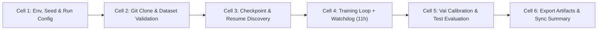
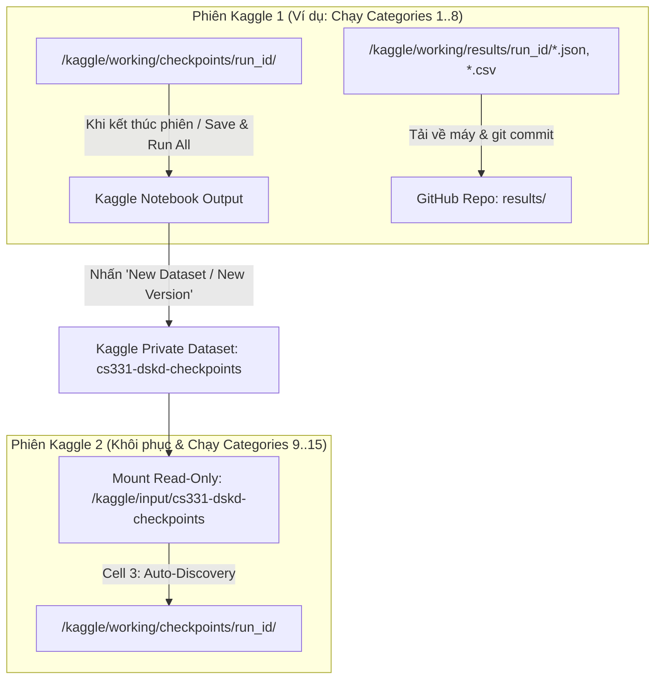

# Kế hoạch Triển khai Mô-đun Hóa & Vận hành Thực nghiệm trên Kaggle GPU (Kaggle Implementation & Reproducibility Plan)

> **Dự án:** CS331 — Chưng cất Tri thức cho Phát hiện Bất thường Công nghiệp Nhẹ (Knowledge Distillation for Lightweight Industrial Anomaly Detection)  
> **Bài báo Gốc (Baseline):** *Dual-Student Knowledge Distillation Networks for Unsupervised Anomaly Detection* (Yao & Gao, arXiv:2402.00448v1, 2024)  
> **Phụ trách:** Agent 5 — Experiment & Reproducibility Engineer  
> **Phạm vi Tài liệu:** Đặc tả kiến trúc phần mềm dự kiến trong `src/anomaly_detection/`, thiết kế khung Notebook Kaggle theo từng Cell, giao thức lưu/khôi phục trạng thái bền vững (`Checkpoint/Resume`), và kế hoạch quản trị ngân sách 60 giờ GPU/tuần. *(Tài liệu thiết kế kỹ thuật — chưa sửa đổi mã nguồn huấn luyện)*.

---

## Hệ thống Nhãn Nhận thức (Epistemic Tagging Legend)

- `[FACT - Paper]`: Đặc tả thuật toán, kiến trúc hoặc thông số trích xuất trực tiếp từ bài báo gốc DSKD (`papers/2402.00448v1.pdf`).
- `[FACT - Repo]`: Các module, hàm tiện ích và quy ước đã tồn tại trong kho mã nguồn hiện tại (`configs/`, `src/`, `scripts/`, `docs/`).
- `[INTERPRETATION - Agent 5]`: Thiết kế kiến trúc phần mềm, giao thức kỹ thuật chống mất dữ liệu trên Kaggle, và ước lượng chi phí tính toán do Agent 5 xây dựng.
- `[HYPOTHESIS]`: Kỳ vọng kỹ thuật về khả năng mở rộng cho Method A, Method B và hiệu năng vận hành thực tế.

---

## 1. Kiến trúc Module hóa Dự kiến trong `src/anomaly_detection/`

### 1.1. Sơ đồ Tổ chức Cây Thư mục Mã nguồn (`src/anomaly_detection/`)
- `[FACT - Repo]` Hiện tại, kho mã nguồn đã có sẵn 3 gói con đã được kiểm thử: `data/` (`mvtec.py`), `evaluation/` (`metrics.py`), và `utils/` (`config.py`, `seed.py`, `profiling.py`).
- `[INTERPRETATION - Agent 5]` Để triển khai đầy đủ Baseline DSKD cùng các biến thể Ablation (Group 0 – Group 4) mà không viết mã nguyên khối (monolithic code) trong Notebook, chúng ta thiết kế 4 phân hệ mới (`models/`, `losses/`, `training/`, `inference/`) tách biệt hoàn toàn với tầng giao diện Notebook:

```text
src/anomaly_detection/
├── __init__.py
├── data/
│   ├── __init__.py
│   └── mvtec.py                 # [FACT - Repo] Đã có: MVTecTrainDataset (80/20 split), MVTecTestDataset, validate_mvtec_category
├── evaluation/
│   ├── __init__.py
│   └── metrics.py               # [FACT - Repo] Đã có: compute_auroc_and_ap, compute_aupro (0.30 & 0.05), evaluate_predictions
├── utils/
│   ├── __init__.py
│   ├── config.py                # [FACT - Repo] Đã có: load_yaml_config, save_yaml_config
│   ├── seed.py                  # [FACT - Repo] Đã có: set_seed
│   └── profiling.py             # [FACT - Repo] Đã có: count_parameters, profile_model_cost (sẽ bổ sung helper cho DSKD)
├── models/                      # [DỰ KIẾN] Kiến trúc mạng DSKD & các biến thể nhẹ Method B (Lite-DSKD)
│   ├── __init__.py
│   └── dskd.py                  # ResNet18FeatureExtractor (T, Se), DeepFeatureEmbedding (DFE/Lite-DFE), ReversedResNet18Decoder (Sd), DSKDModel
├── losses/                      # [DỰ KIẾN] Hàm mất mát chưng cất đa tỷ lệ & các biến thể Method A (FC-DSKD: A1, A2)
│   ├── __init__.py
│   └── dskd_loss.py             # l2_normalize_features, compute_layer_anomaly_map, DSKDLoss, FCDistillationLoss
├── training/                    # [DỰ KIẾN] Quản lý vòng lặp huấn luyện & Checkpoint bền vững (CHECKPOINT_SCHEMA_V2)
│   ├── __init__.py
│   ├── checkpoint.py            # CheckpointManager (atomic write, RNG/AMP/DataLoader seed capture/restore, Kaggle auto-resume)
│   └── trainer.py               # DSKDTrainer (200-epoch loop, strict dual Adam optimizers with DFE input detach, val/good evaluation)
└── inference/                   # [DỰ KIẾN] Suy luận bản đồ bất thường (Algo 2) & Hiệu chuẩn Method A (FC-DSKD: A3)
    ├── __init__.py
    └── anomaly_scorer.py        # DSKDAnomalyScorer (Gaussian sigma=4.0, Val Z-score calibration, Linear/Synergistic fusion, Top-rho_tail scoring)
```

---

### 1.2. Thiết kế Giao diện Chi tiết cho Từng Module (Interface Specifications)

#### A. Module `src/anomaly_detection/models/dskd.py`
- `[FACT - Paper]` Theo Mục 3.1 & 3.2 (tr. 5–7, Hình 3 & Hình 4), hệ thống DSKD gồm 4 thành phần:
  1. **Teacher $T$:** `ResNet18` tiền huấn luyện trên ImageNet-1K, đóng băng toàn bộ trọng số (`requires_grad = False`, luôn đặt ở chế độ `.eval()`), trích xuất $K=3$ bản đồ đặc trưng trung gian từ `conv2_x` (`layer1`), `conv3_x` (`layer2`), `conv4_x` (`layer3`). Với ảnh đầu vào $(B, 3, 256, 256)$, kích thước 3 bản đồ là:
     $$F_t^1 \in \mathbb{R}^{B \times 64 \times 64 \times 64}, \quad F_t^2 \in \mathbb{R}^{B \times 128 \times 32 \times 32}, \quad F_t^3 \in \mathbb{R}^{B \times 256 \times 16 \times 16}$$
  2. **Student Encoder $S_e$:** Có cấu trúc `ResNet18` giống hệt $T$ nhưng khởi tạo ngẫu nhiên, trích xuất $[F_e^1, F_e^2, F_e^3]$ cùng kích thước với $[F_t^1, F_t^2, F_t^3]$.
  3. **Deep Feature Embedding (`DFE`):** Nhận đầu vào là các đặc trưng từ $S_e$ (hoặc từ $T$ trong cấu trúc ablation `T-D`). Theo Hình 4 (tr. 5) và Mục 3.2 (tr. 6–7):
     - $F^1 (64 \times 64)$ được downsample **2 lần** qua hai khối `Conv3x3(stride=2) + BN + ReLU` về kích thước $16 \times 16$.
     - $F^2 (32 \times 32)$ được downsample **1 lần** qua một khối `Conv3x3(stride=2) + BN + ReLU` về kích thước $16 \times 16$.
     - Ba bản đồ cùng kích thước không gian $16 \times 16$ được ghép kênh (`concat`), sau đó đi qua khối **Residual Bottleneck** (có nhánh tắt `Conv1x1` để tránh suy biến gradient) tạo ra biểu diễn nhúng $F_{\text{emb}}$.
  4. **Student Decoder $S_d$:** Có cấu trúc đảo ngược hoàn toàn từ $S_e$ (`Reversed ResNet18`), trong đó các phép lấy mẫu xuống (`stride=2 conv`) được thay bằng phép lấy mẫu lên (`ConvTranspose2d(kernel_size=2, stride=2)` hoặc `Upsample + Conv3x3`), giải mã $F_{\text{emb}}$ thành 3 bản đồ đặc trưng $[F_d^3, F_d^2, F_d^1]$ khớp chính xác kích thước với $[F_t^3, F_t^2, F_t^1]$.

- `[INTERPRETATION - Agent 5]` **Thiết kế Giao diện Lớp (Class Signatures) trong `models/dskd.py`:**

```python
# Thiết kế giao diện dự kiến (Interface Blueprint - Chưa thực thi)
from typing import Dict, List, Literal, Sequence, Tuple
import torch
import torch.nn as nn

ArchMode = Literal["DS", "T-E", "T-D", "E-D"]
DFEVariant = Literal["vanilla", "b1_lite_dfe"]
ProjActVariant = Literal["bn_only", "bn_relu", "bn_leakyrelu"]


class ResNet18FeatureExtractor(nn.Module):
    """Trích xuất 3 tầng đặc trưng trung gian (layer1, layer2, layer3) của ResNet18."""
    def __init__(self, pretrained: bool = False, freeze: bool = False, width_mult: float = 1.0) -> None: ...
    def train(self, mode: bool = True) -> "ResNet18FeatureExtractor":
        """Nếu freeze=True (Teacher T), luôn ép mạng ở chế độ eval() để cố định BatchNorm."""
        ...
    def forward(self, x: torch.Tensor) -> Tuple[torch.Tensor, torch.Tensor, torch.Tensor]:
        """Input: (B, 3, H, W) -> Output: (F1[B,c1,H/4,W/4], F2[B,c2,H/8,W/8], F3[B,c3,H/16,W/16])."""
        ...


class DeepFeatureEmbedding(nn.Module):
    """Khối nút cổ chai DFE (Hình 4, Mục 3.2) nối giữa Student Encoder Se và Student Decoder Sd.
    
    Hỗ trợ các biến thể kiến trúc của Method B (Lite-DSKD - Sinh viên 2):
    - 'vanilla': Chuẩn bài báo gốc (Dense Conv3x3 stride 2 + Concat + Residual Block với 1x1 shortcut, 3.222M params).
    - 'b1_lite_dfe': Depthwise-Separable Multi-Scale Aggregation (DS-MSA) + Bottleneck Depthwise Residual Fusion (BDRF) kèm 1x1 shortcut PW_skip (0.104M - 0.409M params).
    """
    def __init__(
        self,
        in_channels: Tuple[int, int, int] = (64, 128, 256),
        out_channels: int = 256,
        variant: DFEVariant = "vanilla",
        rho: float = 0.5,
        use_dfe: bool = True,
    ) -> None: ...

    def forward(
        self, features: Sequence[torch.Tensor]
    ) -> torch.Tensor:
        """Input: [F1, F2, F3] (đã detach nếu detach_se_to_dfe=True) -> Output: F_emb (B, out_channels, H/16, W/16)."""
        ...


class ReversedResNet18Decoder(nn.Module):
    """Mạng giải mã Sd có cấu trúc đảo ngược từ ResNet18 (Mục 3.1), hỗ trợ nén kênh width_mult cho Method B."""
    def __init__(
        self,
        in_channels: int = 256,
        out_channels: Tuple[int, int, int] = (64, 128, 256),
        width_mult: float = 1.0,
        proj_act: ProjActVariant = "bn_relu",
    ) -> None: ...

    def forward(
        self, f_emb: torch.Tensor
    ) -> Tuple[torch.Tensor, torch.Tensor, torch.Tensor]:
        """Input: F_emb -> Output: (Fd1[B,64,H/4,W/4], Fd2[B,128,H/8,W/8], Fd3[B,256,H/16,W/16])."""
        ...


class DSKDModel(nn.Module):
    """Mô hình tổng thể Dual-Student Knowledge Distillation (Algorithm 1 & 2)."""
    def __init__(
        self,
        arch_mode: ArchMode = "DS",
        dfe_variant: DFEVariant = "vanilla",
        width_mult: float = 1.0,
        rho: float = 0.5,
        proj_act: ProjActVariant = "bn_relu",
        use_dfe: bool = True,
        detach_se_to_dfe: bool = True,
    ) -> None: ...

    def forward(
        self, images: torch.Tensor
    ) -> Dict[str, List[torch.Tensor]]:
        """Trả về từ điển chứa các bản đồ đặc trưng thô và đã chuẩn hóa L2 theo Công thức (3) (N1/N2/N3):
        {
            "raw_f_t": [Ft1, Ft2, Ft3],
            "raw_f_e": [Fe1, Fe2, Fe3],
            "raw_f_d": [Fd1, Fd2, Fd3],
            "f_t": [Ft1_hat, Ft2_hat, Ft3_hat],
            "f_e": [Fe1_hat, Fe2_hat, Fe3_hat],
            "f_d": [Fd1_hat, Fd2_hat, Fd3_hat],
        }
        Lưu ý bắt buộc từ Kiểm toán: f_emb = self.dfe([f.detach() for f in raw_f_e]) khi detach_se_to_dfe=True.
        """
        ...
```

---

#### B. Module `src/anomaly_detection/losses/dskd_loss.py`
- `[FACT - Paper]` Theo Công thức (3)–(7) (tr. 5–6), tại mỗi tầng $k \in \{1, 2, 3\}$ và mỗi vị trí không gian $(i, j)$, sau khi các vector đặc trưng đã được chuẩn hóa $\ell_2$ về độ dài đơn vị ($\|\hat{F}_t^k(I_m)_{ij}\|_2 = \|\hat{F}_e^k(I_m)_{ij}\|_2 = \|\hat{F}_d^k(I_m)_{ij}\|_2 = 1$), khoảng cách pixel-wise gồm hai thành phần:
  $$\ell_2^{t-s}(I_m)_{ij} = \frac{1}{2} \left\| \hat{F}_t^k(I_m)_{ij} - \hat{F}_s^k(I_m)_{ij} \right\|_2^2, \quad \ell_{\text{cos}}^{t-s}(I_m)_{ij} = 1 - \frac{(\hat{F}_t^k(I_m)_{ij})^\top \cdot \hat{F}_s^k(I_m)_{ij}}{\|\hat{F}_t^k(I_m)_{ij}\|_2 \|\hat{F}_s^k(I_m)_{ij}\|_2}$$
  $$M_{t-s}^k(I_m)_{ij} = \lambda \ell_2^{t-s}(I_m)_{ij} + \ell_{\text{cos}}^{t-s}(I_m)_{ij}, \quad \text{với } \lambda = 0.1, \; s \in \{e, d\}$$
  $$\ell_s(I_m) = \frac{1}{K} \sum_{k=1}^K \left[ \frac{1}{h_k w_k} \sum_{i=1}^{h_k} \sum_{j=1}^{w_k} M_{t-s}^k(I_m)_{ij} \right]$$

- `[INTERPRETATION - Agent 5]` **Thiết kế Giao diện Hàm & Lớp trong `losses/dskd_loss.py`:**

```python
# Thiết kế giao diện dự kiến (Interface Blueprint - Chưa thực thi)
from typing import Dict, List, Literal, Sequence
import torch
import torch.nn as nn
import torch.nn.functional as F

LossVariant = Literal["vanilla", "a1_focal_ctx", "a1_a2_full"]
NormMode = Literal["n1_unit_l2", "n2_raw_l2_cos", "n3_literal_inv_sq"]


def l2_normalize_features(
    features: Sequence[torch.Tensor], eps: float = 1e-12, norm_mode: NormMode = "n1_unit_l2"
) -> List[torch.Tensor]:
    """Chuẩn hóa đặc trưng theo chiều kênh (dim=1) tại mỗi vị trí không gian (i, j) theo Công thức (3) (N1/N2/N3)."""
    if norm_mode == "n3_literal_inv_sq":
        return [f / (torch.sum(f * f, dim=1, keepdim=True) + eps) for f in features]
    return [F.normalize(f, p=2.0, dim=1, eps=eps) for f in features]


def compute_layer_anomaly_map(
    f_target_hat: torch.Tensor,
    f_pred_hat: torch.Tensor,
    lambda_l2: float = 0.1,
) -> torch.Tensor:
    """Tính bản đồ bất thường M^k(I_m) kích thước (B, 1, H_k, W_k) theo Công thức (4), (5), (6)."""
    ...


class DSKDLoss(nn.Module):
    """Hàm mất mát chưng cất kép cho Se (loss_e) và DFE+Sd (loss_d) theo Công thức (7).
    
    Hỗ trợ mở rộng cho Method A (FC-DSKD - Sinh viên 1, loss_variant='a1_focal_ctx' / 'a1_a2_full'):
    - Mô-đun A1: Trọng số tiêu cự không gian tự chuẩn hóa (Spatial-Focal Weighting) + khoảng cách ngữ cảnh lân cận 3x3 (AvgPool3x3).
    - Mô-đun A2: Đồng thuận bất đối xứng giữa hai học sinh l_{e-d} với stop-gradient sg[F_e] -> F_d (chỉ cộng vào loss_d).
    """
    def __init__(
        self,
        lambda_l2: float = 0.1,
        loss_variant: LossVariant = "vanilla",
        norm_mode: NormMode = "n1_unit_l2",
        focal_gamma: float = 1.0,
        omega_ctx: float = 0.5,
        beta_ed: float = 0.15,
    ) -> None: ...

    def forward(
        self, model_outputs: Dict[str, List[torch.Tensor]]
    ) -> Dict[str, torch.Tensor | List[torch.Tensor]]:
        """Trả về:
        {
            "loss_e": scalar tensor (dùng để backward cho Se),
            "loss_d": scalar tensor (dùng để backward cho DFE + Sd),
            "loss_total": loss_e + loss_d (dùng để theo dõi trên val/good),
            "maps_te": [M_te^1, M_te^2, M_te^3],
            "maps_td": [M_td^1, M_td^2, M_td^3],
        }
        """
        ...
```

---

#### C. Module `src/anomaly_detection/training/` (`checkpoint.py` & `trainer.py`)
- `[INTERPRETATION - Agent 5]` Phân hệ `training/` đảm nhiệm hai chức năng sống còn trên môi trường Kaggle:
  1. **Huấn luyện tách biệt hai nhánh học sinh (Algorithm 1, dòng 14–17):** Khởi tạo `optimizer_e = Adam(model.student_e.parameters(), lr=1e-3, betas=(0.5, 0.999))` và `optimizer_d = Adam( list(model.dfe.parameters()) + list(model.student_d.parameters()), lr=1e-3, betas=(0.5, 0.999))`.
  2. **Quản lý Checkpoint nguyên tử & chống timeout 12h:** Lưu trạng thái định kỳ và tự động phát hiện điểm dừng để chạy tiếp qua nhiều phiên Kaggle.

```python
# Thiết kế giao diện dự kiến (Interface Blueprint - Chưa thực thi)
from pathlib import Path
from typing import Any, Dict, Optional
import torch
from torch.utils.data import DataLoader


class CheckpointManager:
    """Quản lý lưu/nạp checkpoint nguyên tử (.tmp -> os.replace) và tự động tìm kiếm điểm khôi phục."""
    def __init__(
        self,
        working_ckpt_dir: str | Path,
        resume_input_dir: Optional[str | Path] = None,
    ) -> None: ...

    def find_latest_checkpoint(self, category: str) -> Optional[Path]:
        """Ưu tiên tìm trong working_ckpt_dir trước, nếu không có thì tìm trong resume_input_dir (/kaggle/input/...)."""
        ...

    def save_atomic(
        self,
        payload: Dict[str, Any],
        target_path: str | Path,
    ) -> Path:
        """Ghi vào tệp tạm <target_path>.tmp rồi dùng os.replace() để tránh hỏng tệp khi Kaggle ngắt đột ngột."""
        ...

    def load_checkpoint(
        self, ckpt_path: str | Path, map_location: str = "cpu"
    ) -> Dict[str, Any]: ...


class DSKDTrainer:
    """Điều phối quá trình huấn luyện 200 epochs và nghiệm thu trên tập bình thường val/good."""
    def __init__(
        self,
        model: torch.nn.Module,
        criterion: torch.nn.Module,
        config: Dict[str, Any],
        ckpt_manager: CheckpointManager,
        device: str | torch.device = "cuda",
    ) -> None: ...

    def evaluate_normal_val(self, val_loader: DataLoader) -> Dict[str, float]:
        """Tính mean(loss_e), mean(loss_d), mean(loss_total) và thống kê phân phối M^k trên tập val/good (20%).
        Tuyệt đối KHÔNG truy cập tập test/.
        """
        ...

    def fit_category(
        self,
        category: str,
        train_loader: DataLoader,
        val_loader: DataLoader,
        max_epochs: int = 200,
        save_every_epochs: int = 10,
        session_start_time: Optional[float] = None,
        max_session_hours: float = 11.0,
    ) -> Dict[str, Any]:
        """Tự động khôi phục từ epoch dở dang (nếu có), chạy đến epoch 200 hoặc dừng an toàn nếu chạm ngưỡng 11.0h."""
        ...
```

---

#### D. Module `src/anomaly_detection/inference/anomaly_scorer.py`
- `[FACT - Paper]` Theo Algorithm 2 (tr. 6) và Công thức (8)–(10) (tr. 7), quy trình suy luận chuẩn trên ảnh kiểm thử $I^a \in \mathbb{R}^{B \times 3 \times H \times W}$ thực hiện:
  1. Tính các bản đồ bất thường trung gian $M_{t-d}^k(I^a)$ với $k \in \{1, 2, 3\}$.
  2. Nội suy từng bản đồ lên kích thước ảnh gốc $(H, W) = (256, 256)$ và cộng tổng:
     $$M(I^a) = \sum_{k=1}^K \text{Upsample}\left(M_{t-d}^k(I^a)\right)$$
  3. Khử nhiễu bằng bộ lọc Gaussian 2D với độ lệch chuẩn $\sigma = 4.0$:
     $$\widetilde{M}(I^a) = G_\sigma(M(I^a)), \quad \sigma = 4.0$$
  4. Điểm bất thường mức ảnh: $\text{score}(I^a) = \max_{i,j} \widetilde{M}(I^a)_{ij}$.

- `[INTERPRETATION - Agent 5]` **Thiết kế Giao diện Lớp `DSKDAnomalyScorer` hỗ trợ đồng thời Baseline, Zero-Cost Ablations (Bảng 7, 9) và Method B (`B2`/`B3`):**

```python
# Thiết kế giao diện dự kiến (Interface Blueprint - Chưa thực thi)
from typing import Any, Dict, Literal, Optional, Sequence
import numpy as np
import torch
from torch.utils.data import DataLoader

ScoreBranchMode = Literal["td_only", "te_only", "ed_only", "dual_calibrated"]


class DSKDAnomalyScorer:
    """Thực thi Algorithm 2 (suy luận bản đồ bất thường & điểm mức ảnh) và hỗ trợ Ablation không cần train lại."""
    def __init__(
        self,
        model: torch.nn.Module,
        lambda_l2: float = 0.1,
        gaussian_sigma: float = 4.0,
        used_layers: Sequence[int] = (1, 2, 3),
        branch_mode: ScoreBranchMode = "td_only",
        dual_alpha: float = 0.8,
        device: str | torch.device = "cuda",
    ) -> None: ...

    def fit_calibration_on_val_good(self, val_loader: DataLoader) -> Dict[str, Any]:
        """(Dành cho Method B - B2/B3 và xác định ngưỡng Eq. 1)
        Ước lượng trung bình và độ lệch chuẩn (mu_k, sigma_k) của từng tầng k trên tập val/good.
        """
        ...

    def predict_dataloader(
        self, test_loader: DataLoader
    ) -> Dict[str, np.ndarray]:
        """Trả về:
        {
            "anomaly_maps": np.ndarray shape (N, 256, 256),
            "image_scores": np.ndarray shape (N,),
            "image_labels": np.ndarray shape (N,),
            "gt_masks": np.ndarray shape (N, 256, 256),
        }
        Kết quả này truyền thẳng vào evaluate_predictions() trong src/anomaly_detection/evaluation/metrics.py.
        """
        ...
```

---

## 2. Thiết kế Cấu trúc Kaggle Notebook Chuẩn (Cell-by-Cell Blueprint)

- `[INTERPRETATION - Agent 5]` Để tránh tình trạng Notebook dài hàng nghìn dòng khó bảo trì và dễ phát sinh lỗi trạng thái ẩn (hidden state bugs), mọi phiên chạy trên Kaggle GPU được chuẩn hóa thành một **Notebook Điều phối Mỏng (Thin Orchestrator Notebook)** gồm **đúng 6 Cells** gọi trực tiếp vào thư viện `src/anomaly_detection/`:



### Đặc tả Chi tiết Từng Cell trong Kaggle Notebook

| Thứ tự Cell | Tên Cell & Vai trò Chính | Các Tác vụ Thực thi Cụ thể | Đầu ra & Chốt kiểm tra (Verification Gate) |
| :---: | :--- | :--- | :--- |
| **Cell 1** | **Env & Seed/Config** *(Khởi tạo Môi trường & Cấu hình Phiên chạy)* | 1. Ghi nhận thời điểm bắt đầu phiên `SESSION_START = time.time()`.<br>2. Định nghĩa các biến điều khiển: `RUN_ID` (ví dụ `"B0_stage1_core5"`), `CONFIG_PATH = "configs/mvtec_ad.yaml"`, danh sách `TARGET_CATEGORIES`, và đường dẫn `RESUME_DATASET_DIR = "/kaggle/input/cs331-dskd-checkpoints"`.<br>3. Kiểm tra GPU khả dụng (`torch.cuda.get_device_name(0)`), xác nhận VRAM $\ge 15\text{ GB}$ (Tesla T4 hoặc P100). | In ra thông tin GPU, dung lượng trống `/kaggle/working` ($\sim 19.5\text{ GB}$), và xác nhận `seed = 42` đã được khóa qua `set_seed(42, deterministic_cudnn=True)`. |
| **Cell 2** | **GitHub Clone/Checkout & Dataset Mount Check** *(Đồng bộ Mã nguồn & Kiểm tra Dữ liệu)* | 1. Clone kho mã nguồn GitHub về `/kaggle/working/repo` và checkout đúng nhánh/commit thực nghiệm.<br>2. Cài đặt gói cục bộ: `pip install -e . --no-deps`.<br>3. Chạy [`scripts/check_environment.py`](../../scripts/check_environment.py).<br>4. Chạy [`scripts/validate_dataset.py`](../../scripts/validate_dataset.py) với `--data-root /kaggle/input/mvtec-ad --categories all`. | Phải xuất ra JSON xác nhận toàn bộ categories có `"zero_train_test_overlap": true` và `"zero_train_val_overlap": true`. Nếu sai đường dẫn mount dataset, dừng ngay lập tức tại Cell 2. |
| **Cell 3** | **Resume & Checkpoint Discovery** *(Phát hiện Điểm Khôi phục Tự động)* | 1. Khởi tạo `CheckpointManager(working_ckpt_dir="/kaggle/working/checkpoints/<RUN_ID>", resume_input_dir=RESUME_DATASET_DIR)`.<br>2. Quét từng category trong `TARGET_CATEGORIES`:<br> - Nếu đã có `metrics_test.json` hợp lệ và `epoch == 200`: đánh dấu `COMPLETED` (bỏ qua train & eval).<br> - Nếu có `last_checkpoint.pth` với `epoch < 200`: đánh dấu `RESUME_FROM_EPOCH_k`.<br> - Nếu chưa có: đánh dấu `START_FRESH (epoch 0)`. | Hiển thị bảng trạng thái (`Status Table`) của cả 5 hoặc 15 categories trước khi bắt đầu tốn tài nguyên GPU ở Cell 4. |
| **Cell 4** | **Training Loop with Periodic Save** *(Huấn luyện Tuần tự & Lưu Định kỳ)* | 1. Lặp qua các category có trạng thái `START_FRESH` hoặc `RESUME_FROM_EPOCH_k`.<br>2. Khởi tạo `MVTecTrainDataset(..., split="train", val_ratio=0.2, seed=42)` và `MVTecTrainDataset(..., split="val", val_ratio=0.2, seed=42)`.<br>3. Gọi `trainer.fit_category(...)` huấn luyện đến `epoch = 200`.<br>4. Lưu nguyên tử `last_checkpoint.pth` mỗi **10 epochs**, cập nhật `best_val_checkpoint.pth` mỗi khi `val_loss_total` giảm, và ghi nối (append) vào `training_log_<cat>.csv`.<br>5. **Cơ chế Watchdog 11 Giờ:** Sau mỗi epoch, nếu `(time.time() - SESSION_START) / 3600 >= 11.0`, lưu ngay `last_checkpoint.pth` và thoát vòng lặp an toàn để nhường 1 giờ cuối cho Cell 5 & Cell 6. | Tệp `last_checkpoint.pth` (tại epoch 200) và `best_val_checkpoint.pth` cho từng category được lưu trong `/kaggle/working/checkpoints/<RUN_ID>/<category>/`. |
| **Cell 5** | **Normal-Val Calibration & Test Evaluation** *(Hiệu chuẩn trên Val & Đánh giá Tập Test)* | 1. Với mỗi category vừa hoàn thành đủ 200 epochs, nạp `last_checkpoint.pth` (chuẩn bài báo) và `best_val_checkpoint.pth` (đối chứng không rò rỉ).<br>2. Chạy `scorer.fit_calibration_on_val_good(val_loader)` trên tập `val/good`.<br>3. Nạp `MVTecTestDataset` và chạy `scorer.predict_dataloader(test_loader)`.<br>4. Gọi `evaluate_predictions(..., include_aupro=True)` từ [`metrics.py`](../../src/anomaly_detection/evaluation/metrics.py) để tính đủ 6 chỉ số độ chính xác.<br>5. Gọi hàm đo độ phức tạp (`Params`, `FLOPs`, `GPU/CPU Latency`, `Peak VRAM`).<br>6. *(Tùy chọn cho `B0`):* Chạy luôn các chế độ suy luận `T-E`, `E-D`, `M1`, `M2`, `M3` và `B2` trên cùng trọng số vừa nạp. | Xuất tệp `/kaggle/working/results/<RUN_ID>/<category>_metrics.json` ngay sau khi mỗi category đánh giá xong. |
| **Cell 6** | **Export Persistent Artifacts** *(Tổng hợp Kết quả & Đóng gói Lưu trữ)* | 1. Gom toàn bộ `<category>_metrics.json` thành bảng tổng hợp `/kaggle/working/results/<RUN_ID>/summary_table.csv` và `run_manifest.json` (chứa `git_sha`, `config_sha256`, thời gian chạy).<br>2. Nén thư mục kết quả nhẹ thành `results_<RUN_ID>.zip` (< 1 MB) để tải trực tiếp về máy tính cá nhân và commit vào thư mục `results/` trên GitHub.<br>3. Dọn dẹp các tệp tạm `.tmp`, giữ lại cấu trúc `/kaggle/working/checkpoints/<RUN_ID>/` sạch sẽ để Kaggle đóng gói thành **Notebook Output**. | In bảng Markdown kết quả ngay trên Notebook và kiểm tra không có tệp `.pth` nào lọt vào gói `results_<RUN_ID>.zip`. |

---

## 3. Giao thức Checkpoint / Resume Bền vững trên Kaggle GPU

### 3.1. Đặc tả Cấu trúc Tệp Checkpoint (`.pth` Schema Specification)
- `[INTERPRETATION - Agent 5]` Để đảm bảo khi một phiên Kaggle bị ngắt ở epoch $e < 200$ và được khôi phục ở phiên sau, quá trình huấn luyện tiếp diễn **tất định tuyệt đối (bit-for-bit hoặc tương đương thống kê hoàn toàn)** như thể chưa từng bị ngắt, mỗi tệp `.pth` bắt buộc phải lưu đầy đủ **11 trường dữ liệu** trong một từ điển Python (`Dict[str, Any]`):

```python
CHECKPOINT_SCHEMA_V2 = {
    # 1. Định danh, Mã Commit & Tiến độ
    "schema_version": "2.0",
    "run_id": str,                      # Ví dụ: "B0_stage1_core5"
    "category": str,                    # Ví dụ: "tile"
    "arch_mode": str,                   # "DS" | "T-E" | "T-D" | "E-D"
    "git_commit_sha": str,              # Git HEAD SHA tại thời điểm chạy
    "epoch": int,                       # Epoch vừa hoàn tất (1..200)
    "global_step": int,                 # Tổng số bước cập nhật mini-batch đã chạy

    # 2. Trọng số của 3 Mô-đun Học được (Bao gồm cả proj_e trong student_e và proj_d trong student_d cho Method B)
    "student_e_state_dict": dict,       # model.student_e.state_dict() (chứa cả proj_e nếu width_mult < 1.0)
    "dfe_state_dict": dict,             # model.dfe.state_dict()
    "student_d_state_dict": dict,       # model.student_d.state_dict() (chứa cả proj_d nếu width_mult < 1.0)

    # 3. Trạng thái Bộ tối ưu hóa, Lập lịch tốc độ học & Mixed-Precision GradScaler
    "optimizer_e_state_dict": dict,     # optimizer_e.state_dict() (chỉ cập nhật student_e)
    "optimizer_d_state_dict": dict,     # optimizer_d.state_dict() (chỉ cập nhật dfe + student_d; đầu vào dfe đã detach Fe)
    "scheduler_e_state_dict": dict,     # None hoặc scheduler_e.state_dict()
    "scheduler_d_state_dict": dict,     # None hoặc scheduler_d.state_dict()
    "amp_scaler_state_dict": dict,      # None hoặc scaler.state_dict() nếu dùng AMP

    # 4. Thống kê Nghiệm thu & Hiệu chuẩn trên Tập Bình thường (val/good)
    "best_val_loss": float,             # Giá trị loss_total thấp nhất trên val/good tính đến epoch hiện tại
    "val_loss_history": list,           # Danh sách [{"epoch": e, "loss_e": ..., "loss_d": ..., "loss_total": ...}]
    "val_calibration_stats": dict,      # Thống kê {(mu_s^k, sigma_s^k)} ước lượng trên val/good (với sàn sigma >= 1e-3)

    # 5. Cấu hình Thực nghiệm Đầy đủ (Self-contained Provenance)
    "config": dict,                     # Bản sao từ điển YAML cấu hình của lần chạy
    "config_sha256": str,               # Mã băm SHA-256 của cấu hình để chống lệch cấu hình khi resume

    # 6. Trạng thái Bộ sinh số Ngẫu nhiên Đầy đủ & DataLoader Seed Offset
    "dataloader_seed_offset": int,      # base_seed + epoch (đảm bảo thứ tự mini-batch tất định khi resume)
    "rng_states": {
        "python": object,               # random.getstate()
        "numpy": object,                # np.random.get_state()
        "torch_cpu": torch.ByteTensor,  # torch.get_rng_state()
        "torch_cuda_all": list,         # torch.cuda.get_rng_state_all()
    },
}
```
- **Tối ưu hóa Dung lượng Lưu trữ:** Vì mạng Teacher $T$ (`ResNet18` tiền huấn luyện ImageNet-1K) hoàn toàn đóng băng, chúng ta **không lưu `teacher.state_dict()`** vào tệp checkpoint. Nhờ đó, dung lượng mỗi tệp `.pth` (bao gồm cả trạng thái Adam optimizer) giảm xuống còn khoảng **`~280 MB - 310 MB`** (hoặc chỉ **`~105 MB`** đối với tệp `best_val_weights_only.pth` dùng để suy luận sau khi đã hoàn tất 200 epochs).

### 3.2. Cơ chế Khôi phục Xuyên Phiên Không Phụ thuộc `/kaggle/working` (Cross-Session Persistence Protocol)
- `[INTERPRETATION - Agent 5]` Trên Kaggle, thư mục `/kaggle/working` là **bộ nhớ tạm thời theo phiên (ephemeral session disk, giới hạn 20 GB)**. Khi phiên chạy kết thúc (do hết 12 giờ, do mất kết nối lâu, hoặc khi mở một phiên mới vào ngày hôm sau), dữ liệu trong `/kaggle/working` sẽ bị làm trống nếu không được xuất ra ngoài. Để giải quyết triệt để rủi ro này, nhóm áp dụng **Quy trình Lưu trữ Hai Tầng (Two-Tier Persistence Workflow)**:



1. **Tầng 1 — Bảo toàn Trạng thái Nặng qua Kaggle Output Dataset (`Heavy Checkpoint Persistence`):**
   - Trong khi chạy (hoặc khi chạy ở chế độ后台 **Save & Run All (Commit)** có thời hạn tối đa 12 giờ liên tục), mọi tệp `last_checkpoint.pth` và `best_val_checkpoint.pth` được ghi vào `/kaggle/working/checkpoints/<RUN_ID>/<category>/`.
   - Ngay khi phiên kết thúc, trên giao diện Kaggle Notebook, vào tab **Output** $\rightarrow$ nhấn **"New Dataset"** (lần đầu) hoặc **"New Dataset Version"** (các lần tiếp theo) để lưu đầu ra thành bộ dữ liệu nội bộ `cs331-dskd-checkpoints`.
   - Ở phiên làm việc tiếp theo, gắn (mount) bộ dữ liệu `cs331-dskd-checkpoints` vào Notebook (nó sẽ xuất hiện ở `/kaggle/input/cs331-dskd-checkpoints`).
   - Tại **Cell 3**, `CheckpointManager` tự động quét cả `/kaggle/working/checkpoints/<RUN_ID>/` và `/kaggle/input/cs331-dskd-checkpoints/<RUN_ID>/`:
     - Với category đã có tệp kết quả hoàn chỉnh tại epoch 200: hệ thống sao chép tệp `<category>_metrics.json` sang `/kaggle/working/results/` và **bỏ qua hoàn toàn** việc huấn luyện lại category đó.
     - Với category bị ngắt giữa chừng (ví dụ ở `epoch = 140`): hệ thống nạp `last_checkpoint.pth` từ `/kaggle/input/...` lên GPU, khôi phục trọng số, bộ tối ưu Adam và trạng thái RNG, rồi **chỉ chạy tiếp từ `epoch = 141` đến `200`**.
   - **Quản lý Giới hạn Đĩa 20 GB của `/kaggle/working`:** Khi một category đã hoàn tất đủ 200 epochs và đã chạy xong bước đánh giá ở Cell 5, hệ thống có thể tự động lược bỏ trạng thái `optimizer_e_state_dict` và `optimizer_d_state_dict` trong bản lưu cuối cùng (chuyển thành checkpoint suy luận gọn nhẹ $\sim 105\text{ MB}$/category). Nhờ đó, toàn bộ 15 categories chỉ chiếm khoảng $15 \times 105\text{ MB} \approx 1.6\text{ GB}$, thấp hơn rất nhiều so với trần 20 GB của `/kaggle/working`.

2. **Tầng 2 — Đồng bộ Tức thời Kết quả Nhẹ lên GitHub (`Lightweight Telemetry Sync`):**
   - `[FACT - Repo]` Theo [`docs/experiment_protocol.md`](../../docs/experiment_protocol.md#L18), các tệp trọng số lớn (`*.pth`, `*.pt`) bị loại trừ bởi `.gitignore` và tuyệt đối không được đẩy lên GitHub.
   - Ngay sau khi mỗi category hoàn thành đánh giá ở Cell 5, một tệp JSON siêu nhẹ (`<category>_metrics.json`, dung lượng $< 4\text{ KB}$) chứa đầy đủ 9–10 chỉ số đánh giá, lịch sử loss trên `val/good`, và mã kiểm tra `config_sha256` được xuất ra. Sinh viên có thể tải ngay tệp này về từ bảng Output của Kaggle để commit vào nhánh thực nghiệm trên GitHub. Ngay cả trong tình huống xấu nhất (quên tạo Dataset Version cho file `.pth`), kết quả định lượng của các category đã chạy xong vẫn được bảo toàn vĩnh viễn.

### 3.3. Quy tắc Chọn Checkpoint Nghiêm ngặt (Strict Checkpoint Selection Policy)
- `[INTERPRETATION - Agent 5]` Hệ thống lưu song song đúng **2 tệp checkpoint** cho mỗi category:
  1. **`epoch_200_checkpoint.pth` (Primary — Chuẩn Bài báo DSKD):** Trọng số tại thời điểm kết thúc epoch thứ 200 (theo Mục 4.1.2, tr. 7 của bài báo). Đây là checkpoint mặc định dùng để báo cáo trong các bảng chính nhằm đảm bảo so sánh công bằng tuyệt đối với bài báo gốc.
  2. **`best_val_checkpoint.pth` (Secondary — Đối chứng Không Rò rỉ):** Trọng số tại epoch có tổng hàm mất mát chưng cất $\mathcal{L}_{\text{val}} = \ell_e + \ell_d$ nhỏ nhất trên 20% tập `val/good`. Dùng để phân tích xem liệu 200 epochs có gây hiện tượng quá khớp (overfitting / student模仿 quá sát teacher kể cả trên nhiễu) trên các category ít dữ liệu như `toothbrush` hay không.
  - **Cấm tuyệt đối:** Không tồn tại bất kỳ logic nào trong `DSKDTrainer` hay trong Kaggle Notebook gọi `MVTecTestDataset` để lưu `best_test_auroc_checkpoint.pth`.

---

## 4. Ước tính Thời gian Huấn luyện, Dung lượng VRAM và Quản trị Rủi ro Quota GPU

### 4.1. Phân tích Định lượng Dung lượng Bộ nhớ GPU (VRAM Footprint Estimation)
- `[FACT - Paper]` & `[INTERPRETATION - Agent 5]` Hãy tính toán chính xác mức tiêu thụ VRAM khi huấn luyện mô hình DSKD trên ảnh $256 \times 256$ ở độ chính xác đơn chuẩn (`FP32`):
  1. **Bộ nhớ Tĩnh (Model Weights, Gradients & Adam Optimizer States cho `B0-Clean`):**
     - Mô hình `B0-Clean` 3-stage chuẩn có **`12.180M` tổng tham số**, trong đó Teacher $T$ chiếm `2.783M` (đóng băng, không gradients/Adam), phần học được của $S_e + \text{DFE} + S_d$ là **`9.397M` tham số trainable**.
     - Trọng số Teacher $T$ (`2.783M` $\times 4$ bytes): $\approx \mathbf{11.1\text{ MB}}$.
     - Trọng số học trò trainable (`9.397M` $\times 4$ bytes): $\approx \mathbf{37.6\text{ MB}}$.
     - Đạo hàm Gradients (`9.397M` tham số $\times 4$ bytes): $\approx \mathbf{37.6\text{ MB}}$.
     - Trạng thái bộ tối ưu Adam (2 moment bậc 1 và bậc 2 cho `9.397M` tham số $\times 8$ bytes): $\approx \mathbf{75.2\text{ MB}}$.
     - **Tổng bộ nhớ tĩnh thực tế:** $\approx \mathbf{161.5\text{ MB}}$ ($\sim 0.16\text{ GB}$, thấp hơn nhiều so với ước lượng cũ $\sim 0.60\text{ GB}$). Với Method B, bộ nhớ tĩnh còn giảm xuống $\sim 50\text{ MB}$.
  2. **Bộ nhớ Động (Forward/Backward Activations & Intermediate Feature Maps):**
     - Với `batch_size = 16` và ảnh $256 \times 256$:
       - Teacher $T$ chạy trong ngữ cảnh `with torch.no_grad():` nên không lưu đồ thị kích hoạt trung gian, chỉ xuất 3 tensor $\hat{F}_t^1, \hat{F}_t^2, \hat{F}_t^3$ tốn $\approx 28\text{ MB}$.
       - Nhánh $S_e$, khối DFE và nhánh giải mã $S_d$ lưu các tensor kích hoạt qua các lớp `Conv2d` / `BatchNorm2d` / `ReLU` để lan truyền ngược, tiêu tốn khoảng $\mathbf{1.4\text{ GB} - 1.9\text{ GB}}$ (với `batch_size = 16`) hoặc $\mathbf{2.8\text{ GB} - 3.6\text{ GB}}$ (với `batch_size = 32`).
  3. **Tổng Peak VRAM Dự kiến:**
     - Với `batch_size = 16`: **`~2.1 GB – 2.6 GB VRAM`**.
     - Với `batch_size = 32`: **`~3.5 GB – 4.3 GB VRAM`**.
     - **Kết luận Kỹ thuật:** Cả hai loại GPU miễn phí trên Kaggle là **NVIDIA Tesla T4 (16 GB VRAM)** và **NVIDIA Tesla P100 (16 GB VRAM)** đều dư sức chứa toàn bộ mô hình DSKD với biên độ an toàn gấp **4 đến 6 lần** mà không có nguy cơ tràn bộ nhớ (`CUDA Out-Of-Memory`).

### 4.2. Ước tính Thời gian Thực thi Từng Category và Toàn bộ Benchmark
- `[FACT - Paper]` & `[FACT - Repo]` Tập MVTec AD có trung bình $\approx 242$ ảnh `train/good` mỗi category. Sau khi tách 80/20 (`val_split_ratio = 0.2`), tập `split="train"` còn trung bình **$\approx 194$ ảnh/category** và tập `split="val"` có **$\approx 48$ ảnh/category**:
  - Với `batch_size = 16`, mỗi epoch chỉ gồm $\lceil 194 / 16 \rceil \approx \mathbf{13\text{ mini-batches}}$ (iterations).
  - Trong **200 epochs**, mỗi category thực hiện tổng cộng $200 \times 13 = \mathbf{2,600\text{ bước cập nhật}}$ (steps).
  - Trên GPU Kaggle Tesla T4 / P100, một bước forward + backward qua ResNet18 ($T + S_e + \text{DFE} + S_d$) với cỡ lô 16 mất khoảng `0.09 – 0.12 giây`, tương đương **`~1.3 – 1.6 giây/epoch`**.
  - Cộng thêm bước đánh giá `val/good` định kỳ và thời gian tính toán `AUPRO@0.30` & `AUPRO@0.05` (tích phân trên 500 ngưỡng trong [`metrics.py`](../../src/anomaly_detection/evaluation/metrics.py#L36)) trên tập `test/` ($\sim 115$ ảnh/category, mất khoảng `45 – 75 giây` trên CPU), ta có bảng định mức thời gian chi tiết:

| Đơn vị Thực thi | Thời gian Huấn luyện (200 Epochs) | Thời gian Đánh giá (`Val` + `Test` 9–10 Metrics) | Tổng Thời gian Thực tế (Wall-Clock) | Quy đổi Giờ GPU (`GPU Hours`) |
| :--- | :---: | :---: | :---: | :---: |
| **1 Category đơn lẻ** (trung bình ~194 ảnh train) | `4.5 – 5.5 phút` | `1.0 – 1.5 phút` | **`~6.0 – 7.0 phút`** | **`~0.11 giờ`** |
| **Stage 1: Core-5 Subset** (5 categories) | `23 – 28 phút` | `5.0 – 7.5 phút` | **`~30 – 36 phút`** | **`~0.60 giờ`** |
| **Stage 2: Phần mở rộng 10 Categories còn lại** | `45 – 55 phút` | `10 – 15 phút` | **`~55 – 70 phút`** | **`~1.15 giờ`** |
| **Full 15-Category Benchmark (1 cấu hình hoàn chỉnh)** | `68 – 83 phút` | `15 – 22 phút` | **`~85 – 105 phút`** | **`~1.75 giờ`** |

### 4.3. Kế hoạch Phân bổ Ngân sách 60 Giờ GPU/Tuần & Quản trị Rủi ro Quota
- `[INTERPRETATION - Agent 5]` Nhóm nghiên cứu gồm 2 sinh viên, mỗi tài khoản Kaggle được cấp **30 giờ GPU/tuần** $\Rightarrow$ Tổng ngân sách khả dụng là **60 giờ GPU/tuần**. Dựa trên bảng định mức ở Mục 4.2, dưới đây là kế hoạch phân bổ ngân sách cho toàn bộ Ma trận Thực nghiệm (Group 0 – Group 4) kèm dự phòng rủi ro:

| Giai đoạn / Nhóm Thí nghiệm | Các Lượt chạy Cụ thể (`run_id`) | Số lượng Mô hình Huấn luyện Mới (Category-Runs) | Số lượng Đánh giá Zero-Cost (Tái sử dụng Checkpoint) | Thời gian GPU Ước tính (Bao gồm hệ số an toàn $1.25\times$) | Phân công Tài khoản Kaggle |
| :--- | :--- | :---: | :---: | :---: | :---: |
| **Pha 0: Benchmarking & Sanity** | `M0_bench` (1 run, 20 ep, 10 min) + `S0_eq3_norm` (6 runs, 50 ep) + `S0_input_norm` (2 runs, 50 ep) + `S0_split` (2 runs, 200 ep) | $10$ runs nhỏ | 10 lượt eval | **`~1.4 giờ`** | **Tài khoản SV 1** |
| **Pha 1: Baseline Stage 1 Core-5** | `B0-Clean` Core-5 (5 cats, 200 ep) + Zero-cost `G0_TE`, `G0_ED`, `G0_M1..M3` | $5$ models | 15 lượt eval | **`~0.6 giờ`** | **Tài khoản SV 1** |
| **Pha 2: Hoàn tất Group 0 Paper Ablation** | `G0_TD` (5 cats) + `G0_noDFE` (5 cats) trên Core-5 Subset | $5 + 5 = 10$ models | 0 | **`~1.5 giờ`** | **Tài khoản SV 1** |
| **Pha 3: Stage 1 Ablation Method A (`FC-DSKD`, Group 2)** | `A_Cfg0b` (Zero-cost trên `B0`) + `A_Cfg1` (5 cats) + `A_Cfg2` (5 cats) + `A_Cfg3` (5 cats) + `A_Cfg4a/4b/4c` (Recalibration-only trên `A_Cfg3`) | $5 \times 3 = 15$ models | 20 lượt eval (`Cfg0b, 4a..4c`) | **`~2.3 giờ`** | **Tài khoản SV 1** |
| **Pha 4: Stage 1 Ablation Method B (`Lite-DSKD`, Group 3)** | `B1` (5 cats) + `B2` (5 cats) + `B3_075` (5 cats) + `B3_050` (5 cats) + `B_act_bn` / `B_act_lrelu` (10 cats) trên Core-5 Subset | $5 \times 6 = 30$ models *(nhẹ hơn 40–58% FLOPs)* | 0 | **`~2.4 giờ`** | **Tài khoản SV 2** |
| **Pha 5: Stage 1 Combined A+B (`FC-Lite-DSKD`, Group 4)** | `C1_075` (5 cats) + `C1_050` (5 cats) trên Core-5 Subset | $10$ models | 0 | **`~1.0 giờ`** | **Tài khoản SV 2** |
| **Pha 6: Stage 2 Mở rộng Đầy đủ 15 Categories** | Chạy 10 categories còn lại cho 5 mô hình chốt: `B0`, `A_Cfg4b`, `B3_075`, `B3_050`, `C1` | $10 \times 5 = 50$ models | 0 | **`~6.4 giờ`** | **Chia đôi: SV 1 (`B0`, `A_Cfg4b`) & SV 2 (`B3_075`, `B3_050`, `C1`)** |
| **Pha 7: Kiểm tra Độ lặp lại (Multi-Seed) & Dự phòng Gỡ lỗi** | Chạy lại 2 seeds bổ sung (`seed=123, 999`) trên Core-5 cho `B0` vs `C1` + Dự phòng lỗi | $20$ models + Buffer | — | **`~4.6 giờ`** | **Cả 2 Tài khoản** |
| **TỔNG CỘNG TOÀN DỰ ÁN** | **Đầy đủ Group 0 – Group 4 (Stage 1 + Stage 2 + Multi-seed)** | **142 models** | **35 lượt eval** | **`~19.5 giờ GPU`** *(Chỉ chiếm **32.5%** ngân sách 60h/tuần)* | **SV 1: ~9.8h / 30h**<br>**SV 2: ~9.7h / 30h** |

### 4.4. Bốn Quy tắc Vận hành Thực tế Để Tránh Lãng phí Quota GPU trên Kaggle
1. **Không Bao giờ Gỡ lỗi (Debug) Trực tiếp trên Phiên GPU:**
   - Mọi bước kiểm tra cú pháp, kiểm tra chiều tensor (`shape check` 1 batch với `img_size=256`), kiểm tra hàm lưu/nạp checkpoint và hàm tính `AUPRO` đều phải được chạy thử nghiệm trước trên **Kaggle CPU Session (miễn phí không giới hạn giờ)** với `epochs = 1` và `max_batches = 2`. Chỉ khi kịch bản chạy thông suốt từ Cell 1 đến Cell 6 trên CPU mới bật sang accelerator **GPU T4 x2 / P100**.
2. **Tách Bước Tính `AUPRO` Nặng sang CPU Nếu Cần Tiết kiệm Quota Tối đa:**
   - Trong [`src/anomaly_detection/evaluation/metrics.py`](../../src/anomaly_detection/evaluation/metrics.py#L32-L152), hàm `compute_aupro()` chạy trên mảng NumPy CPU (dùng `scipy.ndimage.label` và quét 500 ngưỡng). Nếu cần tiết kiệm từng phút GPU, Cell 5 trên GPU chỉ cần lưu các tensor bản đồ bất thường dự đoán `anomaly_maps.npz` (nén `float16` chỉ khoảng `3–5 MB`/category), tắt GPU ngay lập tức, và tính `AUPRO@0.30` / `AUPRO@0.05` trên phiên CPU.
3. **Sử dụng Chế độ "Save & Run All (Commit)" Thay vì Để Tab Trình duyệt Mở:**
   - Phiên Interactive trên trình duyệt sẽ bị ngắt nếu mất mạng hoặc đóng máy tính sau 45–60 phút không tương tác. Khi đã qua bước kiểm tra nhanh ở Cell 1–3, luôn dùng nút **Save Version $\rightarrow$ Save & Run All** để Kaggle thực thi ngầm trên máy chủ và tự động lưu toàn bộ `/kaggle/working` thành Output cố định khi chạy xong.
4. **Tận dụng Tối đa Các Phép Đánh giá Không Tốn Chi phí Huấn luyện (`Zero-Cost Inference Reuse`):**
   - Như đã thiết kế tại Mục 1.2.D và Mục 4.3, các thí nghiệm `G0_TE`, `G0_ED`, `G0_M1`, `G0_M2`, `G0_M3` (Bảng 7 & Bảng 9 của bài báo) và biến thể Mô-đun A3 (hiệu chuẩn đa nhánh trên `val/good`) đều được trích xuất trực tiếp từ checkpoint đã huấn luyện của `B0`, giúp tiết kiệm trọn vẹn **30 lượt huấn luyện category** ($\approx 3.5\text{ giờ GPU}$).
