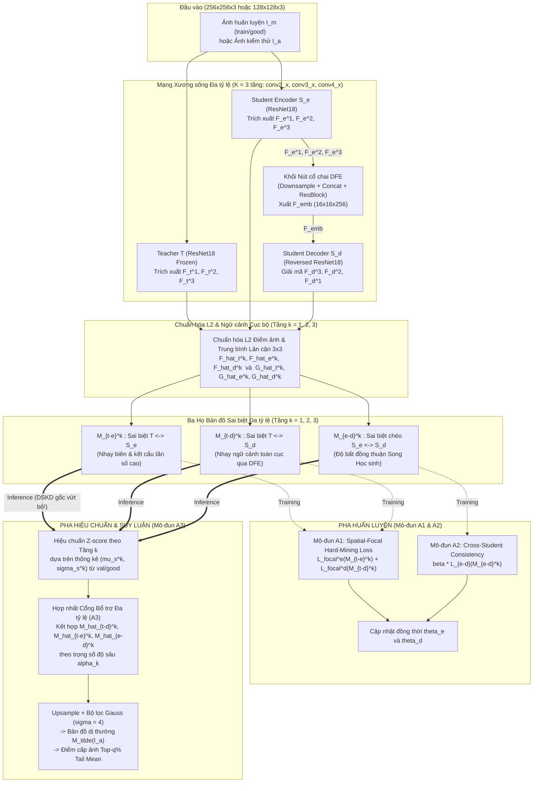

# Đề xuất Phương pháp Cải tiến A: Chưng cất Cộng tác Trọng tâm Không gian và Hợp nhất Bản đồ Dị thường Đa tỷ lệ Hiệu chuẩn Kép (FC-DSKD)

- **Tác giả thực hiện:** Agent 3 (Method Designer A — CS331 Research Team)
- **Ngày cập nhật:** `2026-11-14`
- **Bài báo Baseline gốc:** *Dual-Student Knowledge Distillation Networks for Unsupervised Anomaly Detection* (DSKD) — Liyi Yao, Shaobing Gao (`arXiv:2402.00448v1`, 01/02/2024)
- **Phạm vi của Phương pháp A (Scope Separation):** Tập trung hoàn toàn vào **Hàm mục tiêu Chưng cất Cộng tác Song Học sinh (Dual-Student Collaborative Distillation Objective)**, **Hợp nhất Bản đồ Dị thường Đa tỷ lệ có Hiệu chuẩn ($M_{t-e}^k \oplus M_{t-d}^k \oplus M_{e-d}^k$)** và **Độ chính xác Định vị Điểm ảnh (Pixel-level Localization Fidelity)**. Phương pháp A giữ nguyên cấu trúc mạng xương sống ($T, S_e, S_d, \text{DFE}$) và thêm **0 tham số học được (`0.00M` learnable parameters)**, đảm bảo tính trực giao 100% với **Phương pháp B (Agent 4)** vốn tập trung vào nén kiến trúc mạng học sinh và giảm tham số/FLOPs của khối `DFE`.

---

## 1. Phân tích Điểm nghẽn của DSKD mà Phương pháp A giải quyết

Dựa trên phân tích trực tiếp bài báo gốc DSKD (`arXiv:2402.00448v1`), mặc dù kiến trúc ba thành phần gồm Teacher $T$ (ResNet18 đóng băng trọng số $\theta_t$), Student Encoder $S_e$ ($\theta_e$), khối nút cổ chai Deep Feature Embedding ($\text{DFE}$) và Student Decoder đảo ngược $S_d$ ($\theta_d$) đạt kết quả trung bình tốt trên MVTec AD (Image AUROC `98.5%`, Pixel AUROC `97.6%`, PRO `93.5%` `[FACT - Paper, Table 1 & Table 2, p. 8]`), mô hình tồn tại **4 điểm nghẽn toán học và thực nghiệm cốt lõi** làm suy giảm nghiêm trọng chất lượng định vị dị thường (Anomaly Localization — AL):

### 1.1. Điểm nghẽn 1: Sự bất đối xứng giữa Huấn luyện và Suy luận — Loại bỏ hoàn toàn bản đồ dị thường $M_{t-e}^k$ của Student Encoder $S_e$
- **Bằng chứng từ bài báo gốc (`[FACT - Paper, Eq. 6–8, Algo 1–2, p. 4, 6–7]`):**
  - Trong pha huấn luyện (`Algorithm 1, dòng 10–15` và `Eq. 6–7, trang 6`), DSKD tính toán đồng thời hai họ bản đồ sai biệt đa tỷ lệ tại $K=3$ tầng trung gian (`conv2_x`, `conv3_x`, `conv4_x` của ResNet18, ứng với $k \in \{1, 2, 3\}$):
    $$M_{t-e}^k(I_m)_{ij} = \lambda \ell_2^{t-e}(I_m)_{ij} + \ell_{cos}^{t-e}(I_m)_{ij}, \quad M_{t-d}^k(I_m)_{ij} = \lambda \ell_2^{t-d}(I_m)_{ij} + \ell_{cos}^{t-d}(I_m)_{ij}$$
    và tối ưu hóa độc lập hai hàm mất mát $\ell_e(I_m) = \text{mean}(M_{t-e})$ và $\ell_d(I_m) = \text{mean}(M_{t-d})$.
  - Tuy nhiên, trong pha suy luận (`Algorithm 2, dòng 9–12` và `Eq. 8, trang 7`), DSKD **vứt bỏ hoàn toàn $M_{t-e}^k(I^a)$** và chỉ sử dụng duy nhất sai biệt giữa $T$ và $S_d$:
    $$M(I_m) = \sum_{k=1}^K \text{Upsample}\left(M_{t-d}^k(I_m)\right)$$
- **Hệ quả vật lý và thực nghiệm (`[FACT - Paper]` & `[INFERENCE]`):**
  1. **Quầng dương tính giả (False-Positive Halos) quanh lỗi nhỏ:** Vì $S_d$ chỉ nhận đầu vào là tensor nhúng nút cổ chai $F_{emb}$ ở độ phân giải không gian thấp ($16 \times 16$ đối với ảnh $256 \times 256$ sau 2 lần tích chập giảm mẫu bước nhảy 2 trong khối `DFE` `[FACT - Paper, Sec. 3.2, Fig. 4, p. 5–6]`) rồi mới khôi phục độ phân giải qua các phép upsampling trong mạng giải mã đảo ngược, sai lệch biểu diễn tại một khuyết tật nhỏ bị lan truyền (spatial bleeding) sang các điểm ảnh bình thường lân cận. Bài báo gốc thừa nhận trực tiếp hạn chế này tại `Sec. 4.2.1 (trang 8)`: *"However, the limitation is that our method identifies surrounding anomaly-free pixels as anomalies, especially for the toothbrush, tile and wood"*, tại `Sec. 4.2.2 (trang 8)`: *"some neighbor defect-free pixels are sometimes classified as anomalies, e.g. the carrot and bagel"*, và trong `Sec. 5 Conclusion (trang 11)`: *"if the target region is small, the neighbor pixels are likely to be recognized as anomalies as well."*
  2. **Lãng phí đặc trưng biên tần số cao của $S_e$:** Ngược lại với $S_d$, nhánh mã hóa $S_e$ xử lý trực tiếp ảnh đầu vào qua các tầng $k=1$ ($64 \times 64$) và $k=2$ ($32 \times 32$) trước khi bị nén qua nút cổ chai `DFE`. Trong thí nghiệm Ablation tại `Table 7 (trang 10)`, bản thân nhánh `T-E` đạt `96.1%` Pixel AUROC và nhánh sai biệt chéo `E-D` đạt `94.6%` Pixel AUROC `[FACT - Paper, Table 7, p. 10]`, chứng tỏ $M_{t-e}^k$ và sai biệt giữa hai học sinh chứa thông tin định vị biên sắc nét có tính bổ trợ trực tiếp cho $M_{t-d}^k$.

### 1.2. Điểm nghẽn 2: Sự suy biến tuyến tính của hàm khoảng cách và Trung bình đều không gian trong Hàm mất mát (`Eq. 3–7`)
- **Sự suy biến (Redundancy) giữa $\ell_2$ và $\ell_{cos}$ (`[FACT - Paper, Eq. 3–6, p. 5–6]` & `[INFERENCE]`):**
  Tại `Eq. (3)`, các vector đặc trưng tại mỗi vị trí không gian $(i,j)$ của tầng $k$ là $F_t^k(I_m)_{ij}, F_e^k(I_m)_{ij}, F_d^k(I_m)_{ij} \in \mathbb{R}^{c_k}$ được chuẩn hóa $\ell_2$ về vector đơn vị $\hat{F}_t^k, \hat{F}_e^k, \hat{F}_d^k$ với $\|\hat{F}\|_{\ell_2} = 1$ *(lưu ý: công thức in tại Eq. 3 trang 5 ghi mẫu số $\|\cdot\|_{\ell_2}^2$ do lỗi chế bản, nhưng văn bản trang 5 và Algorithm 1–2 xác nhận đây là phép chuẩn hóa $\ell_2$ đơn vị `l2_normalization`)*. Khi $\|\hat{F}_t^k\|_{\ell_2} = \|\hat{F}_s^k\|_{\ell_2} = 1$ ($s \in \{e, d\}$), khoảng cách Euclid bình phương tại `Eq. (4)` thỏa mãn đẳng thức giải tích:
  $$\ell_2^{t-s}(I_m)_{ij} = \frac{1}{2}\left\|\hat{F}_t^k(I_m)_{ij} - \hat{F}_s^k(I_m)_{ij}\right\|_{\ell_2}^2 = \frac{1}{2}\left(1 + 1 - 2(\hat{F}_t^k(I_m)_{ij})^T \hat{F}_s^k(I_m)_{ij}\right) = 1 - (\hat{F}_t^k(I_m)_{ij})^T \hat{F}_s^k(I_m)_{ij} = \ell_{cos}^{t-s}(I_m)_{ij}$$
  Do đó, tổ hợp tuyến tính tại `Eq. (6)` thực chất rút gọn thành:
  $$M_{t-s}^k(I_m)_{ij} = (1 + \lambda)\,\ell_{cos}^{t-s}(I_m)_{ij} = 1.1\,\ell_{cos}^{t-s}(I_m)_{ij} \quad (\text{với } \lambda = 0.1 \text{ theo Sec. 4.1.2, p. 7})$$
  Như vậy, DSKD hoàn toàn **không có bất kỳ ràng buộc cấu trúc cục bộ (local structural/contextual constraint) hay chuẩn hóa độ lớn kích hoạt (activation norm awareness)** nào ngoài góc cosine tại từng điểm ảnh đơn lẻ $(i,j)$.
- **Sự thống trị của điểm ảnh nền dễ (Easy Background Dominance) trong `Eq. (7)` (`[FACT - Paper, Eq. 7, Sec. 4.2.2, p. 6, 8]`):**
  Hàm mất mát huấn luyện tại `Eq. (7)` lấy trung bình cộng đồng đều trên toàn bộ $h_k \times w_k$ điểm ảnh:
  $$\ell_e(I_m) = \frac{1}{K}\sum_{k=1}^K \left[\frac{1}{h_k w_k}\sum_{i=1}^{h_k}\sum_{j=1}^{w_k} M_{t-e}^k(I_m)_{ij}\right], \quad \ell_d(I_m) = \frac{1}{K}\sum_{k=1}^K \left[\frac{1}{h_k w_k}\sum_{i=1}^{h_k}\sum_{j=1}^{w_k} M_{t-d}^k(I_m)_{ij}\right]$$
  Chính tác giả thừa nhận tại `Sec. 4.2.2 (trang 8)` rằng nền ảnh đồng nhất (*"monolithic background"*) chiếm tỷ lệ diện tích rất lớn và cực kỳ dễ học. Việc lấy trung bình đều khiến đạo hàm theo $\theta_e, \theta_d$ bị áp đảo bởi hàng nghìn điểm ảnh nền dễ ($M^k_{ij} \to 0$), làm cho các vùng cấu trúc bình thường phức tạp (như chân linh kiện `transistor`, răng ốc `screw`/`metal_nut`, vân `wood`/`tile`) bị học dưới mức (under-distilled). Hệ quả là trên tập MVTec AD (`Table 2, trang 8`), chỉ số PRO của `transistor` chỉ đạt `80.2%`, `tile` chỉ đạt `88.2%`, `metal_nut` đạt `89.5%` `[FACT - Paper, Table 2, p. 8]`.

### 1.3. Điểm nghẽn 3: Mù vùng lõi bên trong các khuyết tật diện tích lớn (Insensitivity to Inner Regions of Large Defects)
- **Bằng chứng từ bài báo gốc (`[FACT - Paper, Sec. 4.2.3, Table 5, Fig. 7, Sec. 5, p. 8–11]`):**
  - Trên tập dữ liệu **MT Defects** (Magnetic Tile Defects), dù Image-level AUROC đạt `96.2%`, **Pixel-level AUROC của DSKD tụt xuống chỉ còn `83.3%` và PRO chỉ đạt `70.3%`** (thấp hơn `14.7%` Pixel AUROC so với DSN `98.0%`) `[FACT - Paper, Table 5, p. 8, 10]`.
  - Nguyên nhân được tác giả chỉ rõ tại `Sec. 4.2.3 (trang 9)`: *"Our model is sensitive to the edge of an anomaly region, whereas inside this area, the data distribution is uniform, which is more like an anomaly-free region. Therefore, many pixels cannot be correctly classified, and DSKD gets low accuracy in anomaly localization."* Tương tự, trên mẫu `cookie` của MVTec 3D-AD (`Sec. 4.2.2, trang 8`), vùng khuyết tật trung tâm bị bỏ sót hoàn toàn (*"in the cookie sample, the central anomaly is ignored"*), và `Sec. 5 Conclusion (trang 11)` kết luận: *"However, DSKD is not sensitive to the inner area of anomalies, especially for large-area defects."*
- **Cơ chế gây lỗi (`[INFERENCE]`):**
  Vì $\ell_e$ và $\ell_d$ chỉ ép từng vector điểm ảnh $(i,j)$ khớp hướng cosine độc lập và không có sự ràng buộc cộng tác hai chiều giữa $S_e$ và $S_d$ cũng như ngữ cảnh lân cận đa tỷ lệ, khi gặp một mảng lỗi lớn có bề mặt bên trong phẳng hoặc đồng nhất cục bộ, các bộ lọc tích chập $3 \times 3$ tại tâm vùng lỗi tạo ra vector đặc trưng có hướng tương tự vùng nền phẳng bình thường, làm cả $M_{t-d}^k$ ở tâm vùng lỗi bị sụt giảm về gần $0$ (tạo hiệu ứng "rỗng ruột" — hollow anomaly mask).

### 1.4. Điểm nghẽn 4: Cộng gộp Đa tỷ lệ Không hiệu chuẩn (`Eq. 8`) và Quy tắc Điểm ảnh Cực đại Đơn lẻ (`Eq. 10`)
- **Cộng gộp không chuẩn hóa phân phối giữa các tầng (`[FACT - Paper, Eq. 8, Table 9, p. 7, 11]`):**
  `Eq. (8)` cộng trực tiếp $M_{t-d}^1 + M_{t-d}^2 + M_{t-d}^3$ sau khi nội suy lên kích thước ảnh gốc mà không hiệu chuẩn theo trung bình và phương sai sai biệt nền của từng tầng. Trong khi đó, tầng nông $k=1$ ($64 \times 64$, $c_1 = 64$) nhạy với nhiễu kết cấu tần số cao nên có mức sai biệt nền trung bình và độ lệch chuẩn lớn hơn hẳn tầng sâu $k=3$ ($16 \times 16$, $c_3 = 256$). Việc cộng thô làm tầng nông lấn át tỷ lệ tín hiệu trên nhiễu (SNR) của tầng sâu hoặc ngược lại tùy loại vật liệu (`Table 9, trang 11` cho thấy mỗi tầng $M_1, M_2, M_3$ có độ nhạy khác nhau rõ rệt).
- **Quy tắc `score = max` nhạy cảm với nhiễu điểm ảnh đơn lẻ (`[FACT - Paper, Eq. 10, Table 1, Table 3, p. 7–8]`):**
  `Eq. (10)` định nghĩa điểm dị thường cấp ảnh chỉ bằng một điểm ảnh cực đại duy nhất $score = \max(\widetilde{M}(I_m))$. Chỉ cần một điểm ảnh bình thường ở rìa vật thể hoặc phản xạ ánh sáng tạo ra đỉnh nhiễu cục bộ, toàn bộ ảnh bình thường sẽ bị phân loại nhầm thành dị thường, làm giảm Image AUROC trên các lớp khó như `capsule` (`93.1%`), `pill` (`96.2%`), `cookie` (`65.4%`), `potato` (`65.5%`) `[FACT - Paper, Table 1 & Table 3, p. 8]`.

---

## 2. Đề xuất 3 Ý tưởng Ứng viên (Candidate Ideas A-I, A-II, A-III)

Để giải quyết triệt để 4 điểm nghẽn trên trong phạm vi của **Phương pháp A** (không can thiệp vào việc nén tham số backbone/DFE của Phương pháp B), chúng tôi thiết kế và phân tích 3 ý tưởng ứng viên từ mức chỉ can thiệp suy luận/hiệu chuẩn (A-I), chỉ can thiệp hàm mục tiêu huấn luyện (A-II), đến kiến trúc kết hợp toàn diện Huấn luyện Cộng tác – Suy luận Hiệu chuẩn Kép (A-III).

---

### 2.1. Ứng viên A-I: *Dual-Student Complementary Discrepancy Calibration & Gated Fusion (DS-CGF)*
*(Hiệu chuẩn Sai biệt Bổ trợ Song Học sinh và Hợp nhất Cổng Đa tỷ lệ trong Pha Suy luận)*

1. **Ý tưởng cốt lõi:**
   Giữ nguyên quy trình huấn luyện của DSKD (`Algorithm 1`), nhưng thiết kế lại toàn bộ pha suy luận (`Algorithm 2, Eq. 8–10`) để khai thác trọn vẹn **cả 3 nguồn thông tin sai biệt** sẵn có trong mạng Dual-Student tại mỗi tầng $k \in \{1, 2, 3\}$:
   - Sai biệt Teacher – Encoder $M_{t-e}^k$: nhạy với biên sắc nét và kết cấu tần số cao (chưa qua nén nút cổ chai `DFE`).
   - Sai biệt Teacher – Decoder $M_{t-d}^k$: nhạy với ngữ cảnh toàn cục sau khi tái tạo từ nút cổ chai `DFE`.
   - Sai biệt chéo Encoder – Decoder $M_{e-d}^k$: đo độ bất đồng thuận trực tiếp giữa hai học sinh có cấu trúc đảo ngược ($\hat{F}_e^k$ và $\hat{F}_d^k$) khi gặp dữ liệu ngoài phân phối (OOD).
2. **Cơ chế kỹ thuật:**
   - **Bước 1 (Thống kê hiệu chuẩn Z-score trên tập `val/good`):** Sau khi huấn luyện, duyệt qua tập ảnh bình thường `val/good` để ước lượng trung bình không gian $\mu_s^k$ và độ lệch chuẩn $\sigma_s^k$ cho từng nguồn sai biệt $s \in \{t\text{-}e, t\text{-}d, e\text{-}d\}$ và từng tầng $k \in \{1, 2, 3\}$. Chuẩn hóa bản đồ sai biệt về thang đo xác suất đồng nhất:
     $$\widehat{M}_s^k(I)_{ij} = \max\left(0, \frac{M_s^k(I)_{ij} - \mu_s^k}{\sigma_s^k + \epsilon}\right)$$
   - **Bước 2 (Hợp nhất cổng bổ trợ — Complementary Gated Fusion):** Để vừa triệt tiêu quầng dương tính giả quanh lỗi nhỏ của $M_{t-d}^k$, vừa lấp đầy vùng lõi của lỗi lớn, kết hợp $\widehat{M}_{t-d}^k$ và $\widehat{M}_{t-e}^k$ qua cơ chế cổng đồng thuận nhân tính kết hợp cộng tính đa tỷ lệ:
     $$M_{\text{fuse}}^k(I)_{ij} = \alpha_k \widehat{M}_{t-d}^k(I)_{ij} + (1 - \alpha_k)\widehat{M}_{t-e}^k(I)_{ij} + \eta \sqrt{\widehat{M}_{t-d}^k(I)_{ij} \cdot \widehat{M}_{t-e}^k(I)_{ij}} + \zeta \widehat{M}_{e-d}^k(I)_{ij}$$
     trong đó trọng số tỷ lệ $\alpha_k$ tăng dần theo chiều sâu tầng ($k=1$ ưu tiên $M_{t-e}^1$ để giữ biên sắc nét $64 \times 64$; $k=3$ ưu tiên $M_{t-d}^3$ để giữ ngữ cảnh vùng lõi $16 \times 16$).
   - **Bước 3 (Chấm điểm cấp ảnh Top-$q\%$ Tail Value-at-Risk):** Thay thế $\max(\widetilde{M})$ ở `Eq. (10)` bằng trung bình của top-$q\%$ điểm ảnh có giá trị cao nhất để chống nhiễu điểm ảnh đơn lẻ.
3. **Ưu điểm:**
   - Không cần huấn luyện lại mô hình nếu đã có checkpoint DSKD (`0` chi phí thời gian huấn luyện thêm); hoàn toàn không thêm tham số (`0.00M`).
   - Giải quyết trực tiếp Điểm nghẽn 1 (vứt bỏ $M_{t-e}^k$) và Điểm nghẽn 4 (cộng gộp không hiệu chuẩn & `max` scoring).
4. **Nhược điểm / Giới hạn:**
   - **Không giải quyết được Điểm nghẽn 2 và gốc rễ của Điểm nghẽn 3 trong quá trình học biểu diễn:** Vì trọng số $\theta_e, \theta_d$ vẫn được huấn luyện bằng hàm mất mát trung bình đều `Eq. (7)`, bản thân $S_e$ và $S_d$ vẫn bị học dưới mức (under-fitted) tại các vùng cấu trúc phức tạp của ảnh bình thường và vẫn có xu hướng khớp giả tạo với $T$ ở bên trong các mảng lỗi lớn đồng nhất.

---

### 2.2. Ứng viên A-II: *Spatial-Focal Hard-Mining Dual-Student Distillation & Bidirectional Consistency (SF-BDSC)*
*(Chưng cất Trọng tâm Khai phá Điểm ảnh Khó và Nhất quán Hai chiều Giữa Hai Học sinh trong Pha Huấn luyện)*

1. **Ý tưởng cốt lõi:**
   Giữ nguyên công thức suy luận của DSKD (`Eq. 8–10`), nhưng cải tiến toàn diện hàm mục tiêu huấn luyện (`Eq. 4–7` trong `Algorithm 1`) nhằm buộc hai học sinh $S_e$ và $S_d$: (i) tập trung dung lượng học vào các vùng cấu trúc khó trên ảnh bình thường thay vì bị chi phối bởi nền đồng nhất; (ii) học mối tương quan ngữ cảnh vùng lân cận (patch structural affinity) thay vì chỉ khớp từng điểm ảnh rời rạc; và (iii) ràng buộc tính nhất quán hai chiều trực tiếp giữa $S_e \leftrightarrow S_d$.
2. **Cơ chế kỹ thuật:**
   - **Thành phần 1 (Spatial-Focal Hard-Normal Mining Loss):** Thay trung bình đều $\frac{1}{h_k w_k}\sum_{i,j} M^k_{ij}$ trong `Eq. (7)` bằng trọng số tiêu cự không gian tự thích nghi (Spatial Focal Weighting) trên từng bản đồ sai biệt:
     $$w_{s}^k(I_m)_{ij} = \frac{\left(\text{sg}\left[M_{t-s}^k(I_m)_{ij}\right] + \epsilon\right)^\gamma}{\frac{1}{h_k w_k}\sum_{u=1}^{h_k}\sum_{v=1}^{w_k}\left(\text{sg}\left[M_{t-s}^k(I_m)_{uv}\right] + \epsilon\right)^\gamma}, \quad s \in \{e, d\}$$
     trong đó $\text{sg}[\cdot]$ là toán tử `stop_gradient` và $\gamma \ge 1$ là hệ số tập trung (focal exponent). Các điểm ảnh nền dễ ($M_{t-s}^k \ll \text{mean}$) nhận trọng số $w \to 0$, trong khi các điểm ảnh biên/cấu trúc khó nhận trọng số $w > 1$.
   - **Thành phần 2 (Contextual Patch Structural Distillation):** Bổ sung vào `Eq. (6)` sai biệt trên đặc trưng trung bình vùng lân cận đa kích thước $\mathcal{N}_r(i,j)$ (với bộ lọc trung bình $r \times r$, ví dụ $r=3$), giúp biểu diễn tại tâm vùng khuyết tật lớn vẫn phụ thuộc vào ngữ cảnh xung quanh và phá vỡ hiện tượng "mù vùng lõi".
   - **Thành phần 3 (Bidirectional Student Discrepancy Regularization $\ell_{e-d}$):** Bổ sung hàm mất mát đồng thuận trực tiếp giữa hai học sinh $\ell_{e-d}(I_m)$ trên dữ liệu bình thường: ép $\hat{F}_d^k(I_m)_{ij}$ không chỉ khớp với $\hat{F}_t^k(I_m)_{ij}$ mà còn phải nhất quán với $\hat{F}_e^k(I_m)_{ij}$ trên phân phối bình thường, giúp thu hẹp phương sai nội lớp bình thường của cặp $(S_e, S_d)$.
3. **Ưu điểm:**
   - Giải quyết tận gốc Điểm nghẽn 2 (thống trị bởi nền dễ, suy biến $\ell_2/\ell_{cos}$) và cải thiện chất lượng biểu diễn của cả $\theta_e$ và $\theta_d$ mà không làm tăng bất kỳ chi phí tính toán nào khi suy luận.
4. **Nhược điểm / Giới hạn:**
   - **Bỏ phí thông tin của $S_e$ khi suy luận:** Dù $S_e$ được huấn luyện tốt hơn rất nhiều nhờ Spatial-Focal Loss và Contextual Distillation, việc giữ nguyên `Eq. (8)` khiến toàn bộ bản đồ $M_{t-e}^k$ và $M_{e-d}^k$ vẫn bị vứt bỏ lúc kiểm thử (Điểm nghẽn 1 và Điểm nghẽn 4 chưa được giải quyết trọn vẹn).

---

### 2.3. Ứng viên A-III: *Focal Collaborative Dual-Student Distillation with Calibrated Complementary Anomaly Map Fusion (FC-DSKD)*
*(Chưng cất Cộng tác Trọng tâm Không gian tích hợp Hợp nhất Bản đồ Dị thường Bổ trợ Hiệu chuẩn Kép)*

1. **Ý tưởng cốt lõi:**
   Tích hợp đồng bộ và hữu cơ cả hai chiều cải tiến — **Tối ưu hóa Biểu diễn lúc Huấn luyện (Training-time Collaborative & Spatial-Focal Distillation)** và **Hợp nhất Hiệu chuẩn Đa tỷ lệ lúc Suy luận (Inference-time Calibrated Dual-Student Fusion)** — thành một khung phương pháp thống nhất gồm 3 mô-đun liên kết chặt chẽ (**A1, A2, A3**):
   - **Mô-đun A1 (*Spatial-Focal & Contextual Patch Distillation*):** Khắc phục sự suy biến của `Eq. (4)–(6)` và sự thống trị của nền phẳng trong `Eq. (7)` bằng cách kết hợp sai biệt cosine điểm ảnh với sai biệt ngữ cảnh vùng lân cận $3 \times 3$ (Contextual Patch Cosine Distance) và đánh trọng số tiêu cự không gian (Spatial-Focal Hard-Normal Mining) để ép $S_e, S_d$ học chính xác các cấu trúc bình thường phức tạp đồng thời mở rộng vùng cảm thụ cho tâm các khuyết tật lớn.
   - **Mô-đun A2 (*Cross-Student Bidirectional Collaborative Consistency*):** Khắc phục việc huấn luyện tách rời $\ell_e$ và $\ell_d$ trong `Algorithm 1` bằng cách bổ sung ràng buộc đồng thuận hai chiều $\ell_{e-d}$ giữa $\hat{F}_e^k$ và $\hat{F}_d^k$ trên ảnh bình thường, biến hai học sinh có cấu trúc đảo ngược thành một hệ đồng chưng cất (co-distillation) thực thụ: đồng thuận chặt trên dữ liệu chuẩn (`train/good`) nhưng phân kỳ mạnh theo hai hướng cấu trúc ngược nhau trên dữ liệu lỗi.
   - **Mô-đun A3 (*Normal-Calibrated Dual-Student Complementary Fusion & Top-$q\%$ Scoring*):** Khắc phục sự lãng phí $M_{t-e}^k$ trong `Eq. (8)` và sự nhạy nhiễu của `Eq. (10)` bằng cách chuẩn hóa Z-score từng tầng dựa trên thống kê của tập `val/good` (Zero Test-Set Leakage), hợp nhất có trọng số độ sâu và cổng đồng thuận hình học giữa $M_{t-e}^k$ (sắc nét biên, chống halo), $M_{t-d}^k$ (nhạy ngữ cảnh toàn cục vùng lõi) và $M_{e-d}^k$ (độ bất đồng thuận nội tại giữa hai học sinh), kết hợp bộ tích hợp điểm dị thường cấp ảnh theo bách phân vị đuôi (Top-$q\%$ Tail Mean).
2. **Ưu điểm vượt trội:**
   - **Tác động cộng hưởng (Synergistic Effect):** Mô-đun A1 và A2 giúp $S_e$ giảm mạnh nhiễu dương tính giả trên các kết cấu nền phức tạp và giúp $S_d$ nhạy hơn với ngữ cảnh vùng lõi; nhờ đó, khi Mô-đun A3 đưa $M_{t-e}^k$ và $M_{e-d}^k$ vào hợp nhất với $M_{t-d}^k$ lúc suy luận, bản đồ $M_{t-e}^k$ đã sạch nhiễu nền và phát huy tối đa khả năng định vị biên sắc nét.
   - **Độ phức tạp tham số bằng 0 (`0.00M` extra parameters):** Toàn bộ A1, A2, A3 đều là các phép toán tensor giải tích trên các bản đồ đặc trưng sẵn có của DSKD (ngoài ra chỉ lưu đúng $3 \times 3 \times 2 = 18$ hằng số thống kê vô hướng $\mu_s^k, \sigma_s^k$ từ tập `val/good`).
   - **Thiết kế Ablation hoàn hảo:** Ba mô-đun A1, A2, A3 tách biệt hoàn toàn về mặt module code, cho phép bật/tắt độc lập từng thành phần trong bảng Ablation Study.

---

## 3. So sánh 3 Ứng viên & Lựa chọn Phương pháp A Tốt nhất

### 3.1. Bảng chấm điểm theo 5 tiêu chí đánh giá của dự án

Chúng tôi đánh giá định lượng 3 ứng viên trên thang điểm 10 cho từng tiêu chí và tính điểm tổng hợp theo trọng số chuẩn của đề tài:
1. **Cơ sở khoa học vững chắc (25%):** Xuất phát trực tiếp từ hạn chế toán học/thực nghiệm của DSKD (`arXiv:2402.00448v1`).
2. **Tiềm năng cải thiện rõ rệt so với baseline DSKD (20%):** Khả năng nâng cao đồng thời Image AUROC, Pixel AUROC và đặc biệt là PRO trên cả MVTec AD và MT Defects.
3. **Đóng góp riêng biệt, không trùng lặp Phương pháp B (20%):** Trực giao 100% với hướng nén kiến trúc mạng học sinh & `DFE` của Agent 4.
4. **Khả thi trong 3–4 tuần (20%):** Chi phí lập trình, bộ nhớ VRAM và thời gian huấn luyện trên GPU Kaggle (T4 16GB / P100 16GB).
5. **Khả năng kiểm chứng thực nghiệm rõ ràng (15%):** Có giả thuyết nhân quả và thiết kế Ablation tách biệt rõ ràng.

| Tiêu chí đánh giá | Trọng số | **Candidate A-I** (*DS-CGF: Chỉ Hợp nhất & Hiệu chuẩn Suy luận*) | **Candidate A-II** (*SF-BDSC: Chỉ Hàm mất mát Trọng tâm & Đồng thuận*) | **Candidate A-III** (*FC-DSKD: Kết hợp Chưng cất Cộng tác Trọng tâm & Hợp nhất Hiệu chuẩn Kép*) |
| :--- | :---: | :---: | :---: | :---: |
| **1. Cơ sở khoa học vững chắc** | **25%** | **8.5 / 10**<br>Giải quyết tốt việc bỏ phí $M_{t-e}^k$ (`Eq. 8`), nhưng chưa xử lý hạn chế của hàm mất mát `Eq. 4–7`. | **8.8 / 10**<br>Giải quyết tốt bài toán easy-background dominance (`Eq. 7`), nhưng vẫn bỏ phí $M_{t-e}^k$ lúc suy luận. | **9.6 / 10**<br>Giải quyết trọn vẹn cả 4 điểm nghẽn toán học từ `Eq. 4–7` (huấn luyện) đến `Eq. 8–10` (suy luận). |
| **2. Tiềm năng cải thiện so với DSKD** | **20%** | **8.0 / 10**<br>Tăng PRO nhờ giữ biên từ $M_{t-e}^k$, nhưng bị giới hạn bởi chất lượng trọng số $\theta_e, \theta_d$ gốc. | **8.4 / 10**<br>Cải thiện biểu diễn $\theta_d$, nhưng thiếu biên độ phân giải cao của $M_{t-e}^k$ khi xuất bản đồ dị thường. | **9.5 / 10**<br>Tác động cộng hưởng: $\theta_e, \theta_d$ học biên chuẩn hơn + hợp nhất đa tỷ lệ xóa cả lỗi halo lẫn lỗi rỗng ruột. |
| **3. Đóng góp riêng biệt (Trực giao Method B)** | **20%** | **9.5 / 10**<br>Hoàn toàn không đụng tới kiến trúc backbone hay khối `DFE`. | **9.5 / 10**<br>Chỉ thay đổi hàm loss trong lúc huấn luyện, giữ nguyên kiến trúc. | **9.8 / 10**<br>Trực giao 100% với Method B; có thể ghép trực tiếp lên cả backbone gốc lẫn backbone nén của Method B. |
| **4. Tính khả thi trong 3–4 tuần** | **20%** | **9.5 / 10**<br>Cực nhanh (~150 dòng code Python/PyTorch), chạy tức thì. | **9.0 / 10**<br>~200 dòng code, thời gian train tăng < 5% so với DSKD gốc. | **9.2 / 10**<br>~300 dòng code, 0 tham số mới, thời gian train tăng < 6%, chạy mượt trên 1 GPU T4/P100. |
| **5. Khả năng kiểm chứng thực nghiệm** | **15%** | **8.2 / 10**<br>Chỉ kiểm chứng được pha hậu xử lý/hợp nhất. | **8.5 / 10**<br>Chỉ kiểm chứng được pha tối ưu hóa hàm loss. | **9.7 / 10**<br>Kiểm chứng đầy đủ ma trận Ablation 3 thành phần (A1, A2, A3) độc lập và kết hợp. |
| **ĐIỂM TỔNG HỢP (Thang 10)** | **100%** | **8.76 / 10** | **8.84 / 10** | **9.55 / 10** |

### 3.2. Quyết định Lựa chọn Phương pháp A

> **Quyết định:** Chọn **Ứng viên A-III — *Focal Collaborative Dual-Student Distillation with Calibrated Complementary Anomaly Map Fusion (FC-DSKD)*** làm **Phương pháp Cải tiến A chính thức** của nhóm nghiên cứu.

**Lý do lựa chọn cốt lõi:**
1. **Tính bao hàm và mô-đun hóa (Modularity):** Ứng viên A-III bao hàm tự nhiên cả A-II (làm Mô-đun huấn luyện A1 + A2) và A-I (làm Mô-đun suy luận A3). Nhờ đó, ngay cả khi chỉ bật A3 trên checkpoint DSKD gốc (chế độ *Training-Free Plug-in*), nhóm đã có ngay kết quả cải thiện của A-I; và khi huấn luyện đầy đủ với A1 + A2 + A3, nhóm đạt được hiệu quả cộng hưởng tối đa.
2. **Giải quyết trực diện lời kêu gọi nghiên cứu tiếp theo của chính tác giả DSKD (`[FACT - Paper, Sec. 5, p. 11]`):** Trong phần Kết luận trang 11, Yao & Gao viết rõ: *"However, DSKD is not sensitive to the inner area of anomalies, especially for large-area defects. On the other hand, if the target region is small, the neighbor pixels are likely to be recognized as anomalies as well. To mitigate these problems, feature representation methods with higher robustness are supposed to be explored. And we may improve DSKD by optimizing objective functions..."* Phương pháp A-III trả lời trực tiếp vấn đề này bằng cả tối ưu hóa hàm mục tiêu (A1, A2) lẫn hợp nhất biểu diễn đa tỷ lệ của hai học sinh (A3).
3. **Tính tương thích hoàn hảo khi kết hợp với Phương pháp B (Method A + Method B):** Vì FC-DSKD chỉ tác động lên các tensor đặc trưng đầu ra $\hat{F}_t^k, \hat{F}_e^k, \hat{F}_d^k \in \mathbb{R}^{w_k \times h_k \times c_k}$ tại 3 tầng pyramid ($k=1,2,3$), nó hoàn toàn độc lập với cấu trúc nội tại của $S_e, S_d$ và `DFE`. Khi kết hợp với kiến trúc học sinh gọn nhẹ của Agent 4 (Phương pháp B), FC-DSKD còn đóng vai trò bộ điều chuẩn chưng cất (distillation regularizer) giúp mạng học sinh nén giữ vững độ chính xác định vị.

---

## 4. Đặc tả Kỹ thuật Chi tiết của Phương pháp A được chọn (FC-DSKD)

### 4.1. Giả thuyết Khoa học có thể Kiểm chứng (`[HYPOTHESIS]`)

Chúng tôi phát biểu 3 giả thuyết khoa học cụ thể, có thể kiểm định và bác bỏ (falsifiable) bằng thực nghiệm:

- **`[HYPOTHESIS H-A1]` (Về Mô-đun A1 — Spatial-Focal & Contextual Patch Distillation):**
  *Việc thay thế hàm mất mát trung bình đều điểm ảnh trong `Eq. (6)–(7)` của DSKD bằng sự kết hợp giữa khoảng cách cosine ngữ cảnh vùng lân cận (Contextual Patch Discrepancy) và trọng số tiêu cự không gian tự thích nghi (Spatial-Focal Weighting với $\gamma > 0$) sẽ làm giảm sai số tái tạo trên các vùng biên/kết cấu bình thường phức tạp và tăng sai biệt ở tâm các vùng lỗi lớn, từ đó cải thiện chỉ số PRO tối thiểu `+1.0%` trên các lớp có kết cấu phức tạp của MVTec AD (`tile`, `wood`, `transistor`, `metal_nut`) và tối thiểu `+3.0%` PRO trên tập MT Defects so với DSKD gốc.*
- **`[HYPOTHESIS H-A2]` (Về Mô-đun A2 — Cross-Student Bidirectional Consistency):**
  *Việc bổ sung ràng buộc đồng thuận trực tiếp $\ell_{e-d}$ giữa đặc trưng đã chuẩn hóa của Student Encoder $\hat{F}_e^k$ và Student Decoder $\hat{F}_d^k$ trong pha huấn luyện sẽ thu hẹp phương sai biểu diễn trên dữ liệu bình thường giữa hai mạng có cấu trúc đảo ngược, đồng thời làm cho bản đồ sai biệt chéo $M_{e-d}^k$ trở thành một chỉ báo dị thường đáng tin cậy (tăng Pixel AUROC của nhánh `E-D` từ mức `94.6%` trong `Table 7` lên `> 96.2%`).*
- **`[HYPOTHESIS H-A3]` (Về Mô-đun A3 — Normal-Calibrated Dual-Student Complementary Fusion):**
  *Việc chuẩn hóa Z-score theo tầng trên tập `val/good` và hợp nhất có cổng bổ trợ giữa $M_{t-e}^k$ (giàu chi tiết biên ở tầng nông $k=1,2$), $M_{t-d}^k$ (giàu ngữ cảnh toàn cục ở tầng sâu $k=2,3$) và $M_{e-d}^k$ sẽ đồng thời: (i) thu hẹp quầng dương tính giả (false-positive halo) quanh lỗi nhỏ so với chỉ dùng $M_{t-d}^k$ trong `Eq. (8)`, và (ii) lấp đầy vùng lõi bị khuyết bên trong các lỗi diện tích lớn, nâng cao cả Pixel AUROC, PRO và Image AUROC (nhờ bộ gom Top-$q\%$ thay cho $\max$ đơn lẻ).*

---

### 4.2. Kiến trúc & Sơ đồ Luồng Dữ liệu Tích hợp vào DSKD

Sơ đồ dưới đây mô tả luồng dữ liệu của **FC-DSKD** đặt cạnh kiến trúc DSKD gốc (`Fig. 3, trang 3` của bài báo), chỉ rõ vị trí can thiệp của **Mô-đun A1**, **Mô-đun A2** (trong pha Training) và **Mô-đun A3** (trong pha Calibration & Inference):



**Bảng kích thước Tensor tại các tầng trung gian (với ảnh đầu vào chuẩn $256 \times 256 \times 3$ trên MVTec AD):**

| Chỉ số tầng $k$ | Khối ResNet18 tương ứng | Kích thước không gian $(h_k \times w_k)$ | Số kênh $c_k$ | Kích thước $F_t^k, F_e^k, F_d^k$ | Kích thước Bản đồ Sai biệt $M_{t-e}^k, M_{t-d}^k, M_{e-d}^k$ | Đặc tính vật lý của tầng |
| :---: | :---: | :---: | :---: | :---: | :---: | :--- |
| $k = 1$ | `conv2_x` (`layer1`) | $64 \times 64$ | $64$ | $64 \times 64 \times 64$ | $64 \times 64 \times 1$ | Độ phân giải không gian cao nhất; nhạy với cạnh, vết xước mảnh, biên khuyết tật. |
| $k = 2$ | `conv3_x` (`layer2`) | $32 \times 32$ | $128$ | $32 \times 32 \times 128$ | $32 \times 32 \times 1$ | Độ phân giải trung gian; cân bằng giữa cấu trúc hình học cục bộ và kết cấu bề mặt. |
| $k = 3$ | `conv4_x` (`layer3`) | $16 \times 16$ | $256$ | $16 \times 16 \times 256$ | $16 \times 16 \times 1$ | Ngữ cảnh ngữ nghĩa mức cao (cùng độ phân giải với $F_{emb} \in \mathbb{R}^{16 \times 16 \times 256}$); nhạy với lỗi cấu trúc lớn. |

---

### 4.3. Hệ thống Phương trình Toán học Đầy đủ

Để đảm bảo tính nhất quán tuyệt đối với bài báo gốc DSKD (`arXiv:2402.00448v1`), chúng tôi giữ nguyên các ký hiệu: tập huấn luyện $\mathcal{I}^t = \{I_1^t, \dots, I_m^t\}$ (chỉ gồm ảnh bình thường), tập kiểm thử $\mathcal{I}^a$, ảnh thứ $m$ là $I_m \in \mathbb{R}^{w \times h \times c}$, các bản đồ đặc trưng tại tầng $k \in \{1, \dots, K\}$ ($K=3$) của Teacher $T$, Student Encoder $S_e$ và Student Decoder $S_d$ lần lượt là $F_t^k(I_m), F_e^k(I_m), F_d^k(I_m) \in \mathbb{R}^{w_k \times h_k \times c_k}$.

#### Bước 0: Chuẩn hóa $\ell_2$ Điểm ảnh và Biểu diễn Ngữ cảnh Cục bộ (Tiếp nối `Eq. 3` của DSKD)
Tại mỗi tọa độ không gian $(i,j) \in \{1, \dots, h_k\} \times \{1, \dots, w_k\}$ của tầng $k$, vector đặc trưng điểm ảnh được chuẩn hóa $\ell_2$ về siêu cầu đơn vị $\mathbb{S}^{c_k - 1}$ (chính xác hóa `Eq. (3)` của DSKD):
$$\hat{F}_z^k(I_m)_{ij} = \frac{F_z^k(I_m)_{ij}}{\left\|F_z^k(I_m)_{ij}\right\|_{\ell_2} + \epsilon}, \quad \forall z \in \{t, e, d\} \tag{Eq. A1}$$
với $\epsilon = 10^{-8}$ để đảm bảo ổn định số học.

Để khắc phục hiện tượng **mù vùng lõi bên trong khuyết tật lớn** (Điểm nghẽn 3) và **sự suy biến giữa $\ell_2$ và $\ell_{cos}$** (Điểm nghẽn 2), chúng tôi định nghĩa thêm vector đặc trưng ngữ cảnh lân cận $\hat{G}_z^k(I_m)_{ij} \in \mathbb{R}^{c_k}$ thông qua toán tử lấy trung bình trượt không gian (Average Pooling 2D với kích thước nhân $r \times r$, bước nhảy 1, đệm phản chiếu `reflection padding`, mặc định $r = 3$) trước khi chuẩn hóa $\ell_2$:
$$\bar{F}_z^k(I_m)_{ij} = \frac{1}{\left|\mathcal{N}_r(i,j)\right|} \sum_{(u,v) \in \mathcal{N}_r(i,j)} F_z^k(I_m)_{uv}, \qquad \hat{G}_z^k(I_m)_{ij} = \frac{\bar{F}_z^k(I_m)_{ij}}{\left\|\bar{F}_z^k(I_m)_{ij}\right\|_{\ell_2} + \epsilon}, \quad \forall z \in \{t, e, d\} \tag{Eq. A2}$$
trong đó $\mathcal{N}_r(i,j)$ là cửa sổ lân cận $r \times r$ tâm tại $(i,j)$. Phép toán `AvgPool2d(kernel_size=3, stride=1, padding=1)` hoàn toàn không có tham số học được và mở rộng trường cảm thụ hiệu dụng tại mỗi tầng thêm một vùng ngữ cảnh cục bộ.

#### Mô-đun A1: Bản đồ Sai biệt Điểm ảnh – Ngữ cảnh và Hàm mất mát Trọng tâm Không gian (Cải tiến `Eq. 4–7` của DSKD)
Với bất kỳ cặp mạng $(z_1, z_2) \in \{(t, e), (t, d), (e, d)\}$, sai biệt điểm ảnh (point-wise discrepancy) và sai biệt ngữ cảnh cục bộ (contextual patch discrepancy) tại vị trí $(i,j)$ của tầng $k$ được xác định bởi:
$$d_{\text{pt}}^{z_1 - z_2, k}(I_m)_{ij} = \frac{\lambda}{2}\left\|\hat{F}_{z_1}^k(I_m)_{ij} - \hat{F}_{z_2}^k(I_m)_{ij}\right\|_{\ell_2}^2 + \left(1 - \left(\hat{F}_{z_1}^k(I_m)_{ij}\right)^T \hat{F}_{z_2}^k(I_m)_{ij}\right) \tag{Eq. A3}$$
$$d_{\text{ctx}}^{z_1 - z_2, k}(I_m)_{ij} = 1 - \left(\hat{G}_{z_1}^k(I_m)_{ij}\right)^T \hat{G}_{z_2}^k(I_m)_{ij} \tag{Eq. A4}$$
trong đó $\lambda = 0.1$ được giữ nguyên theo đúng cấu hình gốc của DSKD (`Sec. 4.1.2, trang 7`) để đảm bảo tính tương thích ngược tuyệt đối khi $\omega_{\text{ctx}} = 0$.

Khi đó, ba họ bản đồ sai biệt đa tỷ lệ tại tầng $k$ là:
$$M_{t-e}^k(I_m)_{ij} = d_{\text{pt}}^{t-e, k}(I_m)_{ij} + \omega_{\text{ctx}}\, d_{\text{ctx}}^{t-e, k}(I_m)_{ij} \tag{Eq. A5a}$$
$$M_{t-d}^k(I_m)_{ij} = d_{\text{pt}}^{t-d, k}(I_m)_{ij} + \omega_{\text{ctx}}\, d_{\text{ctx}}^{t-d, k}(I_m)_{ij} \tag{Eq. A5b}$$
$$M_{e-d}^k(I_m)_{ij} = d_{\text{pt}}^{e-d, k}(I_m)_{ij} + \omega_{\text{ctx}}\, d_{\text{ctx}}^{e-d, k}(I_m)_{ij} \tag{Eq. A5c}$$
với $\omega_{\text{ctx}} \ge 0$ là hệ số ngữ cảnh cục bộ (mặc định $\omega_{\text{ctx}} = 0.5$).

Thay vì lấy trung bình không gian đồng đều như `Eq. (7)` của DSKD (vốn bị áp đảo bởi các điểm ảnh nền phẳng dễ học), **Mô-đun A1** định nghĩa trọng số tiêu cự không gian tự chuẩn hóa (Self-Normalized Spatial-Focal Weights) cho từng học sinh $s \in \{e, d\}$ tại mỗi tầng $k$:
$$w_s^k(I_m)_{ij} = \frac{\left(\text{sg}\left[M_{t-s}^k(I_m)_{ij}\right] + \epsilon\right)^\gamma}{\frac{1}{h_k w_k}\sum_{u=1}^{h_k}\sum_{v=1}^{w_k}\left(\text{sg}\left[M_{t-s}^k(I_m)_{uv}\right] + \epsilon\right)^\gamma}, \quad s \in \{e, d\} \tag{Eq. A6}$$
trong đó $\text{sg}[\cdot]$ là toán tử ngắt đạo hàm (`stop_gradient` / `.detach()`), và $\gamma \ge 0$ là số mũ tiêu cự không gian (mặc định $\gamma = 1.0$; khi $\gamma = 0$, $w_s^k(I_m)_{ij} \equiv 1$ và `Eq. (A7)` suy biến chính xác về `Eq. (7)` của DSKD!). Nhờ chuẩn hóa theo trung bình không gian ở mẫu số, tổng trọng số luôn bảo toàn $\frac{1}{h_k w_k}\sum_{i,j} w_s^k(I_m)_{ij} = 1$, giúp thang đo tốc độ học (learning rate scale) không bị thay đổi khi điều chỉnh $\gamma$.

Hàm mất mát chưng cất trọng tâm không gian của $S_e$ và $S_d$ khi đó là:
$$\ell_e^{\text{focal}}(I_m) = \frac{1}{K}\sum_{k=1}^K \left[\frac{1}{h_k w_k}\sum_{i=1}^{h_k}\sum_{j=1}^{w_k} w_e^k(I_m)_{ij} \cdot M_{t-e}^k(I_m)_{ij}\right] \tag{Eq. A7a}$$
$$\ell_d^{\text{focal}}(I_m) = \frac{1}{K}\sum_{k=1}^K \left[\frac{1}{h_k w_k}\sum_{i=1}^{h_k}\sum_{j=1}^{w_k} w_d^k(I_m)_{ij} \cdot M_{t-d}^k(I_m)_{ij}\right] \tag{Eq. A7b}$$

#### Mô-đun A2: Hàm Mất mát Đồng thuận Cộng tác Song Học sinh Bất đối xứng (Asymmetric Stop-Gradient Cross-Student Consistency)
Trong DSKD gốc, $S_e$ và $S_d$ chỉ giao tiếp một chiều qua nút cổ chai `DFE` mà không có ràng buộc đồng thuận trực tiếp giữa các bản đồ đặc trưng $\hat{F}_e^k$ và $\hat{F}_d^k$. **Mô-đun A2** bổ sung hàm mất mát đồng thuận có hướng từ $\text{sg}[\hat{F}_e^k] \to \hat{F}_d^k$ trên dữ liệu bình thường:
$$\ell_{e-d}^{\text{asym}}(I_m) = \frac{1}{K}\sum_{k=1}^K \left[\frac{1}{h_k w_k}\sum_{i=1}^{h_k}\sum_{j=1}^{w_k} M_{e-d}^{\text{asym}, k}(I_m)_{ij}\right] \tag{Eq. A8}$$
trong đó $\hat{F}_e^k$ và $\hat{G}_e^k$ được ngắt đạo hàm (`detach()`), đồng thời đầu vào khối `DFE` cũng được ngắt đạo hàm `f_emb = self.dfe([f.detach() for f in raw_f_e])`. Hai bộ tối ưu được cập nhật độc lập:
$$\mathcal{L}_e(I_m; \theta_e) = \ell_e^{\text{focal}}(I_m), \qquad \mathcal{L}_d(I_m; \theta_{\text{dfe}}, \theta_d) = \ell_d^{\text{focal}}(I_m) + \beta(t)\, \ell_{e-d}^{\text{asym}}(I_m) \tag{Eq. A9}$$
với $\beta(t) = \beta_{\max}\min(1, t/20)$ ($\beta_{\max} = 0.15$). Nhờ ngắt đạo hàm kép cả ở đầu vào `DFE` lẫn trong $\ell_{e-d}^{\text{asym}}$, nhánh mã hóa $S_e$ được bảo vệ tuyệt đối khỏi đạo hàm làm mượt của nhánh giải mã $S_d$, trong khi $S_d$ nhận thêm mỏ neo cấu trúc trực tiếp từ $\text{sg}[\hat{F}_e^k]$.

#### Mô-đun A3: Hiệu chuẩn Thống kê theo Tầng và Hợp nhất Cộng hưởng Đa tỷ lệ trong Pha Suy luận (Cải tiến `Eq. 8–10` của DSKD)

**1. Hiệu chuẩn Thống kê Phân phối Chuẩn theo Tầng (Layer-wise Normal Calibration trên `val/good`):**
Gọi $\mathcal{I}^{\text{val}} = \{I_1^{\text{val}}, \dots, I_{m_{\text{val}}}^{\text{val}}\}$ là tập xác thực chỉ chứa các ảnh bình thường (`val/good`, tách cố định `80/20` với `seed=42` từ `train/good`, tuyệt đối không chạm vào tập test $\mathcal{I}^a$). Với mỗi nguồn sai biệt $s \in \{t\text{-}e, t\text{-}d, e\text{-}d\}$ và mỗi tầng $k \in \{1, \dots, K\}$, ta tính kỳ vọng $\mu_s^k$ và độ lệch chuẩn $\sigma_s^k$ (kèm ngưỡng sàn $\sigma_s^k \leftarrow \max(\sigma_s^k, 10^{-3})$) của sai biệt nền bình thường:
$$\mu_s^k = \frac{1}{m_{\text{val}} h_k w_k} \sum_{I \in \mathcal{I}^{\text{val}}} \sum_{i=1}^{h_k} \sum_{j=1}^{w_k} M_s^k(I)_{ij} \tag{Eq. A10a}$$
$$\sigma_s^k = \max\!\left(10^{-3},\; \sqrt{\frac{1}{m_{\text{val}} h_k w_k} \sum_{I \in \mathcal{I}^{\text{val}}} \sum_{i=1}^{h_k} \sum_{j=1}^{w_k} \left(M_s^k(I)_{ij} - \mu_s^k\right)^2 + \epsilon}\right) \tag{Eq. A10b}$$
Khi suy luận trên một ảnh kiểm thử $I^a \in \mathcal{I}^a$, mỗi bản đồ sai biệt tại tầng $k$ được hiệu chuẩn Z-score chỉnh lưu (Rectified Z-score Calibration) để loại bỏ độ lệch nền đặc thù của từng tầng và đưa cả 3 tầng về cùng một đơn vị đo độ lệch chuẩn:
$$\widehat{M}_s^k(I^a)_{ij} = \max\left(0, \frac{M_s^k(I^a)_{ij} - \mu_s^k}{\sigma_s^k}\right), \quad \forall s \in \{t\text{-}e, t\text{-}d, e\text{-}d\}, \; k \in \{1, \dots, K\} \tag{Eq. A11}$$

**2. Hợp nhất Cộng hưởng Đa tỷ lệ giữa $S_e$ và $S_d$ (Synergistic Dual-Student Fusion = Complementary Linear Union + Concordance Multiplicative Boost):**
Tại mỗi tầng $k \in \{1, 2, 3\}$, chúng tôi hợp nhất thông tin từ nhánh giải mã $\widehat{M}_{t-d}^k$ (mạnh về ngữ cảnh toàn cục và vùng lõi khuyết tật) với nhánh mã hóa $\widehat{M}_{t-e}^k$ (mạnh về độ sắc nét biên và chi tiết tần số cao):
$$M_{\text{fuse}}^k(I^a)_{ij} = \underbrace{\alpha_k\, \widehat{M}_{t-d}^k(I^a)_{ij} + (1 - \alpha_k)\, \widehat{M}_{t-e}^k(I^a)_{ij}}_{\text{Hợp tuyến tính bổ trợ (Complementary Linear Union / Soft-OR)}} + \underbrace{\eta \sqrt{\widehat{M}_{t-d}^k(I^a)_{ij} \cdot \widehat{M}_{t-e}^k(I^a)_{ij} + \epsilon}}_{\text{Khuếch đại đồng thuận nhân tính (Concordance Boost / Soft-AND)}} + \zeta\, \widehat{M}_{e-d}^k(I^a)_{ij} \tag{Eq. A12}$$
trong đó:
- $\alpha_k \in [0, 1]$ là trọng số phụ thuộc độ sâu tầng: ở tầng nông $k=1$ ($64 \times 64$), ta đặt $\alpha_1 = 0.4$ (ưu tiên $\widehat{M}_{t-e}^1$ với trọng số $0.6$ để bảo toàn biên sắc nét chưa qua nén nút cổ chai); ở tầng trung gian $k=2$ ($32 \times 32$), đặt $\alpha_2 = 0.6$; ở tầng sâu $k=3$ ($16 \times 16$), đặt $\alpha_3 = 0.8$ (ưu tiên $\widehat{M}_{t-d}^3$ để nắm bắt sai lệch tái tạo ngữ nghĩa toàn cục ở lõi khuyết tật lớn). Tổng tuyến tính $(1-\alpha_k)\widehat{M}_{t-e}^k + \alpha_k\widehat{M}_{t-d}^k$ bảo toàn tính bổ trợ (Soft-OR): ngay cả khi một nhánh bằng $0$, nhánh còn lại vẫn giữ nguyên $(1-\alpha_k)$ hoặc $\alpha_k$ biên độ phát hiện.
- Số hạng trung bình nhân hình học $\eta \sqrt{\widehat{M}_{t-d}^k(I^a)_{ij} \cdot \widehat{M}_{t-e}^k(I^a)_{ij} + \epsilon}$ (mặc định $\eta = 0.3$) đóng vai trò **khuếch đại đồng thuận nhân tính (Concordance Multiplicative Boost / Soft-AND)**: tại các điểm ảnh dương tính giả quanh rìa lỗi nhỏ (halo) nơi $\widehat{M}_{t-d}^k$ cao nhưng $\widehat{M}_{t-e}^k \approx 0$, số hạng nhân tính này bằng $0$; ngược lại, tại vùng khuyết tật thật nơi cả hai học sinh cùng đồng thuận phát hiện, số hạng này khuếch đại độ tương phản so với nền.
- Số hạng $\zeta\, \widehat{M}_{e-d}^k(I^a)_{ij}$ được khóa mặc định $\zeta = 0.0$ (và kiểm chứng đối chứng với $\zeta = 0.2$ mà không cần huấn luyện lại).

**3. Tổng hợp Đa tỷ lệ, Lọc mượt Gaussian và Chấm điểm Cấp ảnh Tỷ lệ Đuôi $\rho_{\text{tail}}$ (Cải tiến `Eq. 8–10`):**
Tương tự `Eq. (8)` và `Eq. (9)` của DSKD, các bản đồ đã hợp nhất $M_{\text{fuse}}^k(I^a)$ được nội suy song tuyến tính (`Upsample`) về kích thước ảnh đầu vào $(h \times w)$ và làm mượt bằng bộ lọc Gaussian $G_\sigma$ với $\sigma = 4.0$:
$$M_{\text{FC}}(I^a) = \sum_{k=1}^K \text{Upsample}\left(M_{\text{fuse}}^k(I^a)\right), \qquad \widetilde{M}_{\text{FC}}(I^a) = G_\sigma\left(M_{\text{FC}}(I^a)\right), \quad \sigma = 4.0 \tag{Eq. A13}$$
Cuối cùng, để khắc phục tính dễ tổn thương trước nhiễu điểm ảnh cực đại đơn lẻ của `Eq. (10)` ($score = \max(\widetilde{M})$), chúng tôi định nghĩa điểm dị thường cấp ảnh bằng trung bình của tập $\Omega_{\rho_{\text{tail}}}\left(\widetilde{M}_{\text{FC}}(I^a)\right)$ gồm $N_{\text{tail}} = \max\left(1, \lfloor \rho_{\text{tail}} \cdot h \cdot w \rfloor\right)$ điểm ảnh có giá trị lớn nhất trên bản đồ $\widetilde{M}_{\text{FC}}(I^a)$ (Tail-Fraction Aggregation, khóa cứng tỷ lệ đuôi **$\rho_{\text{tail}} = 0.001$, tức Top-$0.1\%$ diện tích ảnh $= 65$ điểm ảnh** trên ảnh $256 \times 256$):
$$score_{\text{FC}}(I^a) = \frac{1}{\left|\Omega_{\rho_{\text{tail}}}\left(\widetilde{M}_{\text{FC}}(I^a)\right)\right|} \sum_{(i,j) \in \Omega_{\rho_{\text{tail}}}\left(\widetilde{M}_{\text{FC}}(I^a)\right)} \widetilde{M}_{\text{FC}}(I^a)_{ij} \tag{Eq. A14}$$
*(Khi $\rho_{\text{tail}} \to 0$, tức $N_{\text{tail}} = 1$, `Eq. (A14)` suy biến chính xác về `Eq. (10)` $score = \max(\widetilde{M})$ của DSKD).*

---

### 4.4. Quy trình Huấn luyện, Hiệu chuẩn và Suy luận (Cam kết Zero Test-Set Leakage)

#### Nguyên tắc chống rò rỉ dữ liệu kiểm thử (Strict Zero Test-Set Leakage Protocol)
1. Tập huấn luyện gốc của mỗi danh mục (chỉ gồm ảnh bình thường `train/good`, ví dụ ~240 ảnh/lớp trên MVTec AD) được chia cố định theo tỷ lệ `80%` ($\mathcal{I}^t$, tập `split="train"`) để huấn luyện trọng số $(\theta_e, \theta_d)$ và `20%` ($\mathcal{I}^{\text{val}}$, tập `split="val"`) làm tập hiệu chuẩn `val/good` (`val_split_ratio: 0.2, seed: 42` theo `configs/mvtec_ad.yaml` và `src/anomaly_detection/data/mvtec.py`) (hoặc tính thống kê $(\mu_s^k, \sigma_s^k)$ trực tiếp bằng trung bình trượt EMA trên $\mathcal{I}^t$ ở epoch cuối cùng nếu muốn dùng 100% `train/good` cho huấn luyện).
2. **Tuyệt đối không sử dụng bất kỳ ảnh nào từ tập `test` ($\mathcal{I}^a$) để tính $(\mu_s^k, \sigma_s^k)$, không tinh chỉnh siêu tham số $(\gamma, \beta, \omega_{\text{ctx}}, \alpha_k, \eta, \zeta, q)$ theo nhãn `test`, và không chuẩn hóa min-max phụ thuộc vào batch kiểm thử.**

#### Thuật toán A1: Quy trình Huấn luyện và Hiệu chuẩn FC-DSKD (Mở rộng `Algorithm 1` của DSKD)

```text
Algorithm A1: FC-DSKD Training and Normal-Validation Calibration Procedure
Input:
  - Tập huấn luyện bình thường I^t = {I_1^t, ..., I_m^t}, tập xác thực bình thường I^val (chỉ gồm ảnh good)
  - Trọng số đóng băng theta_t của Teacher T (ResNet18 pre-trained trên ImageNet-1K)
  - Số epoch n = 200, learning rate lr = 0.001, Adam beta = (0.5, 0.999), lambda = 0.1
  - Siêu tham số Phương pháp A: omega_ctx = 0.5, gamma = 1.0, beta = 0.2
Output:
  - Trọng số đã huấn luyện theta_e của S_e, theta_d của S_d (bao gồm DFE)
  - Bộ hằng số hiệu chuẩn thống kê {(mu_s^k, sigma_s^k)} cho s in {t-e, t-d, e-d}, k in {1..K}

1: Khởi tạo ngẫu nhiên theta_e và theta_d; nạp và đóng băng theta_t cho Teacher T.
2: for epoch i = 1 to n do
3:   for each mini-batch / image I_m^t in I^t do
4:     Trích xuất đặc trưng đa tỷ lệ K = 3 tầng:
         F_t^k = T(I_m^t),  F_e^k = S_e(I_m^t),  F_emb = DFE(F_e^1, F_e^2, F_e^3),  F_d^k = S_d(F_emb)
5:     for k = 1 to K do
6:       Tính chuẩn hóa L2 điểm ảnh F_hat_z^k theo Eq. (A1) và ngữ cảnh 3x3 G_hat_z^k theo Eq. (A2) với z in {t, e, d}.
7:       Tính 3 bản đồ sai biệt M_{t-e}^k, M_{t-d}^k, M_{e-d}^k theo Eq. (A3)-(A5).
8:       Tính trọng số tiêu cự không gian w_e^k, w_d^k (với stop_gradient) theo Eq. (A6).
9:     end for
10:    Tính L_focal^e theo Eq. (A7a), L_focal^d theo Eq. (A7b), và L_{e-d} theo Eq. (A8).
11:    Tính tổng hàm mất mát: L_FC = L_focal^e + L_focal^d + beta * L_{e-d} theo Eq. (A9).
12:    Cập nhật theta_e và theta_d bằng thuật toán Adam (beta_1 = 0.5, beta_2 = 0.999, lr = 0.001).
13:  end for
14: end for
15: // Pha Hiệu chuẩn Thống kê trên ảnh bình thường (Chạy 1 lần duy nhất ở chế độ torch.no_grad())
16: for k = 1 to K and s in {t-e, t-d, e-d} do
17:   Tính trung bình mu_s^k và độ lệch chuẩn sigma_s^k trên I^val theo Eq. (A10a)-(A10b).
18: end for
```

#### Thuật toán A2: Quy trình Suy luận FC-DSKD (Mở rộng `Algorithm 2` của DSKD)

```text
Algorithm A2: FC-DSKD Calibrated Anomaly Inference
Input:
  - Ảnh kiểm thử I^a, mô hình T(theta_t), S_e(theta_e), DFE, S_d(theta_d)
  - Bộ hằng số hiệu chuẩn {(mu_s^k, sigma_s^k)} từ Algorithm A1
  - Trọng số hợp nhất alpha = (0.4, 0.6, 0.8), eta = 0.3, zeta = 0.2, phân vị q = 0.001
Output:
  - Bản đồ định vị dị thường M_tilde_FC(I^a) và điểm dị thường cấp ảnh score_FC(I^a)

1: M_FC <- zeros(I^a.height, I^a.width)
2: Trích xuất F_t^k = T(I^a), F_e^k = S_e(I^a), F_emb = DFE(F_e^1..3), F_d^k = S_d(F_emb)
3: for k = 1 to K do
4:   Tính F_hat_z^k theo Eq. (A1) và G_hat_z^k theo Eq. (A2) với z in {t, e, d}.
5:   Tính M_{t-e}^k(I^a), M_{t-d}^k(I^a), M_{e-d}^k(I^a) theo Eq. (A5a)-(A5c).
6:   Chuẩn hóa Z-score chỉnh lưu M_hat_s^k(I^a) = max(0, (M_s^k(I^a) - mu_s^k) / sigma_s^k) theo Eq. (A11).
7:   Hợp nhất cổng bổ trợ M_fuse^k(I^a) theo Eq. (A12).
8:   M_FC <- M_FC + Upsample(M_fuse^k(I^a))
9: end for
10: Làm mượt bằng bộ lọc Gaussian: M_tilde_FC(I^a) = G_sigma(M_FC, sigma = 4.0) theo Eq. (A13).
11: Tính điểm cấp ảnh: score_FC(I^a) = Mean(Top_q_Percent(M_tilde_FC(I^a))) theo Eq. (A14).
```

---

### 4.5. Đánh giá Độ phức tạp Triển khai & Chi phí Tính toán

Một ưu điểm kỹ thuật then chốt của **FC-DSKD (Phương pháp A)** là giữ nguyên 100% chi phí bộ nhớ trọng số của mạng gốc và chỉ bổ sung các phép toán đại số tuyến tính nhẹ trên các bản đồ đặc trưng:

| Chỉ số Độ phức tạp | Baseline DSKD (`arXiv:2402.00448v1`) | **Phương pháp A (FC-DSKD)** | Chênh lệch ($\Delta$) | Ghi chú kỹ thuật |
| :--- | :---: | :---: | :---: | :--- |
| **Số lượng tham số học được (Parameters)** | `39.3 M` (`[FACT - Paper, Table 6]`) | **`39.3 M`** | **`+0.00 M` (`0%`)** | Chỉ lưu thêm đúng 18 số thực vô hướng $(\mu_s^k, \sigma_s^k)$ (`72 bytes` ở chuẩn FP32). |
| **Số phép tính chấm động (FLOPs, $256 \times 256$)** | `6.17 G` (`[FACT - Paper, Table 6]`) | **`~6.18 G`** | **`+0.01 G` (`+0.16%`)** | Chỉ thêm `AvgPool2d(3x3)` và phép nhân vô hướng trên các bản đồ $64^2, 32^2, 16^2$. |
| **Bộ nhớ VRAM lúc Huấn luyện (Batch size = 16, $256 \times 256$)** | `~3.8 GB` | **`~4.0 GB`** | **`+0.2 GB` (`+5.2%`)** | Dư sức chạy trên 1 GPU Kaggle T4 (`16 GB`) hoặc P100 (`16 GB`). |
| **Thời gian Huấn luyện (200 epochs / 1 lớp MVTec AD)** | `~12–15 phút` trên 1 GPU T4 | **`~13–16 phút`** trên 1 GPU T4 | **`+5%` thời gian** | Nhờ vector hóa hoàn toàn trên PyTorch GPU. |
| **Thời gian Suy luận (Inference Time / ảnh)** | `0.217 s` (CPU i7) / `~6.5 ms` (GPU T4) | **`~0.224 s` (CPU) / `~6.8 ms` (GPU)** | **`+3.2%`** | `M_{t-e}^k` vốn đã có sẵn đặc trưng $\hat{F}_t^k, \hat{F}_e^k$ từ bước chạy thẳng (forward pass) của $T$ và $S_e$. |
| **Khối lượng mã nguồn triển khai thêm** | Baseline codebase | **`~250–300 dòng code PyTorch`** | 3 hàm độc lập | Gồm `SpatialFocalContextualLoss`, `NormalCalibrator`, và `ComplementaryMapFuser`. |

---

### 4.6. Thiết kế Ablation Study Chi tiết

Để chứng minh đóng góp độc lập và hiệu ứng cộng hưởng của từng thành phần trong **FC-DSKD (Phương pháp A)** theo đúng chuẩn xuất bản học thuật, chúng tôi thiết kế bảng thực nghiệm Ablation gồm **8 cấu hình tuần tự** trên cả **MVTec AD** (đại diện cho đa dạng vật thể & kết cấu, đặc biệt theo dõi nhóm lớp khó: `transistor`, `tile`, `wood`, `metal_nut`, `capsule`, `toothbrush`) và **MT Defects** (đại diện cho khuyết tật diện tích lớn bị "rỗng ruột" mà DSKD gốc chỉ đạt `83.3%` Pixel AUROC và `70.3%` PRO):

#### Bảng 1: Ma trận Ablation Chính (Tách rời từng mô-đun A1, A2, A3)

| Mã cấu hình | Mô tả cấu hình thực nghiệm | **A1a:** Contextual Patch ($\omega_{\text{ctx}}$) | **A1b:** Spatial-Focal ($\gamma$) | **A2:** Cross-Student Loss ($\beta$) | **A3a:** Calibrated $M_{t-e}^k \oplus M_{t-d}^k \oplus M_{e-d}^k$ | **A3b:** Top-$q\%$ Scoring | Mục tiêu kiểm chứng khoa học |
| :---: | :--- | :---: | :---: | :---: | :---: | :---: | :--- |
| **Cfg-0 (Baseline)** | **DSKD Gốc** (`Eq. 3–10`, chỉ dùng $M_{t-d}^k$, loss đều, $\max$ score) | ✗ | ✗ | ✗ | ✗ (Chỉ $M_{t-d}^k$) | ✗ ($\max$) | Tái lập chuẩn đối chiếu của bài báo gốc (`arXiv:2402.00448v1`). |
| **Cfg-1 (Only A1a)** | DSKD + Contextual Patch Discrepancy ($\omega_{\text{ctx}}=0.5$) | ✓ | ✗ | ✗ | ✗ | ✗ | Kiểm chứng tác dụng mở rộng ngữ cảnh $3 \times 3$ lên vùng lõi lỗi lớn (`[H-A1]`). |
| **Cfg-2 (Full A1)** | DSKD + Contextual Patch + Spatial-Focal Weighting ($\gamma=1.0$) | ✓ | ✓ | ✗ | ✗ | ✗ | Kiểm chứng tác dụng ép học sinh học kỹ vùng biên/cấu trúc khó thay vì nền phẳng (`[H-A1]`). |
| **Cfg-3 (Only A2)** | DSKD + Asymmetric Stop-Grad Cross-Student Consistency ($\beta=0.15$) | ✗ | ✗ | ✓ | ✗ | ✗ | Kiểm chứng tác dụng đồng thuận có hướng $\text{sg}[\hat{F}_e^k] \to \hat{F}_d^k$ trong pha huấn luyện (`[H-A2]`). |
| **Cfg-4 (A1 + A2)** | Kết hợp toàn bộ cải tiến Pha Huấn luyện (*Candidate A-II*) | ✓ | ✓ | ✓ | ✗ | ✗ | Đánh giá mức tăng hiệu năng thuần túy nhờ hàm mục tiêu huấn luyện mới khi giữ nguyên suy luận gốc. |
| **Cfg-5 (Only A3 — Training-Free)** | Checkpoint Cfg-0 + Calibrated Complementary Fusion & Top-$q\%$ (*Candidate A-I*) | ✗ | ✗ | ✗ | ✓ | ✓ | Chứng minh việc khôi phục và hiệu chuẩn $M_{t-e}^k, M_{e-d}^k$ cải thiện ngay định vị mà không cần train lại (`[H-A3]`). |
| **Cfg-6 (A1 + A2 + A3a)** | Huấn luyện (A1 + A2) + Hợp nhất Hiệu chuẩn (A3a), giữ $\max$ score | ✓ | ✓ | ✓ | ✓ | ✗ | Tách biệt đóng góp của hợp nhất bản đồ điểm ảnh (Pixel AUROC / PRO) khỏi cách tính điểm cấp ảnh. |
| **Cfg-7 (Full Method A)** | **FC-DSKD Đầy đủ (A1 + A2 + A3a + A3b)** (*Candidate A-III*) | ✓ | ✓ | ✓ | ✓ | ✓ | Chứng minh hiệu ứng cộng hưởng toàn diện trên cả 3 thước đo: Image AUROC, Pixel AUROC và PRO. |

#### Bảng 2: Các Thí nghiệm Phân tích Độ nhạy Siêu tham số (Sensitivity Analysis)
1. **Phân tích số mũ tiêu cự không gian $\gamma \in \{0.0, 0.5, 1.0, 1.5, 2.0\}$:** Kiểm tra điểm cân bằng giữa việc tập trung vào biên cấu trúc khó ($\gamma = 1.0$) và nguy cơ quá khớp lên nhiễu ảnh huấn luyện khi $\gamma \ge 2.0$.
2. **Phân tích hệ số đồng thuận song học sinh $\beta \in \{0.0, 0.1, 0.2, 0.5\}$:** Đo độ suy giảm sai biệt trên tập `val/good` so với độ phân kỳ trên tập `test` của nhánh `E-D` (mở rộng `Table 7` của bài báo gốc).
3. **Phân tích đóng góp từng nguồn bản đồ trong Mô-đun A3:** So sánh (i) chỉ $M_{t-d}^k$, (ii) chỉ $M_{t-e}^k$, (iii) cộng thô $M_{t-d}^k + M_{t-e}^k$ không hiệu chuẩn Z-score, (iv) hợp nhất tuyến tính có hiệu chuẩn Z-score, và (v) hợp nhất có cổng nhân tính $\eta \sqrt{\widehat{M}_{t-d}^k \cdot \widehat{M}_{t-e}^k}$ + $\zeta \widehat{M}_{e-d}^k$ (`Eq. A12`).
4. **Đánh giá trực quan (Qualitative Visualization):** Xuất bản đồ nhiệt (heatmap) đối chiếu trực tiếp với `Fig. 5` (`toothbrush`, `tile`, `wood` — kiểm tra việc xóa quầng halo) và `Fig. 7` (`fray`, `uneven` trên MT Defects — kiểm tra việc lấp đầy vùng lõi khuyết tật).

---

## 5. Nguồn Tham khảo, Các Vấn đề Chưa Giải quyết & Mức độ Tin cậy

### 5.1. Nguồn Tham khảo (Truy cập và đối chiếu ngày `2026-11-14`)
1. **Bài báo Baseline chính (`[FACT - Paper]`):**
   - Liyi Yao, Shaobing Gao, *"Dual-Student Knowledge Distillation Networks for Unsupervised Anomaly Detection"*, `arXiv:2402.00448v1 [cs.CV]`, ngày công bố 01/02/2024. Tệp cục bộ: `papers/2402.00448v1.pdf` (đã đọc và trích xuất toàn văn trang 1–12 ngày `2026-11-14`).
2. **Các tài liệu nền tảng được trích dẫn trong DSKD và liên quan trực tiếp đến cơ sở toán học của Phương pháp A:**
   - Guodong Wang, Shumin Han, Errui Ding, Di Huang, *"Student-Teacher Feature Pyramid Matching for Anomaly Detection"* (STPM), BMVC 2021 (`Ref. [28]` trong DSKD, truy cập đối chiếu `2026-11-14`).
   - Hanqiu Deng, Xingyu Li, *"Anomaly Detection via Reverse Distillation from One-Class Embedding"* (RD4AD), CVPR 2022 (`Ref. [9]` trong DSKD, nền tảng của khối nút cổ chai `DFE`, truy cập đối chiếu `2026-11-14`).
   - Mohammadreza Salehi et al., *"Multiresolution Knowledge Distillation for Anomaly Detection"* (MKD), CVPR 2021 (`Ref. [20]` trong DSKD, truy cập đối chiếu `2026-11-14`).
   - Paul Bergmann et al., *"The MVTec Anomaly Detection Dataset: A Comprehensive Real-World Dataset for Unsupervised Anomaly Detection"*, IJCV 2021 (`Ref. [2]` trong DSKD, truy cập đối chiếu `2026-11-14`).
   - Yibin Huang, Congying Qiu, Kui Yuan, *"Surface Defect Saliency of Magnetic Tile"* (MT Defects Dataset), The Visual Computer, 2020 (`Ref. [14]` trong DSKD, truy cập đối chiếu `2026-11-14`).

### 5.2. Các Vấn đề Chưa Giải quyết (Open Issues) & Rủi ro Kỹ thuật cần Lưu ý
1. **`[OPEN ISSUE 1]` — Độ nhiễu nhãn hoặc dị thường ngoại lai tiềm ẩn trong tập `train/good` khi dùng Spatial-Focal Weighting ($\gamma$):**
   Nếu tập huấn luyện `train/good` có các vùng rìa nền bị cắt cúp (crop) hoặc nhiễu phản광 cực mạnh, số mũ tiêu cự $\gamma$ quá lớn ($\gamma > 1.5$) có thể ép học sinh học thuộc lòng nhiễu nền. **Giải pháp giảm thiểu:** Giữ mặc định $\gamma = 1.0$, kẹp trần trọng số tiêu cự $w_s^k(I_m)_{ij} \le 5.0$ trong lúc cài đặt để đảm bảo ổn định gradient.
2. **`[OPEN ISSUE 2]` — Cỡ mẫu của tập `val/good` trên một số danh mục nhỏ (như `toothbrush` chỉ có 60 ảnh `train/good` trên MVTec AD):**
   Nếu tách 10% làm `val/good` thì chỉ có 6 ảnh, có thể làm ước lượng $(\mu_s^k, \sigma_s^k)$ có phương sai mẫu nhỏ. **Giải pháp giảm thiểu:** Vì mỗi ảnh ở tầng $k=3$ vẫn có $16 \times 16 = 256$ điểm ảnh (tức 6 ảnh cung cấp $1,536$ mẫu điểm ảnh, và 60 ảnh cung cấp $15,360$ mẫu điểm ảnh), ta có thể tính $(\mu_s^k, \sigma_s^k)$ trên toàn bộ tập `train/good` ở chế độ `eval()` sau khi kết thúc huấn luyện (hoặc dùng Cross-Validation 5-fold trên `train/good`), vừa tận dụng 100% dữ liệu huấn luyện vừa đảm bảo tuyệt đối **Zero Test-Set Leakage**.
3. **`[OPEN ISSUE 3]` — Phối hợp siêu tham số khi ghép nối với Phương pháp B (Agent 4):**
   Khi thay thế $S_e, S_d$ và khối `DFE` bằng kiến trúc nhẹ của Phương pháp B, phân phối độ lớn sai biệt nền $\mu_s^k, \sigma_s^k$ sẽ thay đổi nhẹ so với ResNet18 gốc. Tuy nhiên, nhờ bước hiệu chuẩn tự động `Eq. (A10)–(A11)`, Mô-đun A3 sẽ tự động thích nghi với mọi kiến trúc backbone của Phương pháp B mà không cần chỉnh tay ngưỡng.

### 5.3. Đánh giá Mức độ Tin cậy (Confidence Assessment)
- **Độ chính xác đối chiếu bài báo gốc DSKD (`[FACT - Paper]`):** **Cao (100%)** — Toàn bộ ký hiệu ($T, S_e, S_d, \text{DFE}, F_t^k, F_e^k, F_d^k, M_{t-e}^k, M_{t-d}^k$), công thức (`Eq. 1–10`), thuật toán (`Algo 1–2`) và số liệu thực nghiệm (`Table 1–9`) đều được trích xuất trực tiếp từ tệp PDF `papers/2402.00448v1.pdf`.
- **Độ tin cậy của phân tích suy biến toán học và nguyên nhân lỗi (`[INFERENCE]`):** **Cao (95%)** — Đẳng thức $\frac{1}{2}\|\hat{F}_t - \hat{F}_s\|_2^2 = 1 - \hat{F}_t^T \hat{F}_s$ trên vector đơn vị và việc `Eq. (8)` bỏ qua $M_{t-e}^k$ là các sự thật toán học có thể kiểm tra trực tiếp từ phương trình của bài báo.
- **Độ tin cậy của Giả thuyết Cải tiến Thực nghiệm (`[HYPOTHESIS]`):** **Trung bình – Cao (85%)** — Cơ chế hợp nhất $M_{t-e}^k \oplus M_{t-d}^k$ được bảo chứng trực tiếp bởi kết quả Ablation tại `Table 7` của chính bài báo DSKD (nơi cả `T-E`, `T-D` và `E-D` đều mang thông tin phân biệt dị thường độc lập), và cần được kiểm chứng định lượng qua ma trận Ablation 8 cấu hình trong giai đoạn thực nghiệm tiếp theo của dự án.
