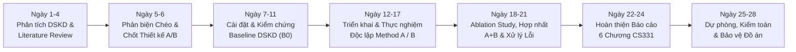

# Kế hoạch Tiến độ Dự án 3–4 Tuần (28 Ngày) — Đồ án CS331

**Dự án:** Knowledge Distillation-Based Lightweight Industrial Anomaly Detection  
**Bài báo nền tảng (Baseline):** *Dual-Student Knowledge Distillation Networks for Unsupervised Anomaly Detection* (`arXiv:2402.00448v1`, Liyi Yao & Shaobing Gao, 2024)  
**Tập dữ liệu:** MVTec AD (15 danh mục công nghiệp: 10 Object + 5 Texture)  
**Hạ tầng thực nghiệm:** Kaggle GPU (Tesla T4 / P100, 16 GB VRAM; hạn mức $2 \times 30\text{h} = 60\text{h}$ GPU/tuần) & GitHub (`chore/repository-reset`)  
**Ngày lập kế hoạch / Truy cập tài liệu:** `2026-11-14`

---

## 1. Phân loại Nhận thức & Cơ sở Lập kế hoạch

- **`[FACT - Paper]`:** Bài báo DSKD (`arXiv:2402.00448v1`, Sec. 4.1.2, tr. 7) huấn luyện $T, S_e, S_d$ dựa trên `ResNet18` ở độ phân giải $256 \times 256$ với bộ tối ưu `Adam` ($\text{lr}=0.001, \beta=(0.5, 0.999)$) trong `200 epochs`, $\lambda=0.1$, lọc Gaussian $\sigma=4.0$.
- **`[FACT - Repo]`:** Repository hiện có sẵn bộ nạp dữ liệu chống rò rỉ `MVTecTrainDataset` (`80/20` train/val split với `seed=42` chỉ trên `train/good`), `MVTecTestDataset` (`src/anomaly_detection/data/mvtec.py`) và bộ đánh giá 6 chỉ số chuẩn (`src/anomaly_detection/evaluation/metrics.py`), vượt qua 9/9 unit tests.
- **`[INTERPRETATION - Agent 5 & Agent 0]`:** Theo kiểm toán của Agent 5 (`docs/research/kaggle_implementation_plan.md`), một lượt huấn luyện 200 epochs + đánh giá AUPRO cho 1 category của Baseline DSKD (`B0-Clean`) chỉ tiêu tốn $\approx 6.5\text{ phút}$ trên GPU T4 ($\sim 2.2\text{ GB}$ VRAM tại `batch_size=16`). Tổng toàn bộ các lượt chạy của cả đồ án (Stage 1 Core-5 + Stage 2 Full-15 cho `B0-Clean`, `Method A`, `Method B` và `Combined A+B`) chỉ tốn khoảng **`16.5 – 19.0 giờ GPU`**, tức chưa tới **1/3 ngân sách GPU của 1 tuần đơn lẻ** ($60\text{h}$/tuần của 2 sinh viên).
- **`[HYPOTHESIS]`:** Việc chia nhỏ tiến độ thành 7 mốc kiểm soát (Milestones M1–M7) kèm cơ chế lưu trữ bền vững `Checkpoint -> Kaggle Dataset Version` giúp nhóm hoàn thành 100% mục tiêu thực nghiệm và báo cáo 6 chương trong đúng **24 ngày chính thức + 4 ngày dự phòng (tổng 28 ngày / 4 tuần)** mà không bị gián đoạn bởi giới hạn phiên 12 giờ của Kaggle.

---

## 2. Phân công Vai trò của Hai Sinh viên (2-Student Work Division)

| Thành viên | Vai trò Chính trong Giai đoạn Baseline (Ngày 1–11) | Vai trò Chuyên sâu Giai đoạn Cải tiến (Ngày 12–21) | Phụ trách Viết Báo cáo (`docs/report_outline.md`) |
| :--- | :--- | :--- | :--- |
| **Sinh viên 1 (Student A)** | • Đồng thiết kế `models/dskd.py` (phụ trách `ResNet18FeatureExtractor` $T$, `StudentEncoder` $S_e$ và phép chuẩn hóa $\ell_2$). • Xây dựng `losses/dskd_loss.py`, `inference/anomaly_scorer.py` và kiểm thử phép chuẩn hóa đầu vào `S0_norm`. • Chạy thực nghiệm Baseline `B0` & Ablation Group 0 trên 8/15 categories. | **Chủ trì Phương pháp A (`FC-DSKD`):** • Cài đặt Mô-đun A1 (Spatial-Focal & Contextual Patch Loss), Mô-đun A2 (Asymmetric Stop-Grad Cross-Student Consistency $\ell_{e-d}$) và Mô-đun A3 (Normal-Val Z-score Calibration + Complementary Fusion $M_{t-e}^k \oplus M_{t-d}^k$ + Top-$q\%$ Scoring). • Chạy Ablation Group 2 (`Cfg-1..7`) trên Core-5 và Full-15 cho `FC-DSKD`. | • **Mục 1:** Introduction (Động lực & đóng góp nhánh A). • **Mục 3:** Theoretical Background (Cơ sở chưng cất & hàm mục tiêu). • **Mục 4.1 & 4.2:** Baseline DSKD & Phương pháp A (`FC-DSKD`). • **Mục 5.2:** Kết quả định vị & Ablation Phương pháp A. |
| **Sinh viên 2 (Student B)** | • Đồng thiết kế `models/dskd.py` (phụ trách khối `DeepFeatureEmbedding` DFE và mạng giải mã ngược `ReversedResNet18Decoder` $S_d$). • Xây dựng `training/checkpoint.py`, `training/trainer.py`, cập nhật `utils/profiling.py` và khung Kaggle Notebook 6 cells. • Chạy thực nghiệm Baseline `B0` trên 7/15 categories còn lại & đo Complexity (`Params`, `FLOPs`, `Latency`, `VRAM`). | **Chủ trì Phương pháp B (`Lite-DSKD`) & Mô hình Kết hợp (`A+B`):** • Cài đặt `Lite-DFE` (DS-MSA + BDRF) và `Slim-DSKD` ($S_e^{(\alpha)}, S_d^{(\alpha)}$ với $\alpha \in \{0.5, 0.75\}$ kèm đầu chiếu $\mathcal{P}_e^k, \mathcal{P}_d^k = \text{ReLU}(\text{BN}(\text{Conv}_{1\times 1}))$). • Chạy Ablation Group 3 (`B1`, `B2`, `B3-0.75`, `B3-0.50`) và phối hợp cùng Sinh viên 1 chạy Group 4 (`Combined FC-Lite-DSKD`). | • **Mục 2:** Dataset (MVTec AD & giao thức chống rò rỉ). • **Mục 4.3 & 4.4:** Phương pháp B (`Lite-DSKD`) & Tích hợp `A+B`. • **Mục 5.1, 5.3 & 5.4:** Thiết lập thực nghiệm, Kết quả Phương pháp B, Phân tích Pareto Chi phí – Độ chính xác. • **Mục 6:** Conclusion. |

---

## 3. Lịch trình Chi tiết 28 Ngày (4 Tuần) và Tiêu chí Nghiệm thu Từng Giai đoạn

### Giai đoạn 1 — Ngày 1–4: Phân tích Bài báo DSKD & Khảo sát Tài liệu Liên quan (Đã hoàn thành trong Pha Khởi tạo)
- **Công việc:**
  - Đọc toàn văn `papers/2402.00448v1.pdf`, trích xuất đầy đủ phương trình `Eq. (1)–(10)`, `Algorithm 1–2`, `Table 1–9` (`docs/research/dskd_paper_analysis.md`).
  - Khảo sát các công trình IAD & KD giai đoạn 2020–2026 và lập bảng đối sánh (`docs/research/literature_review.md`, `docs/research/research_gap_analysis.md`).
  - Thiết kế độc lập các ứng viên cho Phương pháp A (`docs/research/method_a_proposal.md`) và Phương pháp B (`docs/research/method_b_proposal.md`).
- **Đầu ra nghiệm thu (Deliverables):** Bộ tài liệu phân tích nền tảng trong `docs/research/`.

### Giai đoạn 2 — Ngày 5–6: Phản biện Chéo, Chốt Thiết kế Kỹ thuật & Duyệt Kế hoạch (Đang hoàn tất — Chờ User Phê duyệt)
- **Công việc:**
  - Thực hiện phản biện chéo Vòng 2 giữa 6 agents; phát hiện và khóa cách xử lý các rủi ro kỹ thuật (thêm `ReLU` sau `BN` ở đầu chiếu $\mathcal{P}_{e,d}^k$ của Method B; áp dụng `Asymmetric Stop-Gradient` $\text{sg}[\hat{F}_e^k]$ ở $\ell_{e-d}$ và khóa siêu tham số của Method A).
  - Hoàn thiện `docs/research/method_comparison.md`, `docs/research/experiment_design.md`, `docs/research/kaggle_implementation_plan.md` và `docs/research/research_decision.md`.
- **Cổng Phê duyệt (Approval Gate):** Trình bày báo cáo tổng hợp và **dừng chờ người dùng phê duyệt** trước khi viết bất kỳ dòng code mô hình nào.

### Giai đoạn 3 — Ngày 7–11 (5 ngày): Cài đặt, Kiểm thử Đơn vị & Tái hiện Baseline DSKD (`B0`)
- **Ngày 7–8 (Cài đặt & Unit Tests):**
  - Sinh viên 1 & 2 cài đặt `src/anomaly_detection/models/dskd.py`, `src/anomaly_detection/losses/dskd_loss.py`, `src/anomaly_detection/training/checkpoint.py`, `src/anomaly_detection/training/trainer.py`, `src/anomaly_detection/inference/anomaly_scorer.py` và cập nhật `src/anomaly_detection/utils/profiling.py`.
  - Viết unit tests kiểm tra kích thước tensor từng tầng ($64^2 \times 64$, $32^2 \times 128$, $16^2 \times 256$), kiểm tra đóng băng trọng số Teacher (`requires_grad=False`), kiểm tra bảo toàn `RNG states` khi save/load checkpoint.
- **Ngày 9 (Chạy Benchmark sơ bộ `M0_bench`, Kiểm định tách biệt `S0_eq3_norm`, `S0_input_norm`, `S0_split` & Group 0 trên Core-5):**
  - Chạy `M0_bench` (10 phút GPU trên 1 category) để đo đạc thực tế tốc độ forward/backward, lưu checkpoint và benchmark hàm `compute_aupro` trên CPU trước khi bắt đầu ma trận lớn.
  - Chạy `S0_split` trên CPU (`0h GPU`) để xuất `configs/splits/mvtec_train_val_seed42.json` và xác nhận $\text{Train} \cap \text{Val} = \emptyset$.
  - Chạy thí nghiệm đối chứng **`S0_eq3_norm`** (50 epochs trên `carpet` và `bottle`, tốn $\sim 18$ phút GPU) so sánh 3 chế độ chuẩn hóa đặc trưng `Eq. (3)`: `N1 (Unit-L2)` vs. `N2 (Raw-L2 + Cosine)` vs. `N3 (Literal Inv-Sq L2)`.
  - Chạy thí nghiệm đối chứng **`S0_input_norm`** (50 epochs trên `carpet` và `bottle`, tốn $\sim 6$ phút GPU) so sánh tiền xử lý ảnh đầu vào ImageNet Z-score vs. Raw $[0,1]$ input.
  - Huấn luyện Baseline `B0-Clean` (200 epochs) trên **Core-5 Subset** (`carpet, tile, bottle, screw, toothbrush` — tốn $\sim 35$ phút GPU) và chạy suy luận tách nhánh Group 0 (`DS`, `T-D`, `T-E`, `E-D`, `M1`, `M2`, `M3` khớp Bảng 7 & Bảng 9 của bài báo).
- **Ngày 10–11 (Mở rộng Baseline `B0-Clean` ra 15 Categories MVTec AD):**
  - Chia đôi 10 categories còn lại cho 2 sinh viên chạy song song trên Kaggle GPU ($\sim 35$ phút GPU/sinh viên).
  - Xuất bảng kết quả Baseline 15 categories (`results/baseline_b0_mvtec15.csv` & `.json`) gồm đủ 6 chỉ số độ chính xác và 4 chỉ số hiệu quả.
- **Tiêu chí nghiệm thu (Exit Criteria Ngày 11):**
  - `B0-Clean` đạt xu hướng nhất quán với Bảng 7 của bài báo gốc (`DS > T-D > T-E > E-D`) và không có lỗi `NaN`/rò rỉ dữ liệu test.

### Giai đoạn 4 — Ngày 12–17 (6 ngày): Triển khai & Thực nghiệm Độc lập Phương pháp A (`FC-DSKD`) và Phương pháp B (`Lite-DSKD`)
- **Nhánh Sinh viên 1 — Phương pháp A (`FC-DSKD`):**
  - **Ngày 12–13:** Cài đặt Mô-đun A1 (Spatial-Focal & Contextual Patch Loss), Mô-đun A2 ($\ell_{e-d}$ với `stop_gradient` trên cả đầu vào `DFE` và $\hat{F}_e^k$) và Mô-đun A3 (Normal-Val Calibration & Synergistic Fusion $M_{t-e}^k \oplus M_{t-d}^k$ với tỷ lệ đuôi $\rho_{\text{tail}}=0.001$). Viết unit tests kiểm tra Zero Test-Set Leakage và kiểm tra `grad == 0` từ $\ell_d + \ell_{e-d}$ về $S_e$.
  - **Ngày 14–15:** Chạy `A_Cfg0b` (Recalibration-Only `A3` trên checkpoint `B0-Clean` — tốn $0$ phút train!), huấn luyện `A_Cfg1`, `A_Cfg2`, `A_Cfg3` trên **Core-5 Subset**, và đánh giá 3 quy tắc hợp nhất (`A_Cfg4a: Linear`, `A_Cfg4b: Synergistic`, `A_Cfg4c: SoftMaxUnion`) từ cùng checkpoint `A_Cfg3` ($\sim 2.3$ giờ GPU).
  - **Ngày 16–17:** Mở rộng cấu hình tốt nhất của Phương pháp A (`FC-DSKD`) ra 10 categories còn lại để hoàn tất bảng 15 categories ($\sim 1.2$ giờ GPU).
- **Nhánh Sinh viên 2 — Phương pháp B (`Lite-DSKD`):**
  - **Ngày 12–13:** Cài đặt `Lite-DFE` (DS-MSA + BDRF + $\text{PW}_{\text{skip}}$) và `Slim-DSKD` ($\alpha \in \{0.5, 0.75\}$ với đầu chiếu $\mathcal{P}_{e,d}^k = \phi(\text{BN}(\text{Conv}_{1\times 1}))$). Viết unit tests kiểm tra số lượng tham số đã kiểm toán (`1.671M` trainable ở $\alpha=0.50, \rho=1.0$; `3.651M` ở $\alpha=0.75, \rho=0.5$) và FLOPs (`5.824G` và `8.352G` FLOPs suy luận; `2.912G` và `4.176G` MACs).
  - **Ngày 14–15:** Huấn luyện chuỗi Ablation Group 3 (`B1: Lite-DFE`, `B2: Slim-DSKD`, `B3-0.75`, `B3-0.50`) và kiểm chứng 3 biến thể hàm kích hoạt đầu chiếu (`BN-only` vs. `BN+ReLU` vs. `BN+LeakyReLU(0.01)`) trên **Core-5 Subset** ($\sim 2.4$ giờ GPU).
  - **Ngày 16–17:** Mở rộng cả `B3-0.75` và `B3-0.50` ra 10 categories còn lại của MVTec AD ($\sim 1.4$ giờ GPU) để vẽ đường cong Pareto trên toàn bộ 15 categories.

### Giai đoạn 5 — Ngày 18–21 (4 ngày): Ablation Chuyên sâu, Hợp nhất `DSKD + A + B` (`C1`) & Trực quan hóa
- **Ngày 18–19 (Thí nghiệm Hợp nhất Group 4 — `C1: FC-Lite-DSKD`):**
  - Ghép nối Plug-and-Play `FC-DSKD` (Method A) + `Lite-DSKD` (Method B) với hai cấu hình `C1-0.75` và `C1-0.50`.
  - Huấn luyện và đánh giá trên Core-5 ($\sim 0.8$ giờ GPU) và mở rộng ra toàn bộ 15 categories ($\sim 1.5$ giờ GPU).
- **Ngày 20 (Khảo sát Độ nhạy & Phân tích Định tính):**
  - Chạy khảo sát độ nhạy đơn biến (OFAT) cho $(\gamma, \beta, q)$ của Method A và $(\alpha, \rho)$ của Method B trên Core-5 Subset.
  - Xuất bản đồ nhiệt định vị (Anomaly Heatmaps) so sánh trực quan 5 hàng: `Input` | `Ground Truth` | `Baseline B0` | `Method A (FC-DSKD)` | `Combined A+B (FC-Lite-DSKD)` để chứng minh việc xóa bỏ quầng dương tính giả (halo) trên `tile, wood, toothbrush` và lấp đầy vùng lõi lỗi lớn.
- **Ngày 21 (Kiểm toán Dữ liệu Thực nghiệm):**
  - Đối chiếu toàn bộ file `.csv/.json` trong `results/`, kiểm tra tính nhất quán của split manifest và lập bảng tổng hợp cho Chương 5.

### Giai đoạn 6 — Ngày 22–24 (3 ngày): Viết & Hoàn thiện Báo cáo Khoa học 6 Chương
- **Ngày 22:** Hoàn thành bản thảo Chương 1 (Introduction), Chương 2 (Dataset), Chương 3 (Theoretical Background) và Chương 4 (Methods — kèm sơ đồ kiến trúc và hệ thống phương trình đã chuẩn hóa).
- **Ngày 23:** Hoàn thành Chương 5 (Experiments — bảng 15 categories, bảng Ablations Core-5, biểu đồ Pareto Params/FLOPs/Latency vs. AUROC/AUPRO@0.05, hình trực quan hóa heatmaps và thảo luận kết quả âm tính nếu có) và Chương 6 (Conclusion).
- **Ngày 24:** Đọc soát chéo (Peer Review) giữa 2 sinh viên; kiểm tra trích dẫn tài liệu tham khảo, định dạng công thức toán học và đối chiếu 100% số liệu trong báo cáo với file log trong `results/`.

### Giai đoạn 7 — Ngày 25–28 (4 ngày): Dự phòng (Buffer), Bổ sung Thực nghiệm & Chuẩn bị Bảo vệ Đồ án
- **Ngày 25–26:** Quỹ thời gian dự phòng cho các thí nghiệm bổ sung nếu hội đồng/giảng viên yêu cầu hoặc nếu có category cần chạy lại với nhiều random seeds (`seed=42, 123, 999`) để báo cáo độ lệch chuẩn ($\text{mean} \pm \text{std}$) trên Core-5.
- **Ngày 27–28:** Chuẩn bị slide thuyết trình bảo vệ đồ án CS331, đóng gói kho mã nguồn sạch và kiểm tra khả năng tái lập lệnh chạy từ README.

---

## 4. Các Vấn đề Chưa Giải quyết & Mức độ Tin cậy

- **Vấn đề chưa giải quyết (Unresolved Issues):**
  1. Cần chạy phép thử `S0_norm` (15 phút GPU vào Ngày 9) để xác nhận thực nghiệm giữa chuẩn hóa đầu vào ImageNet Z-score và chuẩn hóa $\ell_2$ ảnh đầu vào được mô tả ngắn gọn ở Mục 4.1.2 của bài báo gốc.
  2. Tốc độ tính `compute_aupro` (500 ngưỡng) trên CPU của Kaggle: nếu mất $>15$ giây/category thì sẽ chỉ chạy `compute_aupro` ở bước đánh giá cuối cùng (epoch 200) thay vì chạy lặp lại trong vòng lặp huấn luyện.
- **Mức độ tin cậy (Confidence Level):** **Cao (95%)** — Ngân sách GPU thực tế ($\sim 18.2\text{h}$) chỉ chiếm $\sim 7.6\%$ tổng quỹ GPU 4 tuần ($240\text{h}$ của 2 sinh viên), tạo biên độ an toàn rất lớn cho việc hoàn thành đúng hạn 28 ngày.
