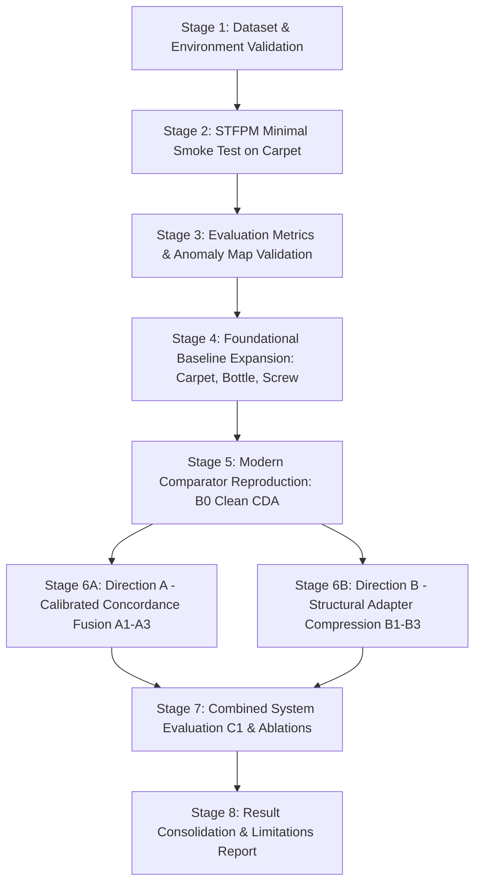

# Revised Experimental Roadmap (Phase 0.2 $\to$ Final Delivery)

## 1. Experimental Philosophy & Scientific Controls

Our execution roadmap is governed by strict empirical principles:
1. **Incremental Staging:** No experimental stage begins until the previous stage satisfies all predefined acceptance criteria.
2. **Strict Zero-Leakage:** Test-set data and masks are never used for model selection, threshold tuning, or normal-distribution calibration.
3. **Controlled Single-Variable Comparison:** When evaluating improvements, exactly one architectural or algorithmic component is modified at a time.
4. **Reproducible Seeding & Environment:** Random seeds are fixed (`seed = 42`), image resolution is standardized ($256 \times 256$), and ImageNet normalization is preserved across all experiments.

---

## 2. Eight-Stage Execution Plan

---

### Stage 1: Validate Dataset Access and Preprocessing Pipeline
- **Objective:** Verify integrity of MVTec AD dataset directory structure, file formats, and ground-truth mask alignment on Kaggle.
- **Actions:**
  1. Execute `scripts/validate_dataset.py` on `/kaggle/input/mvtec-ad` across all 15 categories.
  2. Verify that every positive test image has a matching binary mask (`_mask.png`) with identical spatial dimensions.
  3. Verify image transform pipeline ($256 \times 256$, ImageNet mean/std) and label encoding.
- **Acceptance Criteria:**
  - [ ] 100% of image and mask paths resolve without missing files or broken links.
  - [ ] Data loader test passes in unit tests (`tests/test_dataset.py`).

---

### Stage 2: STFPM Minimal Smoke Test on Single Category (`carpet`)
- **Objective:** Establish the foundational baseline execution in the Kaggle environment.
- **Actions:**
  1. Run a 2-epoch sanity check of STFPM on category `carpet` using GPU.
  2. Confirm forward pass, loss computation ($\ell_2$-normalized feature distance), optimizer step, and checkpoint generation (`stfpm_carpet_smoke.pth`).
  3. Expand to full 100-epoch training on `carpet` to verify convergence.
- **Acceptance Criteria:**
  - [ ] Training loss descends smoothly without NaN or divergence.
  - [ ] Peak GPU VRAM remains under 4 GB on Kaggle Tesla T4.
  - [ ] Checkpoint saves and reloads cleanly.

---

### Stage 3: Validate Evaluation Metrics and Anomaly Heatmaps
- **Objective:** Guarantee scientific rigor of evaluation code before conducting large-scale benchmarking.
- **Actions:**
  1. Verify Image-AUROC, Image-AP, Pixel-AUROC, Pixel-AP, standard $\text{AUPRO}_{0.30}$, and strict $\text{AUPRO}_{0.05}$ calculations in `src/anomaly_detection/evaluation/metrics.py`.
  2. Generate visual anomaly overlays using `scripts/visualize_predictions.py` comparing STFPM predicted heatmaps against true defective masks on `carpet` test samples (`color`, `cut`, `hole`, `thread`).
  3. Verify that predicted pixel anomaly scores lie within valid numerical ranges $[0, \infty)$ and display smooth spatial transitions.
- **Acceptance Criteria:**
  - [ ] Metric calculations pass automated unit tests (`tests/test_metrics.py`).
  - [ ] STFPM on `carpet` achieves Image-AUROC $> 0.90$ and Pixel-AUROC $> 0.95$ (approaching paper reported $0.988$).
  - [ ] Visual overlays confirm true defects are highlighted and defect-free regions produce low scores.

---

### Stage 4: Expand Foundational Baseline to Representative Categories
- **Objective:** Benchmark STFPM across a balanced triad representing different industrial surface geometries:
  - `carpet`: High-frequency regular texture surface.
  - `bottle`: Rigid structural object with specular reflections and transparent boundaries.
  - `screw`: Small-scale metallic object with tiny thread defects and boundary variations.
- **Actions:**
  1. Train STFPM (100 epochs, SGD, lr=0.4, wd=1e-4) on `carpet`, `bottle`, and `screw`.
  2. Log all 5 quality metrics and 4 efficiency metrics into `outputs/baseline_stfpm/metrics_summary.json`.
- **Acceptance Criteria:**
  - [ ] All 3 categories complete training within $\sim 15$ minutes total on Kaggle GPU.
  - [ ] Baseline performance table recorded with zero missing fields.

---

### Stage 5: Reproduce Modern Comparator (Clean CDA Baseline `B0`)
- **Objective:** Establish the modern architectural comparator baseline using our clean-room, bug-fixed PyTorch implementation.
- **Actions:**
  1. Train `B0` (160 epochs, Adam lr=0.005, batch size=4) on the core triad (`carpet`, `bottle`, `screw`).
  2. Save checkpoints at fixed final epoch (`epoch160.pth` / `last.pth`) to prevent test-set selection leakage.
  3. Evaluate against STFPM: quantify gains from Reverse Distillation (`GCM`), GSU decoder, and cross-scale distillation.
- **Acceptance Criteria:**
  - [ ] `B0` converges without NaN or memory exhaustion (VRAM $< 6\text{ GB}$).
  - [ ] Final-epoch evaluation logged across all 5 quality metrics.
  - [ ] Hardware cost measured: 43.18M trainable parameters, ~24.5 ms latency on Tesla T4.

---

### Stage 6: Component-Wise Implementation of Proposed Research Directions

#### Track A: Thành (Researcher A) — Calibrated Reliability Fusion (`A1` $\to$ `A3`)
- **Implementation Sequence:**
  1. **`A1` (Normal-Distribution Z-Score Standardization):** Compute $(\mu_k^{\text{norm}}, \sigma_k^{\text{norm}})$ per scale $k \in \{1, 2, 3\}$ strictly on `train/good` loader; standardize discrepancy maps $\tilde{a}_k = (a_k - \mu_k) / \sigma_k$.
  2. **`A2` (Cross-Scale Concordance Gating):** Multiply same-scale maps by cross-scale agreement gates $a_k^{\text{gated}} = \tilde{a}_k \odot \text{Sigmoid}(ac_k)$ to filter isolated texture noise.
  3. **`A3` (Scale-Adaptive Smoothing & Top-$q\%$ Pooling):** Apply scale-proportional Gaussian blurs $(\sigma_1=1.0, \sigma_2=2.0, \sigma_3=4.0)$ and evaluate top-10% mean pooling for image scoring.
- **Acceptance Criteria:**
  - [ ] Evaluated directly on frozen `B0` checkpoints (zero retraining overhead).
  - [ ] Demonstrates $\ge +1.5\%$ gain in Pixel-AP and $\ge +2.0\%$ gain in strict $\text{AUPRO}_{0.05}$ on textured categories (`carpet`).

#### Track B: Luân (Researcher B) — Structural Adapter & Bottleneck Compression (`B1` $\to$ `B3`)
- **Implementation Sequence:**
  1. **`B1` (Inference-Time Cross-Scale Pruning / Aux-CSD):** Evaluate `B0` checkpoint with cross-scale adapters (`c11..c32`) disabled at inference time. Quantify the parameter drop (-38.3% trainable params) vs. AUROC retention.
  2. **`B2` (Depthwise-Separable Cross-Scale Adapters):** Train model variant where $3\times3$ dense adapters are factorized into $1\times1$ pointwise $+ 3\times3$ depthwise convolutions (adapter params drop from 16.52M to 1.86M).
  3. **`B3` (CDA-Lite: Factorized GCM + Separable Adapters):** Further factorize the `GCM.res` bottleneck block (trainable params drop to 19.46M, a -54.9% overall reduction).
- **Acceptance Criteria:**
  - [ ] All variants trained under identical optimizer, seed, and 160-epoch schedule.
  - [ ] Efficiency Pareto curve plotted: Params vs. Image-AUROC, Latency vs. Pixel-AUROC.

---

### Stage 7: Joint System Evaluation (`C1`) and Ablation Synthesis
- **Objective:** Combine Luân's most efficient model (`B2` or `B3`) with Thành's calibrated fusion (`A3`).
- **Hypothesis Tested:** Calibrated reliability fusion compensates for minor localization drops introduced by structural model compression.
- **Acceptance Criteria:**
  - [ ] `C1` maintains $\ge 99.0\%$ of baseline detection quality while slashing model parameters by $\ge 35–50\%$ and increasing inference throughput.
  - [ ] Full ablation table populated across all intermediate variants (`B0`, `A1`, `A2`, `A3`, `B1`, `B2`, `B3`, `C1`).

---

### Stage 8: Consolidation of Results, Limitations, and Final Defense
- **Objective:** Synthesize findings into the final project report and presentation.
- **Reporting Requirements:**
  1. Full disclosure of paywalled paper limitations (what could and could not be verified regarding CDA).
  2. Honest reporting of negative or mixed results (e.g., categories where separable factorization caused degradation or where Z-score calibration did not improve object categories).
  3. Clear, reproducible instructions enabling external evaluators to re-run all tests from the repository.
